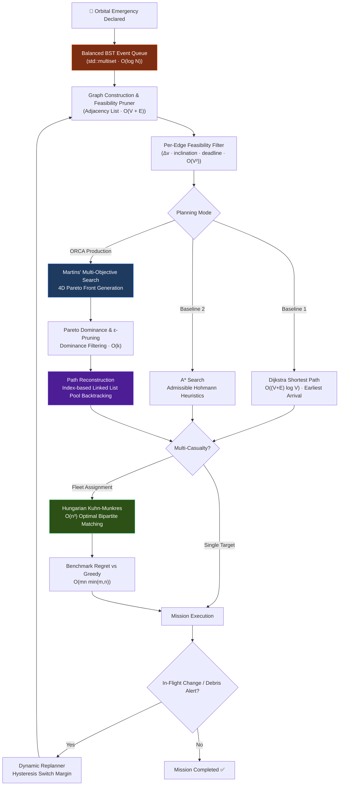

# ORCA

**Autonomous Orbital Rescue Mission Planning Using Multi-Objective Optimization**

A C++20 data-structures-and-algorithms project: an offline, deterministic orbital-rescue
simulator whose planning decisions are computed entirely by a C++ engine, with a React +
Three.js interface that makes those decisions — and the algorithms behind them — visible.

> **Status: Phase 11 complete.** The engine plans multi-vehicle, multi-emergency rescue
> assignments end to end (Dijkstra, A\*, Pareto search, mission scoring, Hungarian/greedy
> assignment), runs as a continuous discrete-event simulation, drives a live NDJSON
> protocol, and is fronted by a real Node bridge and React/Three.js UI (Mission Control,
> Optimization Lab, Algorithm Lab, Orbital Network, Mission History, Presentation Mode).
> Phase 11 added deterministic scenario generation up to 1000 objects, a real benchmark
> suite with analyzed results, live Pareto profile re-scoring, Pareto planning-pass history,
> instanced marker rendering, and hardening fixes found via real end-to-end testing.
> **675 C++ tests, 29 backend tests, 71 frontend tests — `scripts/run_tests.sh`,
> `backend && npm test`, `frontend && npm test`.**
> CMake remains uninstalled on the reference machine (`REPOSITORY_AUDIT.md` §3), so
> `scripts/*.sh` — not the `CMakeLists.txt` files — is the verified C++ build path.
> See [IMPLEMENTATION_ROADMAP.md](docs/IMPLEMENTATION_ROADMAP.md) for the full phase-by-phase
> history, including every place a later phase corrected an earlier one's claims.

---

## 🌐 Quick Access & Localhost Services

When the stack is running locally (`bash scripts/build_engine.sh`, `cd backend && npm start`, `cd frontend && npm run dev`), the system is available at:

| Service | Localhost URL | Port | Purpose |
|---|---|---|---|
| **Mission Control UI** | [http://localhost:5173](http://localhost:5173) | `5173` | React 18 + Three.js 3D Orbital Operations & Algorithm Lab |
| **Backend REST & Engine Bridge** | [http://localhost:4000](http://localhost:4000) | `4000` | Node.js IPC bridge communicating with C++20 engine via NDJSON |
| **API Health & Engine Status** | [http://localhost:4000/health](http://localhost:4000/health) | `4000` | Returns engine readiness, schema version, and uptime status |
| **Live Simulation Snapshot** | [http://localhost:4000/snapshot](http://localhost:4000/snapshot) | `4000` | Full JSON state: active spacecraft, fleet status, queued events |
| **Orbital Constellation Stream** | [http://localhost:4000/visual/constellation](http://localhost:4000/visual/constellation) | `4000` | Real-time orbital shells and debris coordinates for 3D rendering |

---

## The Problem

A spacecraft fails in orbit. A limited fleet of rescue vehicles is available. Decide which
vehicle goes to which casualty, by which route, starting when — where **time**, **fuel**,
**risk** and **transfer distance** genuinely conflict.

The conflict is not manufactured. It falls out of orbital mechanics: the synodic period
between a 500 km and an 800 km orbit is **25.4 hours**, so the fuel-optimal departure phase
recurs about once a day, while survival windows run tens of minutes. The planner must
continuously price *"depart now at a poor phase and pay Δv"* against *"wait and pay time"*.

ORCA computes the **Pareto-optimal set first**, then applies operator preference — rather than
collapsing the objectives into one score up front, which cannot reach concave regions of the
trade-off surface.

---

## Architecture

```
LEVEL 3  PRESENTATION   React · TypeScript · Three.js       the eyes
LEVEL 2  BRIDGE         Node · Express                      the nervous system
LEVEL 1  ENGINE         C++20                                the brain
```

The engine owns **all** state and computation. The bridge relays real commands and snapshots
over NDJSON (engine stdin/stdout) and REST (Node ⇄ browser). The frontend displays; it never
computes a value the engine could compute.

**The engine runs standalone.** It builds, plans, benchmarks, and passes its full test suite
with no Node and no browser installed. It also runs live and scriptable from a terminal —
`orca_engine --serve` speaks the same NDJSON protocol the Node bridge speaks, and
`orca_engine --serve <family>:<size>[:<seed>]` boots a large generated scenario instead of the
small fixed demo one (`docs/FINAL_BENCHMARK_REPORT.md` §6 used this for a real rendering
measurement).

---

## 🧠 Data Structures & Algorithms (DSA) Architecture

ORCA is engineered in modern **C++20** as a data-structures-and-algorithms laboratory. Rather than using generic libraries or black-box solvers, its core components — including multi-objective Pareto label setting, the Kuhn–Munkres Hungarian matching algorithm, and custom tree/list indices — are implemented from first principles with verified mathematical proofs, property testing, and empirical benchmarking.

### DSA Implementation & Complexity Matrix

| Category | Concrete Data Structure / Algorithm | Source File | Time Complexity | Space Complexity | Role in ORCA |
|---|---|---|---|---|---|
| **Linked Lists** | Flat-Pool Index-Based Singly Linked List | [`cpp/algorithms/ParetoLabel.hpp`](cpp/algorithms/ParetoLabel.hpp) | Insert: $O(1)$<br/>Traversal: $O(L)$ | $O(\|L\| \cdot k)$ | Predecessor chains for backtracking route reconstruction without pointer invalidation |
| **Trees** | Self-Balancing Red-Black BST (`std::multiset`) | [`cpp/simulation/EventQueue.hpp`](cpp/simulation/EventQueue.hpp) | Insert: $O(\log N)$<br/>Delete: $O(\log N)$<br/>Min: $O(1)$ | $O(N)$ | Chronological discrete-event schedule with arbitrary $O(\log N)$ event cancellation |
| **Trees** | State-Space Branch-and-Bound Trees | [`cpp/algorithms/ParetoSearch.cpp`](cpp/algorithms/ParetoSearch.cpp) | Pruning: $O(k)$ per node | $O(V \cdot \|L_v\|)$ | Implicit search tree exploration with early branch pruning via vector dominance |
| **Graphs** | Weighted Directed Graph (Adjacency List) | [`cpp/graph/MissionGraph.hpp`](cpp/graph/MissionGraph.hpp) | Neighbors: $O(\text{deg}(u))$<br/>Build: $O(V^2 \cdot C)$ | $O(V + E)$ | Sparse orbital transfer feasibility network with continuous time-dependent edge costs |
| **Heaps / PQs** | Binary Min-Heap (`std::priority_queue`) | [`cpp/algorithms/Dijkstra.cpp`](cpp/algorithms/Dijkstra.cpp), [`AStar.cpp`](cpp/algorithms/AStar.cpp) | Push: $O(\log V)$<br/>Pop: $O(\log V)$ | $O(V)$ | Earliest-arrival search frontiers with deterministic multi-attribute tie-breakers |
| **Hash Tables** | Dual-Indexed Hash Map (`std::unordered_map`) | [`cpp/simulation/EventQueue.hpp`](cpp/simulation/EventQueue.hpp) | Lookup: $O(1)$ amortized | $O(N)$ | Caches persistent tree node iterators by unique `EventId` for $O(1)$ lookup $+ O(\log N)$ cancellation |
| **Pathfinding** | **Dijkstra's Algorithm** (Time-Dependent) | [`cpp/algorithms/Dijkstra.cpp`](cpp/algorithms/Dijkstra.cpp) | $O((V + E) \log V \cdot C)$ | $O(V + E)$ | Single-objective earliest-arrival baseline evaluating transfer physics dynamically at node arrival |
| **Pathfinding** | **A\* Search** (Admissible Heuristic) | [`cpp/algorithms/AStar.cpp`](cpp/algorithms/AStar.cpp) | $O((V + E) \log V \cdot C)$ | $O(V + E)$ | Directed shortest path with admissible Hohmann transfer and plane-change lower-bound heuristics |
| **Optimization**| **Martins' Multi-Objective Label Setting** | [`cpp/algorithms/ParetoSearch.cpp`](cpp/algorithms/ParetoSearch.cpp) | $O(\|L\| \log \|L\| \cdot (k + \text{deg}))$ | $O(\|L\| \cdot k)$ | Exact 4D Pareto front generation across Time, Fuel ($\Delta v$), Risk, and Distance |
| **Pruning** | **Pareto & $\varepsilon$-Dominance Checking** | [`cpp/algorithms/Dominance.cpp`](cpp/algorithms/Dominance.cpp) | Comparison: $O(k)$ | $O(1)$ | Prunes dominated partial paths; $\varepsilon$-box dominance prevents combinatorial label explosion |
| **Matching** | **Hungarian Algorithm (Kuhn–Munkres)** | [`cpp/algorithms/Hungarian.cpp`](cpp/algorithms/Hungarian.cpp) | $O(n^3)$ | $O(n^2)$ | Optimal multi-vehicle to multi-casualty global assignment via dual potentials and augmenting paths |
| **Matching** | **Greedy Assignment Heuristic** | [`cpp/algorithms/GreedyAssignment.cpp`](cpp/algorithms/GreedyAssignment.cpp) | $O(m \cdot n \cdot \min(m, n))$ | $O(m \cdot n)$ | Deterministic local-minimum heuristic baseline used to quantify assignment regret |
| **Sorting / Selection** | Introsort + deterministic comparator chains (`std::sort`) | [`cpp/optimization/MissionScorer.cpp`](cpp/optimization/MissionScorer.cpp) | $O(n \log n)$ | $O(\log n)$ | Ranks Pareto solutions under a weighted profile with a total-order tie-break chain, so the same front always yields the same recommendation |
| **Dynamic Array** | Contiguous ID-dense vectors (`std::vector`) | [`cpp/graph/MissionGraph.hpp`](cpp/graph/MissionGraph.hpp), [`cpp/domain/Scenario.hpp`](cpp/domain/Scenario.hpp) | Index: $O(1)$<br/>Append: $O(1)$ amortized | $O(n)$ | `NodeId`/`EdgeId` are issued sequentially from zero, so an ID *is* an array index — no hash lookup anywhere on the search's hot path |

---

### Detailed DSA Breakdown

#### 1. 🔗 Linked Lists & Predecessor Pointer Chains
- **Architecture**: In pathfinding and Pareto route generation, each discovered state is represented by a `ParetoLabel`. When an edge is relaxed, a new label is created that links back to its predecessor.
- **Why Index-Based Lists Over Raw Pointer Linked Lists?**
  A naive implementation uses heap-allocated nodes connected by raw pointers (`struct Node { Node* prev; }`). In C++, this causes severe heap fragmentation, cache misses during traversal, and fatal dangling pointers if backing containers reallocate.
  Instead, ORCA uses a **Flat Memory Pool with Index-Based Linked Lists** ([`cpp/algorithms/ParetoLabel.hpp`](cpp/algorithms/ParetoLabel.hpp)):
  ```cpp
  struct ParetoLabel {
      NodeId node;
      ObjectiveVector cost;
      std::optional<LabelId> predecessor; // Stable integer index link into pool
      std::optional<EdgeId> viaEdge;
      Seconds arrivalTimeSec;
      bool active;
  };
  std::vector<ParetoLabel> pool; // Contiguous memory pool
  ```
- **Path Reconstruction**: Backtracking follows `label.predecessor` from target back to source in $O(L)$ time, taking advantage of CPU L1/L2 cache locality, and then reverses the collected legs to yield the final optimal trajectory.

#### 2. 🌲 Trees & Balanced Binary Search Trees (BSTs)
- **Self-Balancing Red-Black BST (`std::multiset`)**:
  ORCA's discrete-event simulation queue ([`cpp/simulation/EventQueue.hpp`](cpp/simulation/EventQueue.hpp)) is implemented as a self-balancing Red-Black binary search tree rather than a conventional binary heap:
  ```cpp
  std::multiset<Event, EventOrder> events_;
  ```
  - **Why a Balanced Tree instead of a Binary Heap (`std::priority_queue`)?**
    In space mission simulation, future scheduled events (such as debris conjunction warnings, trajectory course corrections, or emergency aborts) often need to be **cancelled or updated by unique ID** when conditions change. In a binary heap, deleting an arbitrary element requires an expensive $O(N)$ linear scan and re-heapification. A self-balancing Red-Black BST supports:
    - Insertion: $O(\log N)$
    - Extraction of earliest event (`*begin()`): $O(1)$
    - Arbitrary event deletion: $O(\log N)$ with persistent node iterators!
- **Dual-Indexing Pattern (BST + Hash Table)**:
  To eliminate searching the tree for an event to cancel, `EventQueue` maintains an auxiliary hash table `std::unordered_map<uint32_t, multiset::iterator> byId_`. This caches the exact node pointer into the Red-Black tree, allowing $O(1)$ lookup and $O(\log N)$ targeted tree node erasure.
- **State-Space Search Trees**:
  In A* and Martins' label-setting, search paths branch across orbital waypoints, forming an implicit search tree. Subtrees that cannot yield non-dominated solutions are pruned immediately via Pareto dominance checks (branch-and-bound).
- **Spatial Indexing — designed, deliberately not yet built**:
  [`docs/ALGORITHMS.md §9`](docs/ALGORITHMS.md) specifies a uniform 3-D grid for debris conjunction queries, and argues it against a K-D tree or octree: orbital debris moves continuously, so a tree pays $O(D \log D)$ rebalancing on *every* simulation tick to buy $O(\log D)$ queries, while a grid rebuilds in $O(D)$ and queries in expected $O(1)$.
  **That index is not in the engine today**, and neither is the debris-proximity term that would consume it. [`cpp/transfer/TransferRiskModel.hpp`](cpp/transfer/TransferRiskModel.hpp) states this in its own header and gives the reason: a zero-weighted fourth risk factor "would look like a feature and behave like nothing." Transfer risk is therefore computed from three geometric factors — manoeuvre severity, plane-change share and arrival fuel margin — and debris is rendered and tracked, but does not yet enter the risk objective.

#### 3. 🕸️ Graphs & Network Topologies
- **Representation**: Weighted Directed Graph using Adjacency Lists ([`cpp/graph/MissionGraph.hpp`](cpp/graph/MissionGraph.hpp)):
  ```cpp
  std::vector<GraphNode> nodes_;
  std::vector<std::vector<EdgeId>> adjacency_; // Indexed by NodeId
  std::vector<GraphEdge> edges_;
  ```
- **Why Adjacency List over Adjacency Matrix?**
  ORCA prunes physically infeasible transfers (due to delta-v limits, inclination bounds, and casualty oxygen exhaustion deadlines) during graph construction. In the standard scenario, out of 756 possible pairs, only 173 edges are feasible. The adjacency list consumes $O(V + E)$ space (~6,000 entries at $V=1000$) compared to $O(V^2)$ (1,000,000 entries for a matrix), and provides $O(\text{deg}(u))$ neighbor expansion during search.
- **Time-Dependent Dynamic Weights**:
  Unlike standard graphs with static weights, ORCA edge weights are dynamic functions of departure time:
  $$w(e, t_{\text{depart}}) \longrightarrow \vec{f} = [\text{Time}, \text{Fuel}, \text{Risk}, \text{Distance}]$$
  Because the synodic orbital period between LEO orbits is ~25.4 hours, phase angles continuously shift, altering delta-v and rendezvous times. Edges are relaxed using intermediate arrival times rather than a fixed epoch.

#### 4. ⚡ Heaps & Priority Queues
- **Binary Min-Heaps (`std::priority_queue`)**:
  Employed in Dijkstra, A*, and Martins' label-setting for frontier exploration.
- **Deterministic Multi-Tier Comparators**:
  To guarantee exact reproducibility across different compilers and architectures, priority queue comparisons use strict weak ordering tie-breakers:
  ```cpp
  struct EarlierArrivalFirst {
      bool operator()(const QueueEntry& a, const QueueEntry& b) const noexcept {
          if (a.arrivalTimeSec != b.arrivalTimeSec) return a.arrivalTimeSec > b.arrivalTimeSec;
          return a.label.value() > b.label.value(); // Unique ID breaks ties deterministically
      }
  };
  ```
- **Lazy Deletion Discipline**: Outdated queue entries rendered obsolete by subsequent dominance checks are discarded lazily upon extraction in $O(1)$, avoiding expensive priority queue update-key operations.

#### 5. 🎯 Multi-Objective Optimization & Martins' Algorithm
- **4D Pareto Objective Vector**: Evaluates transfers simultaneously across four conflicting dimensions without arbitrary scalar weighting:
  $$\vec{f}(p) = [t_{\text{arrival}}, \Delta v_{\text{total}}, \text{risk}_{\text{debris}}, d_{\text{transfer}}] \in \mathbb{R}^4$$
- **Pareto Dominance**: A route label $A$ strictly dominates $B$ ($A \prec B$) if $A$ is no worse in all 4 objectives and strictly better in at least one:
  $$\forall i \in \{1..4\}, A_i \le B_i \quad \land \quad \exists j \in \{1..4\}, A_j < B_j$$
- **$\varepsilon$-Box Dominance**: To prevent the exponential explosion of labels in dense graphs, $\varepsilon$-dominance groups close objective vectors into hypercubes of dimension $\varepsilon$, bounding the number of Pareto-optimal labels while preserving bounded approximation quality.

#### 6. 🏆 Combinatorial Assignment: Hungarian vs Greedy
- **Kuhn–Munkres Hungarian Algorithm ($O(n^3)$)** ([`cpp/algorithms/Hungarian.cpp`](cpp/algorithms/Hungarian.cpp)):
  - Computes global minimum-cost bipartite matching between rescue vehicles and orbital casualties.
  - Formulated using the **Jonker–Volgenant method** with dual potentials $u_i, v_j$ maintaining complementary slackness ($C_{ij} - u_i - v_j \ge 0$) and Dijkstra-like shortest augmenting path searches.
  - Formulated on a $(M+N) \times (M+N)$ block matrix with dummy idle columns and priority-scaled penalty sentinels to cleanly handle unequal fleet sizes and physically unreachable casualties.
- **Greedy Assignment Heuristic ($O(mn \min(m,n))$)** ([`cpp/algorithms/GreedyAssignment.cpp`](cpp/algorithms/GreedyAssignment.cpp)):
  - Iteratively pairs the cheapest available vehicle-casualty edge.
  - Used as an empirical baseline in the benchmark suite: demonstrates where greedy decisions fail (e.g., committing a versatile vehicle to a local minimum that strands a critical emergency) and measures true Hungarian regret.

#### 7. ⚖️ Where each algorithm is actually *decided* between

The engine does not pick one search and hide the others. All three run against the identical
[`MissionGraph`](cpp/graph/MissionGraph.hpp), which is what makes the comparison in the
Algorithm Lab meaningful rather than decorative:

| Question the planner is asking | Algorithm it runs | Why the other two are wrong for it |
|---|---|---|
| "What is the soonest this vehicle can be there?" | Dijkstra | A* needs a target-specific heuristic and gains nothing when the answer is needed for *every* node; Pareto search returns a set where a single number was asked for |
| "Soonest arrival at *this one* target?" | A* | Dijkstra expands the whole reachable frontier; the admissible Hohmann + plane-change lower bound ([`AStarHeuristic.cpp`](cpp/algorithms/AStarHeuristic.cpp)) prunes most of it |
| "What are the operator's *options*?" | Martins' label setting | Both scalar searches have already collapsed the trade-off into one number by the time they return — the information cannot be recovered afterwards |
| "Which vehicle takes which casualty?" | Hungarian | Greedy commits a versatile vehicle to a local minimum and strands a critical emergency; the benchmark suite measures exactly that regret |

The single most important design consequence sits in
[`Dijkstra.hpp`](cpp/algorithms/Dijkstra.hpp)'s own header: Dijkstra enforces **per-edge**
delta-v feasibility but *cannot* enforce a **cumulative** path-wide delta-v budget. A slower
path that has spent less fuel is not dominated by a faster, thirstier one — but single-label
search has already discarded it by the time that matters. Enforcing a cumulative resource
constraint correctly requires keeping multiple non-dominated labels per node, which is precisely
what label setting does. The project resisted bolting a second, narrower version of that
machinery onto Dijkstra, and the header says so.

#### 8. 🧪 How the data structures are held to their complexity claims

Every complexity figure in the matrix above is a claim the test and benchmark suites check,
not a comment:

- **Property tests** assert the invariants directly — that every surviving label in a front is
  mutually non-dominated, that the Hungarian result is a true permutation, and that dominance is
  irreflexive and transitive.
- **Dual certificates** verify optimality rather than observing it. The Hungarian solver's final
  potentials satisfy $\sum u_i + \sum v_j = $ matching cost, and LP duality makes that an
  optimality *proof*, not a low number that looked right.
- **Scaling benchmarks** ([`benchmarks/`](benchmarks), [`docs/BENCHMARK_PLAN.md`](docs/BENCHMARK_PLAN.md))
  fit measured runtime against the predicted curve, which is how the 45.9× label-setting cost
  growth from 25 to 100 objects quoted on the landing page was obtained.
- **Determinism tests** run the same scenario twice and compare byte-for-byte. Every comparator
  in the codebase terminates in a guaranteed-unique key for this reason: `std::priority_queue`
  and `std::multiset` make no stable-order guarantee for equal keys, so equal keys are never
  allowed to occur.

---

### 🚀 Deployment, authentication and the browser model

The React frontend ([`frontend/`](frontend)) is a static bundle and deploys to Vercel with no
server of its own. Two consequences are worth stating plainly, because both are visible in the
product:

- **Accounts are real, and they are per-browser.** Sign-up derives a PBKDF2-HMAC-SHA-256 key
  (210 000 iterations, 16-byte random salt per account) over the password and stores only the
  salt and the derived key; sign-in repeats the derivation and compares in constant time
  ([`frontend/src/auth/accountStore.ts`](frontend/src/auth/accountStore.ts)). No password is
  ever stored or transmitted. There is no identity server in this repository, so an account
  created in one browser does not exist in another — the UI says so rather than implying a
  cloud account.
- **"Continue with Google" is the real Google flow when a client ID is configured.** Set
  `VITE_GOOGLE_CLIENT_ID` and the button opens Google's own account chooser and signs in with no
  password, as on any other site. Without one — an OAuth client ID is issued per origin and
  cannot be committed to a repository — it falls back to a device-local chooser that states, in
  the dialog itself, that Google verified nothing. See [`frontend/.env.example`](frontend/.env.example).
- **The workspace runs without the C++ engine.** `EngineProvider` probes the Node bridge, and
  when nothing answers it switches to an in-browser kinematic model
  ([`frontend/src/services/demoEngine.ts`](frontend/src/services/demoEngine.ts)): real
  closed-form circular-orbit motion, a recurring emergency arrival process, and representative
  Pareto fronts and algorithm counters. A banner on every page says which of the two is
  producing the numbers. Start the engine and the bridge locally and the frontend switches to
  the real thing automatically, with no flag to set.

---

### End-to-End Algorithmic Decision Pipeline



---

## Documentation

| Document | Contents |
|---|---|
| [PRD.md](docs/PRD.md) | Problem, goals, non-goals, requirements, acceptance criteria |
| [ARCHITECTURE.md](docs/ARCHITECTURE.md) | Layers, technology decisions, state ownership, error handling |
| [SYSTEM_DESIGN.md](docs/SYSTEM_DESIGN.md) | Ten diagrams, end to end |
| [DATA_MODEL.md](docs/DATA_MODEL.md) | Every entity, unit, range and invariant |
| [API_CONTRACT.md](docs/API_CONTRACT.md) | The original protocol design (aspirational — see `INTEGRATION_ARCHITECTURE.md` for as-built) |
| [INTEGRATION_ARCHITECTURE.md](docs/INTEGRATION_ARCHITECTURE.md) | The real, as-built engine⇄bridge⇄frontend contract |
| [ALGORITHMS.md](docs/ALGORITHMS.md) | Pseudocode, correctness, complexity |
| [SIMULATION_MODEL.md](docs/SIMULATION_MODEL.md) | Physics, validated values, 14 stated limitations |
| [OPTIMIZATION_MODEL.md](docs/OPTIMIZATION_MODEL.md) | Two-stage optimization, worked example |
| [PARETO_SEARCH.md](docs/PARETO_SEARCH.md) | Multi-objective label-setting search, termination proof |
| [ASSIGNMENT_MODEL.md](docs/ASSIGNMENT_MODEL.md) | Multi-vehicle/multi-emergency assignment: Hungarian, greedy, global cost normalisation |
| [VISUAL_DESIGN.md](docs/VISUAL_DESIGN.md) | The real, as-built UI — every screen, every real-vs-illustrative data source |
| [UI_UX_SPEC.md](docs/UI_UX_SPEC.md) | The original nine-screen design system (aspirational) |
| [TEST_PLAN.md](docs/TEST_PLAN.md) | Verification strategy and falsification conditions |
| [BENCHMARK_PLAN.md](docs/BENCHMARK_PLAN.md) | Measurement protocol (aspirational — as-built results in the two below) |
| [FINAL_BENCHMARK_REPORT.md](docs/FINAL_BENCHMARK_REPORT.md) | Real benchmark methodology, environment, results, two real bugs found |
| [RESEARCH_EVALUATION.md](docs/RESEARCH_EVALUATION.md) | Real research questions answered from real benchmark data |
| [RESEARCH_EXTENSION.md](docs/RESEARCH_EXTENSION.md) | Future directions and their seams |
| [VIVA_GUIDE.md](docs/VIVA_GUIDE.md) | 33 prepared defences, including Phase 11's real numbers |
| [IMPLEMENTATION_ROADMAP.md](docs/IMPLEMENTATION_ROADMAP.md) | Every phase, with exit criteria and later corrections |
| [REPOSITORY_AUDIT.md](docs/REPOSITORY_AUDIT.md) | What existed, toolchain, model validation |
| [ARCHITECTURE_REVIEW.md](docs/ARCHITECTURE_REVIEW.md) | Adversarial review; changes made |

---

## Getting Started

**Prerequisite:** CMake is **not installed** on the reference machine — `scripts/*.sh` is the
verified C++ build path (see [REPOSITORY_AUDIT.md §3.2](docs/REPOSITORY_AUDIT.md)).

### C++ engine (standalone — no Node, no browser needed)

```bash
bash scripts/build_engine.sh   # builds build-direct/orca_engine
bash scripts/run_tests.sh      # 675 tests

./build-direct/orca_engine --version
./build-direct/orca_engine --serve                     # NDJSON protocol loop, canonical demo scenario
./build-direct/orca_engine --serve dense:500            # ...or a large generated scenario
./build-direct/orca_engine --bench                       # writes benchmarks/results/*.csv
```

### Full stack (engine + Node bridge + React frontend)

```bash
bash scripts/build_engine.sh
cd backend  && npm install && npm start &   # http://localhost:4000
cd frontend && npm install && npm run dev   # http://localhost:5173
```

### Tests, typecheck, build — every layer

```bash
bash scripts/run_tests.sh                          # C++: 675 tests
(cd backend  && npm test && npx tsc --noEmit)       # Node: 29 tests
(cd frontend && npm test && npx tsc --noEmit \
                && npm run build)                   # React: 71 tests
```

---

## Project Principles

1. **The C++ engine is the sole source of truth.** The frontend displays; it never derives.
2. **The engine is useful without the UI.** `bash scripts/run_tests.sh` needs no Node, no
   browser.
3. **Nothing is faked.** No mock telemetry, no invented benchmark numbers — every number in
   `docs/RESEARCH_EVALUATION.md`/`docs/FINAL_BENCHMARK_REPORT.md` traces to a real compiled
   run.
4. **Determinism is a feature.** Seed + config ⇒ identical run.
5. **Every technology has a reason.** Python is used for offline benchmark-CSV analysis only,
   never for computation — see [ARCHITECTURE.md §3.1](docs/ARCHITECTURE.md).
6. **Claims are checked before they're written down.** Twice in Phase 11 alone, a first
   analysis pass produced a plausible-but-wrong result (assignment "regret" looked negative;
   a benchmark suite silently favored a misleading matrix dimension) — both were caught by
   re-deriving the numbers a second way before publishing them (`docs/RESEARCH_EVALUATION.md` §5.3).

---

## Scope

ORCA **solves a real optimization problem over an approximate physical model.**

It uses circular two-body orbits, impulsive burns and patched Hohmann transfers. It is a
**simulation model**, not a validated astrodynamics tool, and its risk model is a designed
heuristic rather than a calibrated collision probability. All 14 simplifications are
enumerated in [SIMULATION_MODEL.md §8](docs/SIMULATION_MODEL.md).

The approximations constrain the *physical* claims. They do not weaken the *algorithmic*
ones, which are exact and independently verified — see
[RESEARCH_EVALUATION.md](docs/RESEARCH_EVALUATION.md) for what was actually measured, and its
own §7-9 for what remains open.
