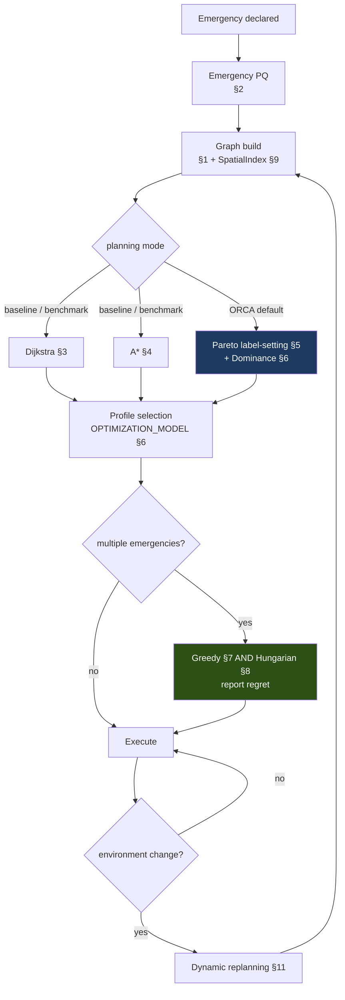

# ORCA — Algorithms

Version 1.2 · updated after Phase 3 · 2026-09-02

Every algorithm in `cpp/algorithms/`, documented to the same template: problem, purpose, data
structure, pseudocode, correctness, complexity, use in ORCA, limitations, implementation
notes.

**Notation.** `V` = vertices, `E` = edges, `k` = objectives (4), `L` = Pareto labels,
`n` = assignment matrix dimension, `D` = debris count.

---

## 1. The Graph

### 1.1 Problem

Represent feasible orbital transfers so shortest-path and multi-objective search can run over
them.

### 1.2 Structure

**Weighted directed graph, adjacency list.**

```cpp
class MissionGraph {
    std::vector<GraphNode> nodes_;
    std::vector<std::vector<EdgeId>> adjacency_;  // indexed by NodeId
    std::vector<GraphEdge> edges_;
};
```

### 1.3 Why adjacency list, not matrix

After feasibility pruning the graph is **sparse**. In the reference demo scenario the builder
accepts 173 edges and rejects 583 — and the rejection ratio *grows* with scenario size,
because Δv budget and survival window are absolute limits while candidate pairs grow as
`O(V²)`.

| | Adjacency list | Adjacency matrix |
|---|---|---|
| Space | `O(V + E)` | `O(V²)` |
| Enumerate neighbours of `u` | `O(deg(u))` | `O(V)` |
| Edge existence query | `O(deg(u))` | `O(1)` |
| At `V = 1000`, `E ≈ 6000` | ~6 k entries | 1 000 000 entries |

Dijkstra and label-setting *only ever enumerate neighbours* — they never ask "does edge `u→v`
exist?". The matrix's one advantage is an operation ORCA does not perform.

### 1.4 Why directed

`u → v` and `v → u` differ in:
- **Δv** — raising an orbit and lowering it are different burns from different starting speeds.
- **Feasibility** — the vehicle at `u` has a different remaining Δv than whatever is at `v`.
- **Risk** — the corridor is traversed at different times, so debris geometry differs.

Modelling this as undirected would be physically wrong and would silently create infeasible
routes.

### 1.5 Time-dependent edge weights — the important part

An ORCA edge weight is **not a constant**. It is a function of departure time:

```
w(e, t_depart) → ObjectiveVector{time, fuel, risk, distance}
```

because the phase angle between two orbits changes continuously, and the Δv required to
rendezvous depends on that phase. Audit §4.2 measured the consequence: the synodic period
between a 500 km and an 800 km orbit is **25.4 hours**, so the phase relationship is never
static on the timescale of a rescue.

This is what elevates the shortest-path work above textbook recital, and §3.3 addresses the
correctness obligation it creates.

### 1.6 Complexity

| Operation | Complexity |
|---|---|
| Build (naive all-pairs) | `O(V² · C)`, `C` = transfer evaluation cost |
| Build (with spatial index for risk) | `O(V² + V·k)` |
| Neighbour enumeration | `O(deg(u))` |
| Full traversal | `O(V + E)` |

Build is quadratic in `V` because every ordered pair is a *candidate*. This is the dominant
cost at `V = 1000` and is exactly what `BENCHMARK_PLAN.md` measures.

---

## 2. Priority Queue

### 2.1 Problem

Repeatedly extract the minimum (or maximum) element from a changing collection — needed in
four distinct places.

### 2.2 Structure

**Binary heap**, via `std::priority_queue`.

| Operation | Complexity |
|---|---|
| `push` | `O(log n)` |
| `top` | `O(1)` |
| `pop` | `O(log n)` |
| build from `n` | `O(n)` |

### 2.3 Four uses, three different reasons

| Use | Key | Why a heap |
|---|---|---|
| Dijkstra / A* open set | tentative distance `g` or `f` | Must repeatedly extract the minimum from a set that grows during iteration |
| Pareto label-setting open set | lexicographic cost vector | Same, with vector keys |
| Event queue | event time (min-heap) | Events are inserted out of order and must be processed chronologically |
| Emergency queue | computed priority (max-heap) | Highest-priority casualty first |

### 2.4 Why not a Fibonacci heap

Fibonacci heaps give Dijkstra `O(E + V log V)` versus the binary heap's `O((V+E) log V)`.
ORCA uses the binary heap anyway, deliberately:

- The improvement matters only for **dense** graphs. ORCA's graphs are sparse, where the two
  are near-identical in practice.
- Fibonacci heaps have large constant factors and poor cache behaviour; they routinely lose
  to binary heaps on real inputs at these sizes.
- `std::priority_queue` is standard, correct, and needs no maintenance.

**The honest reason it works without `decrease-key`:** ORCA uses **lazy deletion** — push a
new entry rather than update an old one, and skip stale entries on pop:

```cpp
while (!open.empty()) {
    auto [cost, node] = open.top(); open.pop();
    if (cost > dist[node]) continue;   // stale entry, superseded
    ...
}
```

This costs at most `O(E)` heap entries instead of `O(V)` — a constant-factor memory increase
in exchange for dropping the indexed-heap machinery entirely.

### 2.5 A structure deliberately not used here

The emergency queue's key (`priority`) **changes over time** as deadlines approach. The
textbook answer is an indexed heap with `decrease-key`. ORCA instead **rebuilds the heap each
tick** (`O(n)` via `std::make_heap`), because `n` is the number of *pending emergencies* —
typically under 10, and bounded by scenario size. An indexed heap here would be more code,
more state, and more bug surface to optimise an `O(10)` operation. This is recorded because
"why didn't you use a decrease-key heap?" is a fair viva question with a real answer.

---

## 3. Dijkstra's Algorithm

### 3.1 Problem

Single-source shortest path over non-negative edge weights, on **one** selected objective.

### 3.2 Purpose in ORCA

Dijkstra is the **baseline**, not the product. It answers "what is the best route if we care
about exactly one thing?" — and its output is the control against which Pareto planning is
measured (`BENCHMARK_PLAN.md` §4).

### 3.3 Pseudocode — as implemented in Phase 3

```
DIJKSTRA_EARLIEST_ARRIVAL(G, source, sink, t_start, vehicleConstraints):
    bestArrival[v] ← ∞ for all v;  bestArrival[source] ← t_start
    predecessor[v] ← null
    open ← min-heap keyed on arrival time; push (t_start, source)

    while open not empty:
        (t, u) ← open.pop()
        if t > bestArrival[u]: continue            # lazy deletion
        if u == sink: break                        # early exit, still optimal
        metrics.nodesExpanded++

        for each edge e = (u → v) in adj[u]:
            result ← transferModel.evaluate(orbit(u), orbit(v), t, vehicleConstraints)
            # THE CRITICAL STEP: departure time is t — the arrival time just reached at
            # u — never t_start. GRAPH_MODEL.md §6.1.
            if not result.feasible: continue        # per-edge only; see §3.6
            metrics.edgesEvaluated++
            candidate ← result.geometry.arrivalTimeSec

            if candidate < bestArrival[v]:
                bestArrival[v] ← candidate
                predecessor[v] ← (e, result)
                open.push((candidate, v))

    return reconstructPath(predecessor, sink), bestArrival[sink]
```

**This is narrower than the objective-parameterised sketch this section previously
showed**, and the narrowing is deliberate, not a simplification of convenience. The
priority key and the accumulated quantity are the same thing — arrival time — so there is
no separate `dist[]` array tracking a different objective while `arrivalTime[]` tracks
time on the side. `BENCHMARK_PLAN.md` §4.2 only ever calls for a time-objective baseline
(`dijkstra-time`); a fuel- or risk-minimising single-objective search was never a
requirement anywhere else in the design, so implementing the generic version would have
been complexity built for a use that does not exist. If one is ever needed, it is a
distinct algorithm — accumulating a different quantity while still stepping time forward
correctly — not a parameter on this one.

### 3.4 Correctness — and the obligation time-dependence creates

Standard Dijkstra's invariant: when a node is popped, its distance is final. The proof needs
**non-negative weights** — true here, since time, fuel, risk and distance are all `≥ 0` by
`ObjectiveVector`'s invariant.

But time-dependent weights need **one more property**:

> **FIFO / non-overtaking:** departing later can never result in arriving earlier.
> Formally, for `t₁ ≤ t₂`: `t₁ + w_time(e, t₁) ≤ t₂ + w_time(e, t₂)`.

Without it, a longer-cost path could yield an earlier arrival, enabling a later relaxation to
improve a finalised node — and Dijkstra's greedy commitment breaks.

**ORCA's position on this is explicit and tested:**

- The transfer model is constructed to be FIFO for the `time` objective: waiting for a better
  phase is modelled as an explicit *wait cost* on the edge, so departing later always arrives
  no earlier. There is no "leave later, overtake" transfer in the model.
- **Established in Phase 2, and proved rather than sampled.** With `A(t)` the next
  rendezvous window at or after `t` and `coast` constant, `arrival(t) = A(t) + coast`.
  `A` is non-decreasing because `{s >= t2}` is a subset of `{s >= t1}`, so FIFO holds
  unconditionally. Verified over **143 991 ordered comparisons, 0 violations**
  (`TRANSFER_MODEL.md` §13).
- **An earlier design would have broken it.** Phase 0 specified a Δv penalty for departing
  off-phase; that model violated FIFO in 827 of 4000 sampled orbit pairs, concentrated in
  LEO→MEO/GEO transfers. It was replaced, not tolerated.
- If the property ever fails, Dijkstra's optimality claim on that objective is void, and the
  correct response is to fix the transfer model — not to relax the test.

**A second condition, needed by §5 rather than by §3.** Multi-objective label-setting also
requires that a dominating label never extends worse than the label it dominates. ORCA
satisfies this because the *non-time* objectives are independent of departure time — all
phase dependence lives in the wait. See `TRANSFER_MODEL.md` §13.4; this is a stronger
requirement than FIFO and is easy to overlook.

**This is the single most important correctness caveat in ORCA**, and it exists precisely
because the graph is physically motivated rather than abstract.

### 3.5 Complexity

| | |
|---|---|
| Structural | `O((V + E) log V)` with binary heap and lazy deletion |
| Space | `O(V + E)`; heap holds up to `O(E)` entries under lazy deletion |
| **Practical** | `O((V + E) log V · C)` — every relaxation calls `TransferModel::evaluate()`, cost `C` |

`C` is a handful of closed-form trigonometric evaluations (Hohmann + plane change + one
phasing search) — no iteration, no root-finding, so cheap — but it is not the free,
amortised-away weight lookup a static-graph Dijkstra enjoys, because there is no
precomputed weight to look up (`GRAPH_MODEL.md` §3.5, §6.4). `BENCHMARK_PLAN.md` will
measure `C`'s real contribution against a scenario large enough for it to matter; no figure
is asserted here that has not been measured.

### 3.6 Limitations

- **Single objective only.** Running it four times gives four extreme points, *not* the
  Pareto front — the interior trade-offs are invisible to it. This is the concrete argument
  for §5.
- Requires non-negative weights (satisfied).
- Requires FIFO under time-dependence (§3.4).
- **Enforces only per-edge delta-v feasibility, not a cumulative path-wide budget.**
  Discovered and deliberately left unfixed in Phase 3: a per-edge check ("is this leg alone
  within the vehicle's total budget") is a fact about the edge, independent of path
  history, so single-label Dijkstra can enforce it soundly. A genuinely cumulative check
  ("do this leg's costs plus every prior leg's exceed the budget") is **not** safe in a
  single-label search — a slower-but-cheaper-so-far path could be wrongly discarded in
  favour of a faster-but-thirstier one that later turns out to be the only affordable
  option. Enforcing that correctly needs multiple non-dominated labels per node, which is
  exactly what §5's label-setting already provides. `Dijkstra.CumulativeBudgetIsNotEnforcedByDesign`
  (`dijkstra_time_dependence_test.cpp`) pins this as a tested boundary rather than an
  undiscovered gap — full reasoning in `GRAPH_MODEL.md` §6.3.

### 3.7 Implementation notes

- Early exit on popping the sink is safe and is applied.
- `bestArrival` as `std::vector<Seconds>` indexed by `NodeId::value()` — no hash map,
  `NodeId` is dense by construction (`MissionGraph` assigns it).
- An edge into an already-finalised node is skipped before calling `evaluate()` at all —
  cheap to check, and it is exactly the nodes near the sink that accumulate the most
  redundant incoming edges as the search fans out.
- Report `nodesExpanded`, `edgesEvaluated`, `relaxationsSucceeded`/`relaxationsRejected`,
  `priorityQueuePushes`/`Pops`, `staleEntriesDiscarded` for direct comparison with A*
  (`cpp/algorithms/SearchMetrics.hpp`).
- Every scenario used to verify this implementation was checked by compiling and running
  it against the real code before being written into a test — including confirming that an
  independent brute-force path enumerator agrees exactly, on a graph containing a real
  cycle (`GRAPH_MODEL.md` §8.1, `dijkstra_oracle_test.cpp`).

---

## 4. A* Search

### 4.1 Problem

Same problem Dijkstra solves — earliest arrival time, single objective, `PathResult.hpp`
(§3.3's narrowing applies here too: `findEarliestArrivalAStar` has no `objective`
parameter) — guided toward the target using a lower bound on remaining time, to expand
fewer nodes than Dijkstra when that bound is informative.

**This is narrower than the multi-objective sketch this section previously showed**, for
the same reason §3.3 gives for Dijkstra: nothing else in the design calls for a fuel- or
risk-guided A* yet, so building one now would be complexity for a use that does not exist.
Phase 5's Pareto label-setting (§5) is where multi-objective search actually belongs; a
per-objective heuristic on a single-label search would not compose with it anyway.

### 4.2 f = g + h

```
f(n) = g(n) + h(n)
```

- `g(n)` — the **absolute arrival time** at `n` on the current best known path. Same
  quantity as Dijkstra's `bestArrival[n]`, not elapsed time since search start.
- `h(n)` — a lower bound on the additional time from `n` to the target.
- `f(n)` — the open set's priority key.

### 4.3 The heuristic, and the admissibility argument that actually holds

**This entire subsection was rewritten in Phase 4.** The original claim here — that the
direct Hohmann half-period `h_time(n) = π√(((r₁+r₂)/2)³/μ)` is admissible because "no
impulsive two-burn transfer between these radii is faster" — is true of a *single*
transfer, but admissibility needs a lower bound over every possible *route*, including
multi-hop ones, and a multi-hop detour can in principle beat a direct hop (`coast(ra,rb)`
depends on the *average* of the two radii, not their difference, so it does not satisfy
the triangle inequality in general). This gap was found in Phase 4 by compiling and
running the real transfer model against the old claim, not by re-reading the old proof —
see `HEURISTIC_DESIGN.md` §3 for the full account, including an intermediate wrong
derivation that was itself caught by numerical verification before this one was accepted.

The heuristic ORCA actually uses:

```
h(n) = min( coast(r(n), r(goal)),                                  // direct
            coast(r(n), R_earth) + coast(R_earth, r(goal)) )       // floor detour
```

where `coast(ra, rb) = π√(((ra+rb)/2)³/μ)` (the Hohmann half-period) with the same-radius
case special-cased to `0` (a pure phasing/plane-change transfer needs no coast at all).
The second term is the cost of detouring through Earth's own surface radius — the global
floor every ORCA orbit is constructed above. It is admissible **for every input, no scope
caveat needed**: `coast(ra,x) + coast(x,rb)`, as a function of the free via-radius `x`, is
strictly increasing in `x`, so its infimum over every physically valid `x` sits at the
smallest one, `R_earth`, and no real node can be below that floor — the "dip to a lower
radius to save cost" move the multi-hop counterexample depends on is structurally
unavailable once the reference point already *is* the lowest point anything can be. Taking
the minimum of this term with the (only conditionally admissible) direct term can only
pull the combined value down, never up, so `h` inherits the floor-detour term's
unconditional admissibility regardless of the direct term's own behaviour.

**Consistency is a sampled, not proven, property** — and figuring out precisely how far
that goes was itself a Phase 4 finding, not an assumption carried in from Phase 0.
`floorDetour` is consistent unconditionally (proof mirrors its admissibility argument).
`direct` is **not** consistent in general — checked directly, with real counterexamples
inside ORCA's realistic altitude range (`heuristic_consistency_test.cpp`). An earlier draft
of `HEURISTIC_DESIGN.md`/`AStarHeuristic.hpp` argued the combined heuristic's consistency
followed from "the minimum of two individually consistent heuristics is itself consistent"
— a correct lemma whose precondition is false here, since `direct` fails it. That was a
genuine documentation error, corrected rather than left in place once the decomposed check
that exposed it was written. What actually holds, checked rather than inferred: the
*combined* `min(direct, floorDetour)` has zero observed consistency violations across a
400,000-sample adversarial search concentrated on exactly the regime that breaks `direct`
alone (source/goal near GEO, intermediate near LEO). This is empirical, not derived from
the parts — see `HEURISTIC_DESIGN.md` §5 for the full reasoning and numbers.

None of this is load-bearing for correctness regardless: A* here uses **admissibility
alone**, via reopening (§4.4), which needs no consistency assumption. The consistency
result is documented because it explains why reopening essentially never triggers in
realistic scenarios (§4.7), not because the search depends on it.

**Fuel, risk and distance heuristics are deferred, not built.** Phase 4 optimises time
only (§4.1); a `h_fuel` lower bound on delta-v (ideal Hohmann Δv plus unavoidable plane
change) remains the right direction *if* a delta-v-objective search is ever needed, but
folding it into a time estimate now would not lower-bound time at all. This is left for
whichever future phase actually needs it, rather than built speculatively ahead of that
need.

### 4.4 Pseudocode — as implemented in Phase 4

```
ASTAR_EARLIEST_ARRIVAL(G, source, sink, t_start, vehicleConstraints, h):
    bestG[v] ← ∞ for all v;  bestG[source] ← t_start
    predecessor[v] ← null
    open ← min-heap keyed on f = g + h;  push (t_start + h(source), t_start, source)

    while open not empty:
        (fu, gu, u) ← open.pop()
        if gu > bestG[u]: continue              # lazy deletion (no separate closed set)
        if u == sink: break                     # safe on the FIRST pop -- see §4.5
        metrics.nodesExpanded++

        for each edge e = (u → v) in adj[u]:
            result ← transferModel.evaluate(orbit(u), orbit(v), gu, vehicleConstraints)
            # THE CRITICAL STEP, identical to Dijkstra: departure time is gu, the arrival
            # time just reached at u -- never t_start. GRAPH_MODEL.md §6.1.
            if not result.feasible: continue
            metrics.edgesEvaluated++
            candidate ← result.geometry.arrivalTimeSec

            if candidate < bestG[v]:
                bestG[v] ← candidate
                predecessor[v] ← (e, result)
                open.push((candidate + h(v, sink), candidate, v))   # reopens unconditionally
    return reconstructPath(predecessor, sink), bestG[sink]
```

**No permanent closed set.** Unlike Dijkstra's `finalised[]`, a node here is never marked
"done": `bestG[]` plus the lazy-deletion comparison on pop is sufficient, and a node whose
`bestG` improves after its first expansion is expanded again automatically. This is not
optional bookkeeping — it is what admissibility-without-consistency requires (§4.3), and a
dedicated test forces it to actually happen rather than trusting the code path is
reachable (`AStarTimeDependence.ReopeningCorrectsWronglyExpandedNodeUnderInconsistentButA
dmissibleHeuristic`, `astar_time_dependence_test.cpp` — a synthetic, deliberately
inconsistent-but-admissible heuristic, since the real one is consistent throughout ORCA's
realistic range and so never exercises this path on its own).

### 4.5 Correctness

With an admissible `h`, A* with reopening returns an optimal path, and it is safe to
terminate on the very first pop of the sink — a stronger and less obvious claim than the
textbook sketch this section previously gave, since f-values are **not** guaranteed
non-decreasing across pops when `h` is merely admissible (only consistency guarantees
that). The full derivation — admissibility alone is enough, proven rather than asserted —
lives in `AStar.hpp`'s "WHY THE FIRST GOAL POP IS STILL SAFE TO TRUST" section; the
one-paragraph version: let `C*` be the true optimum and take the smallest-index node `vj`
on some truly-optimal path whose `bestG` has not yet reached its optimal value when the
sink first pops. Its predecessor already has its optimal `g` (by minimality of `vj`'s
index), so the real optimal-path edge out of it was already relaxed, putting `vj` in the
open set with `f(vj) ≤ C*` (admissibility). The sink popping first, with `g > C*`, would
need `f(sink) ≤ f(vj) ≤ C*` by the heap property — contradiction. So the sink cannot pop
with a suboptimal `g`.

**ORCA tests this rather than trusting it**, at three independent levels:

- **The heuristic itself**, against a real multi-hop brute-force graph oracle and a direct
  numerical re-derivation of the floor-detour monotonicity lemma — never against A* or
  Dijkstra (`heuristic_admissibility_test.cpp`, `heuristic_consistency_test.cpp`).
- **The search**, against the same independent brute-force oracle
  `dijkstra_oracle_test.cpp` uses, rewritten fresh (`astar_oracle_test.cpp`).
- **Cross-validation against Dijkstra**: same found/not-found, same arrival time, same
  total objectives, on every fixture graph (`astar_oracle_test.cpp`'s
  `DijkstraAndAStarAgreeOnRandomisedSmallGraphs`) — not necessarily the same *path*, since
  `PathResult` does not specify a canonical choice among tied-optimal routes.
- **The h=0 ablation**: A* with a heuristic that always returns `0` must match Dijkstra's
  results exactly (not merely "similarly") — `AStarTimeDependence.ZeroHeuristicMatchesDijk
  straOn{Direct,Indirect}Route`.

### 4.6 Complexity

| | |
|---|---|
| Time | `O((V + E) log V)` worst case — identical to Dijkstra |
| Space | `O(V + E)` |
| Practice | Measured, not asserted — see below |

**A\* is not asymptotically better than Dijkstra, and on the graphs actually measured, it
was not faster in wall-clock time either.** The Phase 4 micro-benchmark
(`benchmarks/dijkstra_vs_astar_bench.cpp`, results in
`benchmarks/phase4_dijkstra_vs_astar_results.txt`) ran both algorithms on four deterministic
graphs (10/25/50/150 nodes, a connected altitude-sorted backbone plus skip edges, 10
measured repetitions each after 3 discarded warm-ups). A* expanded the same or fewer nodes
than Dijkstra at every size (9≤9, 20<22, 45<47, 150≤150) — the heuristic does provide real
guidance — but A* was slower in median wall-clock time at every size (e.g. 0.0235ms vs
0.0020ms at 10 nodes; 0.0806ms vs 0.0550ms at 150 nodes), because each heuristic evaluation
costs two closed-form Hohmann computations and that fixed cost was not repaid by the
modest reduction in nodes/edges touched on these particular graphs.

The benchmark also computed the heuristic-quality ratio `h(source,target) / trueCost`
(`trueCost` from Dijkstra's real result): it fell from 0.167 at 10 nodes to 0.003 at 150
nodes. This is explained by, not merely correlated with, the heuristic's own design
(§4.3): `h` bounds coast time only, never wait time, and larger graphs in this benchmark's
topology accumulate more phasing wait along the optimal route, so true cost grows from a
term the heuristic deliberately does not estimate. A looser bound guides the search less,
which is consistent with A* not earning back its evaluation cost here.

**This is not a general verdict against A* for ORCA.** The benchmark topology (a
backbone climb from lowest to highest altitude) was chosen for guaranteed connectivity and
reproducibility, not because it is where A*'s advantage would be largest — a graph with
many branches the heuristic can see are hopeless (e.g. dense fan-out around the target)
would plausibly show more pruning. That scenario was not built in Phase 4; building and
measuring it, rather than assuming the answer, is exactly the kind of claim this document
avoids making without a number behind it.

### 4.7 Limitations

- **Time objective only** — see §4.3's "deferred, not built" note on `h_fuel`.
- **Heuristic evaluation adds real per-node cost, confirmed by measurement, not merely
  possible in principle**: A* was slower in wall time than Dijkstra at every size tested
  in the Phase 4 benchmark (§4.6), despite expanding fewer nodes at three of the four
  sizes.
- **The heuristic's informativeness degrades as the true cost's wait-time share grows**
  (§4.6) — it is a bound on coast time only, by design (`HEURISTIC_DESIGN.md` §1), so
  scenarios dominated by long rendezvous waits are exactly where it helps least.
- **`direct` alone is not consistent, even within ORCA's realistic range** (§4.3) — the
  combined heuristic empirically is, but this is a measured property with a large sample
  behind it, not a proof, and is stated with that precise, honest scope.
- Shares Dijkstra's cumulative-delta-v-budget limitation unchanged (§3.6) — both build the
  identical per-edge `TransferConstraints`, so the same single-label argument applies
  (`AStar.CumulativeBudgetIsNotEnforcedByDesign`, `astar_test.cpp`).

---

## 5. Multi-Objective Pareto Search (Label-Setting)

**The centrepiece of ORCA — implemented in Phase 5.** Full derivation, proofs and
independent verification: `PARETO_SEARCH.md`. This section is the condensed version, in
the same relationship to that document as §4's condensed A* section has to
`HEURISTIC_DESIGN.md`.

### 5.1 Problem

Find *all* Pareto-optimal paths from source to target over `k = 4` simultaneously-minimised
objectives, under a time-dependent transfer model and a hard, cumulative delta-v budget.
This is the **Multi-Objective Shortest Path Problem (MOSP)**, and it is **NP-hard** in
general — the number of Pareto-optimal paths can grow exponentially in `V`.

### 5.2 Algorithm

**Martins' label-setting algorithm** with dominance pruning — named, published, and
implemented as specified, not an ad-hoc invention.

The essential departure from Dijkstra/A*: a node no longer has *a* best value. It has a
**set of mutually non-dominated labels**, because a path that is slower but cheaper is
neither better nor worse than a faster, costlier one — it is incomparable, and both must
survive.

### 5.3 Structure

```cpp
struct ParetoLabel {
    NodeId node;
    ObjectiveVector cost;                     // accumulated via compose()
    std::optional<LabelId> predecessor;       // flat-pool index, never a pointer
    std::optional<EdgeId> viaEdge;
    std::optional<TransferResult> legResult;  // actual evaluation, not the edge's cache
    Seconds arrivalTimeSec;                   // absolute time; next edge's departure time
    bool active;                              // lazy-deletion flag
};
```

(`algorithms/ParetoLabel.hpp`.) Labels live in one flat `std::vector<ParetoLabel>`
(`ParetoSearch.cpp`), addressed by `LabelId` — an index, never a pointer, so predecessor
chains survive the pool reallocating as it grows. `PARETO_SEARCH.md` §5 has the full
reasoning for every field, including why no separate accumulated-delta-v field exists
(`cost.fuel` already *is* that quantity, verified against `TransferModel.cpp`'s real
formula).

### 5.4 Pseudocode — as implemented in Phase 5

```
FIND_PARETO_ROUTES(G, source, target, t_start, constraints):
    pool ← [root label at source, cost=0, arrivalTime=t_start]
    labelsAtNode[source] ← {root};  open.push(root)

    while open not empty:
        L ← open.pop()                       # earliest arrivalTime first (processing
        if not L.active: continue            # order only -- PARETO_SEARCH.md §8.2)
        if L.node == target: continue         # never expand outgoing edges of target
        for each edge e = (L.node → v):
            result ← transferModel.evaluate(orbit(L.node), orbit(v), L.arrivalTime, ...)
            if not result.feasible: continue
            c' ← compose(L.cost, result.objectives())
            if c'.fuel > 1.0: continue        # THE CUMULATIVE DELTA-V HARD CONSTRAINT --
                                               # new in Phase 5, PARETO_SEARCH.md §9
            outcome ← insertCandidate(c', v, ...)     # dominance update, §5.4.1
            if outcome == Inserted: open.push(new label)

    return { reconstruct(L) : L ∈ labelsAtNode[target], L.active }
```

#### 5.4.1 The dominance update

For candidate `C` arriving at node `v`, against `v`'s existing non-dominated labels:

1. If any existing label dominates `C`: discard `C`.
2. Else if `C` is equivalent to an existing label (§6, a distinct concept from dominance):
   discard `C` — the deterministic policy is "first-inserted wins."
3. Else: remove every existing label `C` dominates.
4. Insert `C`.

**A correction from the original sketch this section showed.** An earlier version used
`dominates_ε` (approximate) for step 1's check but plain `dominates` (exact) for step 3's —
an asymmetry that would make exact and approximate mode disagree about which labels
survive. `insertCandidate()` (`ParetoSearch.cpp`) uses the *same* mode, exact or epsilon,
consistently for both checks.

### 5.5 Cost composition

Reused verbatim from `core/ObjectiveVector.hpp`'s `compose()` (Phase 1/2), not
reimplemented here:

```
time'     = time     + w.time
fuel'     = fuel     + w.fuel
distance' = distance + w.distance
risk'     = 1 − (1 − risk)·(1 − w.risk)     # independent survival
```

Risk composes multiplicatively-in-survival because two independent 10% hazards give a 19%
cumulative hazard, not 20%. This keeps risk **monotonically non-decreasing along a path and
bounded in `[0,1]`** — what the correctness argument in §5.6 requires.

### 5.6 Correctness

**Monotonicity.** Every objective is non-decreasing along a path (all edge components are
`≥ 0`, and the risk composition above is non-decreasing). So extending a dominated label
can never produce a label that dominates an extension of the dominating one.

**Pruning soundness.** If label `M` dominates candidate `C` at node `v`, then for any
continuation `P` from `v`, `M ⊕ P` dominates `C ⊕ P` — by monotonicity and componentwise
composition. Discarding `C` cannot discard any Pareto-optimal solution.

**Termination — established fresh, not inherited from Dijkstra/A*'s single-label FIFO
argument (a genuinely different property is needed here).** Any label that extends around a
cycle with at least one non-zero-cost edge is, by monotonicity, componentwise no better than
— and strictly worse than — the label it started from, which is already present at that
node by construction. It is therefore self-dominated and discarded (step 1 above). A
perfectly zero-cost cycle produces an *equivalent* label instead, caught by step 2. Either
way, no cycle can ever add a genuinely new, surviving label. Full derivation:
`PARETO_SEARCH.md` §12. Verified directly, not just argued:
`ParetoSearchOracle.AgreesOnDirectedGraphWithARealCycle` and
`ParetoSearch.CyclicGraphTerminatesAndAgreesWithDijkstraOnArrivalTime`
(`pareto_search_test.cpp`, `pareto_search_oracle_test.cpp`) run this search on a real graph
containing a real cycle.

**ORCA tests this rather than trusting it**, via an independent brute-force multi-objective
oracle that shares no code with the search or with `Dominance.hpp`
(`pareto_search_oracle_test.cpp`, `PARETO_SEARCH.md` §13) — including five structurally
distinct randomised graphs, not just hand-picked cases.

### 5.7 Complexity

| | |
|---|---|
| Time | `O(\|L\| · log\|L\| · (k + deg))`, where `\|L\|` = labels ever inserted |
| Space | `O(\|L\| · k)` |
| Worst case | `\|L\|` exponential in `V` — MOSP is NP-hard |
| Practice | Bounded by dominance pruning (exact) and optional ε-dominance (approximate) |

**ORCA does not pretend this is polynomial.** Measured, not asserted:
`benchmarks/pareto_search_bench.cpp`, `benchmarks/phase5_pareto_search_results.txt`. On a
19-route exact frontier, dominance comparisons numbered 2401; `epsilon=0.02` cut that to
117 (a 95% reduction) at the cost of collapsing the frontier to 3 routes.

| Mitigation | Effect | Cost |
|---|---|---|
| Dominance pruning | The only lever active by default | none — exact |
| **ε-dominance** (`ParetoSearchOptions::epsilonDominance`) | Treats `A` as dominating `B` if `A ≤ B·(1+ε)` componentwise. Collapses near-identical labels — measured 19→3 routes at ε=0.02 on the benchmark's richest scenario | **approximate**, opt-in, never the default |
| `maxLabels` cap | Hard bound on search size | **truncation** — `ParetoSearchMetrics::truncated` set, front may be incomplete |
| Feasibility pre-pruning (Group 1-3, `GRAPH_MODEL.md` §3) | Infeasible edges never relaxed | none — exact |

When ε-dominance or truncation is active, `ParetoSearchResult::metrics.truncated` (or the
fact that `epsilonDominance` was set) is available to the caller. **An approximate result
is never presented as exact by this layer** — no field claims completeness that was not
achieved.

### 5.8 Limitations

- NP-hard; large `k` degrades pruning effectiveness sharply (the "curse of dimensionality"
  for dominance — with more objectives, fewer pairs are comparable, so less gets pruned).
  `k = 4` is chosen partly for this reason.
- `ε > 0` sacrifices exactness for tractability, and discarded labels are not recoverable
  in this phase.
- **Natural multi-way trade-offs from real orbital parameters were harder to find than
  expected** — most parameter combinations correlate across objectives rather than trading
  them off. `PARETO_SEARCH.md` §17 has the full account; this shaped both the permanent
  tests' scenario construction and the benchmark's topology choice.
- No multi-objective heuristic guidance exists yet (§5.6's correctness does not need one,
  but search remains fully unguided) — deferred, not designed;
  `PARETO_SEARCH.md` §18.

---

## 6. Dominance and Equivalence

### 6.1 Definition

```
A dominates B  ⟺  (∀i: Aᵢ ≤ Bᵢ)  ∧  (∃j: Aⱼ < Bⱼ)
```
"No worse in every objective, strictly better in at least one." `A` and `B` are
**equivalent** (a distinct concept, §6.3) if every component is equal within tolerance —
neither dominates, but they are not a genuine trade-off either.

### 6.2 Implementation, and where it actually lives

```cpp
// cpp/algorithms/Dominance.hpp -- NOT optimization/, see below.
inline constexpr double kDominanceNoiseEpsilon = 1.0e-6;

bool dominates(const ObjectiveVector& a, const ObjectiveVector& b) noexcept {
    bool strictlyBetterSomewhere = false;
    for (std::size_t i = 0; i < kObjectiveCount; ++i) {
        if (a[i] > b[i] + kDominanceNoiseEpsilon) return false;
        if (a[i] < b[i] - kDominanceNoiseEpsilon) strictlyBetterSomewhere = true;
    }
    return strictlyBetterSomewhere;
}
```

**Lives in `algorithms/`, not `optimization/`, correcting this document's own earlier
implication.** `ParetoSearch.cpp` calls `dominates()` at every label insertion, and
`ARCHITECTURE.md`'s dependency table has `optimization/` depend on `algorithms/`, never the
reverse — the same reasoning that moved `ObjectiveVector` itself out of `optimization/` in
Phase 1 (`core/ObjectiveVector.hpp`'s file comment). `optimization/`'s scoring code reaches
down into `algorithms/` for `dominates()`, the same direction it reaches for everything
else it needs.

**Two epsilons, never the same constant.** `kDominanceNoiseEpsilon` above is fixed,
non-configurable, floating-point-noise tolerance only — not the `ε` in "ε-dominance."
Controlled approximation is a separate function, `dominatesWithEpsilon(a, b, epsilon)`,
requiring an explicit epsilon argument with no default, so approximate pruning can never be
reached by accident. An earlier draft of this section used one `kEpsilon` for both roles;
that conflation is corrected here, matching `Dominance.hpp`'s actual, tested implementation.

### 6.3 Why this is its own file

`Dominance.{hpp,cpp}` is small and has a dedicated header, source and test file
(`dominance_test.cpp`, 19 tests). That is deliberate: it is the **single most reused
predicate in the system** (label pruning, front construction, front validation, future
assignment filtering), and every correctness argument in §5 rests on it. A bug here would
silently produce plausible-but-wrong fronts — the worst failure mode ORCA has. So it is
isolated and property-tested.

### 6.4 Properties (property-tested, not assumed)

| Property | Statement |
|---|---|
| Irreflexive | `¬dominates(A, A)` — requires strict improvement somewhere |
| Asymmetric | `dominates(A,B) ⇒ ¬dominates(B,A)` |
| Transitive | `dominates(A,B) ∧ dominates(B,C) ⇒ dominates(A,C)` |
| **Partial**, not total | Incomparable pairs exist — *this is the whole point* |
| `dominatesWithEpsilon` also irreflexive, for any `ε ≥ 0` | A deliberate design choice, not the only valid definition of ε-dominance — `Dominance.cpp`'s comment explains why |

The partial-order row is the justification for the entire multi-objective apparatus:
because dominance is a partial order, there is generally no unique minimum, so a *set* must
be returned.

### 6.5 Floating-point care

`kDominanceNoiseEpsilon` is a documented constant, not a magic number, and is the same
order of magnitude as Dijkstra/A*'s own relaxation epsilon, justified the same way
(`TRANSFER_MODEL.md` §13.3's few-ulp noise floor). Without it, floating-point noise makes
dominance non-transitive, which corrupts the front.

### 6.6 Front extraction

ORCA's actual implementation extracts the non-dominated set incrementally, during search
(§5.4.1), not as a separate post-processing sweep over a fixed candidate list — each
insertion is `O(n)` against the current non-dominated set at that node, which is what the
benchmark's dominance-comparison counts (§5.7) measure directly.

---

## 7. Greedy Assignment

### 7.1 Problem

Assign `m` emergencies to `n` rescue vehicles, minimising total cost.

### 7.2 Algorithm

```
GREEDY_ASSIGN(C):                    # C[i][j] = cost of vehicle j serving emergency i
    assignment ← ∅
    while ∃ unassigned emergency with a feasible vehicle:
        (i, j) ← argmin over unassigned i, unused j of C[i][j]
        assignment ← assignment ∪ {(i, j)}
        mark i assigned, j used
    return assignment
```

### 7.3 Complexity

`O(m·n·min(m,n))` with a linear scan per step; `O(mn log mn)` with a pre-sorted edge list.

### 7.4 Why it is here

Greedy is the **strawman with a real defence**: it is fast, obvious, and what most people
would actually implement. ORCA includes it so the difference against Hungarian can be
quantified directly.

**Implemented in Phase 6, correcting this section on two points.** `algorithms/
GreedyAssignment.hpp`'s `solveGreedyRectangularAssignment()` matches the pseudocode above
exactly, but: (1) there is no `regret` field anywhere in the codebase — Hungarian and greedy
are two independent functions with matching signatures
(`optimization/AssignmentResult.hpp`'s `solveAssignmentHungarian()` /
`solveAssignmentGreedy()`); a caller wanting `regret` computes
`greedyResult.totalCost - hungarianResult.totalCost` itself, since nothing in Phase 6's
scope runs both automatically on every cycle (§8.2 below revises the same over-claim from
`OPTIMIZATION_MODEL.md` §8.2). (2) it deliberately runs on the **rectangular** `V x E`
matrix, never Hungarian's padded square one — `GreedyAssignment.hpp`'s file comment
documents why: greedy applied to a padded matrix trivially prefers the free "vehicle idle"
cells over any real assignment, degenerating to zero real assignments. This was not a
hypothetical concern; it was caught by an end-to-end smoke test before it became a
permanent bug (`ASSIGNMENT_MODEL.md` §9).

### 7.5 Limitation — the counterexample that motivates §8

```
              RV-01   RV-02
    E-A (crit)  10      12
    E-B (mod)   11      99
```
Greedy takes the global minimum `(E-A, RV-01) = 10`, forcing `(E-B, RV-02) = 99`. Total 109.
Optimal is `(E-A, RV-02) = 12` and `(E-B, RV-01) = 11`. **Total 23.**

Greedy is not merely suboptimal here — it is worse by a factor of nearly five, because it
commits to a locally cheap choice that destroys the only good option for the other casualty.
This hand-picked matrix is a *conceptual* validation case
(`tests/algorithms/greedy_assignment_test.cpp`'s `BriefsOwnCounterexampleMatrix`, using the
brief's own `[[1,2],[2,100]]` variant of the same shape). Phase 6 brief §16 additionally
required a counterexample built from **real ORCA orbital data**, not a hand-picked matrix:
`ASSIGNMENT_MODEL.md` §11 and `tests/integration/assignment_scenarios_test.cpp`'s
`ScenarioF_GreedyFailureWithRealData` have it — two vehicles sharing the *exact same orbit*,
differing only in remaining delta-v budget, produce a real (not fabricated) cost matrix on
which Hungarian beats greedy (1.167632 vs 1.570000).

---

## 8. Hungarian Algorithm

### 8.1 Problem

Optimal assignment: find the permutation `σ` minimising `Σᵢ C[i][σ(i)]`.

### 8.2 Algorithm

Kuhn–Munkres, `O(n³)`. ORCA uses the **Jonker–Volgenant-style `O(n³)` formulation** with
potentials and shortest augmenting paths, which is both faster in practice and easier to get
right than the classical zero-covering-lines description.

```
HUNGARIAN(C):                          # square via dummy padding
    u[0..n], v[0..n] ← 0                # dual potentials
    p[0..n] ← 0                         # p[j] = row assigned to column j
    for i in 1..n:                      # add one row at a time
        # Dijkstra-like search for the shortest augmenting path
        minv[j] ← ∞;  used[j] ← false;  j₀ ← 0;  p[0] ← i
        repeat:
            used[j₀] ← true;  i₀ ← p[j₀];  δ ← ∞
            for each unused j:
                cur ← C[i₀][j] − u[i₀] − v[j]      # reduced cost
                if cur < minv[j]: minv[j] ← cur; way[j] ← j₀
                if minv[j] < δ: δ ← minv[j]; j₁ ← j
            for each j:                             # update potentials
                if used[j]: u[p[j]] += δ; v[j] −= δ
                else:       minv[j] −= δ
            j₀ ← j₁
        until p[j₀] == 0
        repeat: j₁ ← way[j₀]; p[j₀] ← p[j₁]; j₀ ← j₁ until j₀ == 0
    return p
```

### 8.3 Correctness intuition

The algorithm maintains **dual feasibility**: potentials `u`, `v` such that every reduced cost
`C[i][j] − u[i] − v[j] ≥ 0`, with equality on assigned pairs (complementary slackness). By LP
duality, a feasible primal assignment satisfying complementary slackness with a feasible dual
is optimal. Each outer iteration assigns one more row while preserving these invariants, so
after `n` iterations the assignment is complete and optimal.

### 8.4 Complexity

| | |
|---|---|
| Time | `O(n³)` |
| Space | `O(n²)` for the matrix, `O(n)` for potentials |
| ORCA scale | `n ≤ ~20` — sub-millisecond |

### 8.5 Rectangular and infeasible cases — corrected in Phase 6

**This section originally specified padding to `max(m,n)` square with dummy rows/columns at
cost 0. That is unsound and was not built.** The problem: `max(m,n)` padding gives the
equal-count case `m == n` *no padding at all* — and if some vehicle has zero feasible
emergencies in that case, Hungarian's perfect-matching requirement has no legal escape and
is forced to select an infeasible real pairing anyway, exactly the "fabricated solution"
Phase 6 brief §13 forbids. `optimization/AssignmentMatrix.hpp` builds the standard
`(m+n) x (m+n)` block matrix instead — full derivation and the four-block layout in
`ASSIGNMENT_MODEL.md` §7. In one line: every vehicle row always has `n` zero-cost idle
columns available, and every emergency column always has `m` dummy-vehicle rows offering it
at a bounded, priority-scaled penalty, regardless of `m` vs `n` or how much of the real
block is infeasible. This makes `O(n³)` become `O((m+n)³)` here, a trade-off
`ASSIGNMENT_MODEL.md` §16 states explicitly.

Infeasible pairs get cost `kInfeasibleAssignmentCost = 1e9` (a finite sentinel, **not**
`∞`, to keep the potential arithmetic well-defined — matches `LARGE` above exactly).
`optimization/AssignmentResult.cpp` additionally *validates* every real assignment against
`AssignmentMatrix::feasibleReal` after solving, rather than trusting the padding design
alone to have prevented it (Phase 6 brief §13's explicit requirement). There is no
`unassigned` field; unserved emergencies are the ones absent from
`AssignmentResult::assignments` — `unassignedEmergencyCount` reports the count, and
`AssignmentStatus::PartiallyAssignable`/`Infeasible` report the overall outcome
(`ASSIGNMENT_MODEL.md` §8).

### 8.6 Scope decision — and one correction

The brief permits omitting this if it destabilises the project. **It is included**: ~150
lines (`algorithms/Hungarian.cpp`), self-contained, depends only on a cost matrix, and
independently unit-tested against brute-force `O(n!)` results for `n <= 7`
(`tests/algorithms/hungarian_oracle_test.cpp`).

**There is no `AssignmentSolver` interface.** Hungarian and greedy are two free functions
with matching signatures (`solveSquareAssignment()`, `solveGreedyRectangularAssignment()`),
the same pattern every other ORCA algorithm uses (`findParetoRoutes()`, `dijkstra()`,
`aStar()` are free functions too, not classes implementing a shared interface) — not an
oversight, but consistency with the rest of the codebase's established style. The
insurance this section originally attributed to an interface is really the matching
signature plus both solvers being independently callable on the same `AssignmentMatrix`:
dropping Hungarian would still leave greedy callable with no code elsewhere needing to
change.

---

## 9. Spatial Index

### 9.1 Problem

For each candidate transfer corridor, find nearby debris to compute risk. Done naively this
is `O(V² · D)` across a graph build — at `V = 1000`, `D = 200` that is 200 million distance
tests per build.

### 9.2 Structure

**Uniform grid** over the ECI bounding volume, cell size ≈ the maximum debris hazard radius.

```cpp
class SpatialIndex {
    double cellSizeKm_;
    std::unordered_map<CellKey, std::vector<DebrisId>> cells_;
};
```

### 9.3 Why a uniform grid, not a k-d tree or octree

| | Uniform grid | k-d tree | Octree |
|---|---|---|---|
| Build | `O(D)` | `O(D log D)` | `O(D log D)` |
| Radius query | `O(cells + hits)` | `O(log D + hits)` | `O(log D + hits)` |
| **Rebuild every tick** | **trivial** | costly | costly |
| Code size | ~60 lines | ~200 lines | ~250 lines |

**The deciding factor is that debris moves every tick.** A tree must be rebuilt or rebalanced
constantly, destroying its query advantage. A grid rebuilds in `O(D)`. Debris is also roughly
uniformly distributed across orbital shells, which is the grid's best case.

### 9.4 Complexity

Query: `O(1)` expected for the cells touched, plus the hits examined. Graph build risk
evaluation drops from `O(V²·D)` to roughly `O(V²·k)` with `k` the mean debris per cell
neighbourhood.

### 9.5 Scope

Tier 3 (`PRD.md` §12). Below ~200 objects, brute force is genuinely fine, and shipping the
grid before it is needed would be premature optimisation. It becomes necessary for the 500 and
1000-object benchmark points, and `BENCHMARK_PLAN.md` measures the crossover rather than
guessing it.

---

## 10. Union-Find (Disjoint Set Union)

### 10.1 Candidate use

Partition the mission graph into connected components to detect casualties that are
unreachable by *any* vehicle — an instant infeasibility answer without running a search.

### 10.2 Structure

Union by rank + path compression: `O(α(V))` amortised per operation, effectively constant.

### 10.3 Honest assessment

**This is the weakest justification in the document, and it is included as a candidate rather
than a commitment.**

The same question — "is the casualty reachable?" — is answered by the search itself, which
must run anyway. Union-Find pays off only when many casualties are queried against one graph,
so the `O(V+E)` component pass amortises across queries.

**Decision rule:** Union-Find is implemented only if the multi-emergency path demonstrates a
measured benefit in benchmarks. Otherwise it is omitted and this section records why. Adding
a data structure to a DSA project for the sake of having it is exactly what `PRD.md` §10's
anti-requirement forbids.

---

## 11. Dynamic Replanning

### 11.1 Problem

The environment changes mid-mission. Decide whether to re-plan, and whether to switch.

### 11.2 Implemented in Phase 7 — this section corrects its own original sketch

**This section originally described `ON_ENVIRONMENT_CHANGE` as a spatial-index-triggered
incremental graph patch (`spatialIndex.query()`, `graph.patchEdges()`) feeding a Pareto
search.** Neither the spatial index (§9) nor incremental edge patching was ever built —
§9.5 states plainly the spatial index remains Tier 3, unbuilt below ~200 objects, and
`MissionGraph` has no `patchEdges()` method (checked directly, not assumed). That sketch
described what is now understood to be **two separate phases**: Phase 8's event engine
(deciding *when* and *from what spatial trigger* to call the replanner — not yet built) and
Phase 7's actual scope, **the decision the replanner makes once called** — a plain,
directly-invokable, deterministic function with no dependency on a spatial index or an
event queue at all. Full design: `DYNAMIC_REPLANNING.md`.

```
evaluateMissionValidity(mission, vehicle, emergency, graph, model, now, policy)
    -> {Valid, Warning, Invalid, Completed}           # never searches (DYNAMIC_REPLANNING.md §2)

DynamicReplanner::evaluate(mission, vehicle, emergency, graph, model, now, trigger, profile):
    validity ← evaluateMissionValidity(...)
    if validity.state == Completed: return Complete
    if validity.state == Invalid:                      # MANDATORY -- switchMargin never applies
        if validity.violatedConstraint == NoAsset: return Abort(VehicleUnavailable)
        front ← findParetoRoutes(graph, model, currentNode, targetNode, now, constraints)  # §5
        best ← selectRecommendedPlan(front, profile)    # §6 of OPTIMIZATION_MODEL
        return best.has_value() ? Replan(best) : Abort(...)
    # Valid or Warning -- OPTIONAL
    if !material(trigger) or throttled: return Continue
    front ← findParetoRoutes(...)
    best ← selectRecommendedPlan(front, profile)
    if !best.has_value(): return Continue
    return (oldScore - newScore >= switchMargin) ? Replan(best) : Continue
```

Every call into search/scoring above is the exact, unmodified Phase 5/6 function — this
layer's own code contains no transfer physics, no dominance rule, and no new optimisation
(`DYNAMIC_REPLANNING.md` §1's "orchestration, not another optimizer").

### 11.3 Three design decisions worth defending

**Replan from current position, not from origin.** The vehicle has already spent Δv and
time; those are sunk. Replanning from the origin would produce routes the vehicle cannot
fly. Implemented via `remainingLegStartIndex()`: a leg already in progress is treated as
committed (evaluation starts at the next one); a leg not yet begun is still fully
re-plannable (`DYNAMIC_REPLANNING.md` §2, §6).

**Full re-search, not an incremental patch.** Unlike this section's original sketch, Phase
7 re-runs the real Pareto search from the vehicle's current node on every replan attempt —
`MissionGraph`'s edges do not change (no incremental patching exists to trust or verify),
and the graph itself is small enough that a fresh search costs microseconds
(`ASSIGNMENT_MODEL.md` §16's benchmark numbers, the same order of magnitude here). Whether
an incremental patch would ever be worth the complexity is an open question for whichever
phase actually introduces edge-level environment changes (debris fields, Phase 8+).

**Hysteresis via `switchMargin`, plus a second, independent mechanism.** Without a
switching threshold, two near-equal routes cause the planner to oscillate every tick.
`ReplanPolicy::switchMargin` is the threshold (default `0.05`, configurable, never applied
to a MANDATORY replan — a hard constraint always wins). A second mechanism,
`minimumReplanIntervalSec`, throttles how often the SAME mission's OPTIONAL path may switch
regardless of trigger frequency — orthogonal to the score-based margin, catching a
different failure mode (rapid-fire trivial triggers, not near-tied scores).

### 11.4 Complexity

Per replan: one Pareto search from the vehicle's current node to the target — the same
`O(V log V + E)`-class cost (§5.7) as any other Phase 5 search, since no incremental
patching narrows the graph. Bounded by how often a caller invokes the replanner, which
Phase 7 itself does not decide (Phase 8's scope).

### 11.5 Limitation

ORCA replans **reactively** — it responds to changes after they are detected. It does not plan
under uncertainty (which would require stochastic or robust optimisation over possible
futures). That is a genuine limitation, and it is the most promising item in
`RESEARCH_EXTENSION.md`. `DYNAMIC_REPLANNING.md` §13 has Phase 7's own additional,
narrower limitations (the delta-v-budget-vs-risk-model interaction found while building
this phase; no continuous mid-leg position; the `Unreachable` diagnosis's honest
simplification; no explicit switching-cost number; global replanning scoped to idle
vehicles only).

---

## 12. Complexity Summary

| Algorithm | Time | Space | Optimal? |
|---|---|---|---|
| Graph build | `O(V² · C)` | `O(V + E)` | exact |
| Binary heap op | `O(log n)` | `O(n)` | exact |
| Dijkstra | `O((V+E) log V)` | `O(V+E)` | ✅ (non-neg + FIFO) |
| A* | `O((V+E) log V)` | `O(V+E)` | ✅ (admissible `h`) |
| Pareto label-setting | `O(\|L\| log\|L\| · (k+deg))` | `O(\|L\|·k)` | ✅ exact if `ε=0` and no truncation |
| Dominance test | `O(k)` | `O(1)` | exact |
| Front extraction | `O(n log n + n·k)` | `O(n)` | exact |
| Greedy assignment | `O(m·n·min(m,n))` | `O(mn)` | ❌ suboptimal |
| Hungarian | `O(n³)` | `O(n²)` | ✅ |
| Spatial index query | `O(1)` expected | `O(D)` | exact |
| Union-Find op | `O(α(V))` | `O(V)` | exact |

---

## 13. Which Algorithm Runs When


