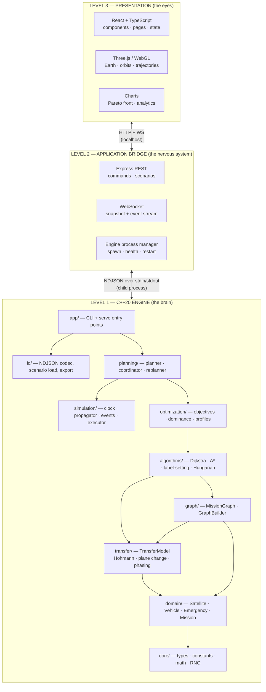
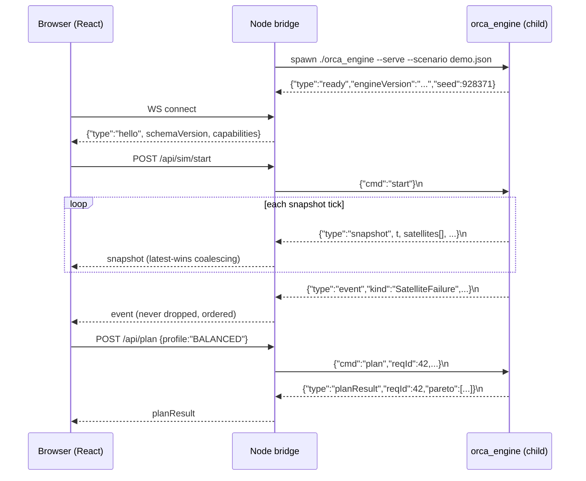

# ORCA — Architecture

Version 1.3 · updated after Phase 5 · 2026-09-03

---

## 1. Architectural Principles

**P1 — The C++ engine is the brain.** All state, all computation, all decisions. Every other
layer transports or displays what the engine produced.

**P2 — Dependencies point inward and downward, never up.** `algorithms/` knows nothing of
`planning/`. `cpp/` knows nothing of `backend/`. `backend/` knows nothing of `frontend/`.
No cycles.

**P3 — The engine is independently useful.** `orca_engine` builds, runs, plans, benchmarks,
and exports with no Node and no browser on the machine. This is enforced by a build target,
not by good intentions.

**P4 — One source of truth per value.** If the engine computes it, nobody else computes it.
The frontend may *format* `13.6%`; it may never *derive* it.

**P5 — Presentation is replaceable.** The UI technology already changed once during Phase 0
(Qt → React; see `REPOSITORY_AUDIT.md` §2) and the computational core needed **zero** changes.
Assume it can change again.

**P6 — Determinism is a feature.** Seed + config ⇒ identical run. No unseeded randomness, no
wall-clock in logic, no unordered iteration affecting results.

**P7 — Simplicity over sophistication.** The simplest mechanism that meets the requirement
wins. This is why the engine speaks NDJSON over a pipe instead of exposing a native binding.

---

## 2. Layer Model



`ALG --> TRA` is the edge Phase 3 added: Dijkstra calls `TransferModel` directly rather
than only reading pre-computed edge weights from `GRA`. §5's correction explains why.

**The two arrows crossing layer boundaries are the entire integration surface.** Everything
else is internal. This is deliberate: a small, explicit, inspectable seam is what makes P3
and P5 achievable.

---

## 3. Technology Decisions

Every technology carries a justification and a rejected alternative. Nothing is present
because it was available.

| Layer | Choice | Why | Rejected |
|---|---|---|---|
| Computational core | **C++20** | Project mandate; performance for 1000-object benchmarks; `std::optional`/`variant`/`ranges`/`format` all verified available (audit §3) | — |
| Build | **CMake** | De-facto C++ standard; `FetchContent` for GoogleTest; IDE/CI portable | Bare Make (no dependency management); Bazel (overkill) |
| Test | **GoogleTest** via FetchContent | Standard, expressive, zero manual install | Catch2 (fine, but GTest's death/param tests suit us better) |
| Frontend | **React** | Mandated as acceptable; component model fits 9 screens; enormous ecosystem | Vanilla JS (state management would be hand-rolled) |
| Frontend language | **TypeScript** | The engine↔frontend contract is a *data schema*. Types make schema drift a compile error rather than a runtime blank panel. Worth the cost precisely because there is a cross-language boundary | Plain JS — rejected: the boundary is exactly where types pay |
| Build tool | **Vite** | Fast HMR, first-class TS, trivial config | CRA (deprecated); Webpack (config burden) |
| 3D | **Three.js** | Mature WebGL abstraction; orbital scenes are its sweet spot | Raw WebGL (weeks of boilerplate); Babylon (heavier) |
| React↔Three | **react-three-fiber** | Declarative scene graph in React's model; avoids imperative/declarative impedance mismatch | Manual Three.js in `useEffect` — rejected: lifecycle bugs |
| Charts | **Recharts** *(provisional)* | The Pareto scatter is the only demanding chart. Decide at Phase 12 | D3 (power unneeded); Plotly (heavy) |
| Bridge | **Node.js 24 + Express** | **Already installed** (audit §3); mandated as acceptable; excellent child-process and WebSocket support | Flask/Django — rejected: adds a second runtime for zero benefit with a React frontend |
| Streaming | **`ws`** | Minimal, standard WebSocket server | Socket.IO (protocol overhead unneeded on localhost) |
| Engine↔Node | **NDJSON over stdin/stdout** | See §4 | N-API, TCP, gRPC — see §4 |
| Desktop | **Electron** *(deferred)* | Only if standalone packaging is genuinely wanted | Not adopted in Phase 1 |
| **Python** | **Not used** | Every core task is C++'s job. Present on the machine (3.14.2); intentionally unused | — |
| **Java** | **Not used** | No layer where it beats C++ or Node | — |
| **Jupyter** | **Not used in-product** | Optional offline analysis of exported CSVs only. Not a dependency, not in the repo | — |

### 3.1 On Python and Java

The brief permits both and asks that they not be added for their own sake. Applying that
test honestly: **neither earns a place.** Statistical analysis is the strongest Python case,
and even that is deferred — ORCA exports CSV, and whatever a researcher uses to analyse those
CSVs later is not part of ORCA. Adding a Python module to compute a mean when the C++ engine
already aggregates metrics would create a second source of truth, violating P4.

If either is ever introduced, the requirement is a written justification in this section
naming the specific capability C++/TypeScript could not provide.

---

## 4. Communication Architecture

### 4.1 Decision

| Option | Verdict |
|---|---|
| **A — Child process, NDJSON over stdin/stdout** | ✅ **Selected for engine ⇄ Node** |
| B — Shared library + N-API native binding | ❌ Rejected |
| C — Local socket / custom IPC | ❌ Rejected |
| D — WebSocket / TCP direct from C++ | ✅ **Selected for Node ⇄ browser only** |

**Selected: A + D.** The engine speaks newline-delimited JSON over pipes to Node; Node speaks
WebSocket + REST to the browser. Each mechanism is used where it is simplest.

> **Correction from Phase 9: D (Node ⇄ browser) was built as REST-polling only, no
> WebSocket.** A now confirmed exactly as designed (§4.2 below describes real, built
> behavior). Phase 9's own brief was explicit that the simplest working architecture should
> come first — "choose the simplest architecture... do not add WebSocket code yet" — so
> `frontend/`'s `EngineProvider` polls `GET /health`/`GET /snapshot` on a fixed interval
> rather than subscribing to a push channel. This is not a rejection of D, only a deferral:
> nothing about the REST surface (`INTEGRATION_ARCHITECTURE.md` §5) would need to change
> shape if a WebSocket push channel were added alongside it later — it would relay the same
> `snapshot`/`event` messages the REST endpoints already expose, just proactively.

### 4.2 Why A for the engine boundary

- **Zero dependencies.** No node-gyp, no rebuilds per Node version, no ABI concerns. The
  engine needs only a JSON writer — hand-rolled or a single vendored header.
- **Crash isolation.** An engine segfault kills a child process. Node observes the exit code
  and reports *"engine unavailable"* to the UI. With a native binding (B), the same segfault
  takes down the web server too.
- **Debuggable by hand.** `echo '{"cmd":"plan",...}' | ./orca_engine --serve` works in a
  terminal. Command sequences can be replayed from a file. This is worth a great deal on a
  student project.
- **Testable.** Golden-file tests feed recorded stdin and diff stdout. No mocking framework.
- **Serves P3 directly.** The same binary, same code path, runs headless in CI.
- **Portable.** Pipes work identically on macOS and Linux.

### 4.3 Why not B, C, D at that boundary

- **B (N-API):** couples engine lifetime to the Node process, blocks the event loop unless
  the engine is threaded, requires the engine as a shared library, and demands a native
  rebuild whenever Node updates. Materially more complex for no capability ORCA needs. This
  is the "most complicated because it sounds advanced" trap the brief warns about.
- **C (custom IPC):** all of A's complexity plus socket lifecycle and cleanup, with no gain
  over pipes at this scale.
- **D at the engine:** would require a C++ WebSocket library (Boost.Beast / uWebSockets) —
  a heavy dependency that also drags HTTP concerns into the engine, violating P1's spirit.

### 4.4 Channel design



**Three stream disciplines, deliberately different:**

| Stream | Discipline | Rationale |
|---|---|---|
| `snapshot` | **Latest-wins coalescing.** Node keeps only the newest undelivered snapshot | Snapshots are full state. A stale one has no value once a newer exists. Prevents pipe backpressure from becoming unbounded memory |
| `event` | **Never dropped, strictly ordered** | Events are the narrative (failure → replan → rendezvous). Dropping one corrupts the timeline |
| `planResult` | **Request/response, correlated by `reqId`** | Lets the UI match a response to the slider drag that caused it and discard superseded replies |

`stdout` carries protocol only. **`stderr` carries human logs** and is never parsed — this
keeps a stray `printf` from corrupting the protocol stream.

### 4.5 Engine run modes

One binary, three modes — the CLI modes are what make P3 concrete:

```bash
orca_engine --serve --scenario configs/demo.json    # NDJSON server (Node spawns this)
orca_engine plan  --scenario X --profile BALANCED   # one-shot plan → JSON on stdout
orca_engine bench --sizes 25,50,100,250,500,1000 --seeds 10 --out benchmarks/
orca_engine run   --scenario X --strategy pareto --seed 928371   # headless full sim
```

---

## 5. Module Boundaries (C++)

Dependency direction is strictly downward. A module may use anything below it, nothing above.

| Module | Owns | May depend on |
|---|---|---|
| `core/` | Types, constants, math, seeded RNG, IDs, units, **`ObjectiveVector`** | *(nothing)* |
| `domain/` | Satellite, RescueVehicle, Emergency, Debris, Orbit, Mission, Scenario | `core` |
| `transfer/` | TransferModel, HohmannTransfer, PlaneChange, PhasingModel, risk, feasibility | `core`, `domain` |
| `graph/` | MissionGraph, GraphNode, GraphEdge, GraphBuilder, GraphBuildStats | `core`, `domain`, `transfer` |
| `algorithms/` | Dijkstra, AStar, ParetoSearch, Dominance, Hungarian, SpatialIndex, PathResult, metrics | `core`, `graph`, **`transfer`** |
| `optimization/` | Normalizer, Profile, Scorer, ParetoFront (operations **on** `ObjectiveVector`) | `core`, `algorithms` |
| `simulation/` | Clock, Engine, Propagator, EventQueue, EmergencyGenerator, MissionExecutor | `core`, `domain`, `graph` |
| `planning/` | MissionValidity, DynamicReplanner, GlobalReplanner, ReplanDecision (dynamic replanning) | `core`…`optimization` |
| `analytics/` | MetricsCollector, BenchmarkRunner, ExperimentRunner | `core`…`planning` |
| `io/` | NDJSON codec, ScenarioLoader/Serializer, ResultExporter | `core`…`analytics` |
| `app/` | `main.cpp`, CLI dispatch, serve loop | everything |

**Key property:** `algorithms/` has no knowledge of missions, emergencies, or simulation. That
is what makes each algorithm unit-testable on a hand-built toy graph with no scenario
machinery — satisfying `PRD.md`'s FR-A2 and its acceptance criteria directly.

**`planning/`, corrected in Phase 7.** This row originally listed `MissionPlanner`,
`RescueCoordinator` and `FeasibilityEvaluator` as classes expected here, and depended on
`simulation/`. None of that matches what Phase 5-7 actually built: candidate generation,
scoring and feasibility evaluation ended up living in `optimization/`
(`CandidateGeneration.hpp`, `MissionScorer.hpp` — Phase 5/6's own natural home for them,
alongside the assignment machinery they feed), and `planning/`'s Phase 7 code depends on
`optimization/` but not `simulation/` at all — every function takes the current time and
state as explicit parameters rather than querying a simulation layer, since no such layer
exists yet and Phase 7's own brief explicitly deferred it (`DYNAMIC_REPLANNING.md` §1).

> **Confirmed in Phase 4.** `AStar.cpp`/`AStarHeuristic.cpp` were added exactly where and
> how this table already predicted — `algorithms/`, depending on `core`, `graph` and
> `transfer` and nothing above them, no new dependency edge required. Unlike Dijkstra
> (below), this table needed no correction: the Phase 3 fix to `algorithms/`'s dependency
> row already anticipated what a second time-dependent search would need.

> **Confirmed in Phase 5, for both rows this time.** `Dominance.cpp`/`ParetoSearch.cpp`
> landed in `algorithms/` and `ObjectiveNormalizer.cpp`/`OptimizationProfile.cpp`/
> `MissionScorer.cpp`/`ParetoFront.cpp` landed in `optimization/`, exactly as this table
> already specified — including `Dominance` specifically being listed under `algorithms/`
> rather than `optimization/`, which the Phase 5 brief's own illustrative directory sketch
> suggested otherwise. This table's version was right and the brief's ad-hoc suggestion was
> corrected against it, not the reverse — see `PARETO_SEARCH.md` §6 and `ALGORITHMS.md`
> §6.2 for why the alternative placement would have recreated the exact dependency cycle
> `ObjectiveVector` was moved out of `optimization/` to avoid in Phase 1.

> **Correction from Phase 3.** This section originally read "`algorithms/` depends on
> `graph/` and `core/` **only**." That was the correct consequence of a design this document
> never actually specified as static: it implicitly assumed `GraphEdge` carried a
> precomputed, reusable cost (`edge.cost[objective]`), so a search would only ever need to
> read the graph. Phase 2 established that ORCA's edge costs are genuinely time-dependent
> (`TRANSFER_MODEL.md` §13), and Phase 3 found the concrete consequence: `Dijkstra` cannot
> get a correct time-dependent cost from the graph alone — it must call
> `TransferModel::evaluate()` itself, fresh, at each relaxation, using the *arrival time at
> the node being expanded* rather than any value cached on the edge
> (`GRAPH_MODEL.md` §3.5, §6.1). So `algorithms/` depends on `transfer/` too, now stated in
> the table above rather than contradicted by it.
>
> This does not weaken the unit-testability property above — `transfer/` is itself
> independent of `graph/`, `domain/` entities beyond `Orbit`, and all scenario machinery
> (`TRANSFER_MODEL.md` §1), so a hand-built toy graph plus a `TransferModel` instance is
> still every dependency a Dijkstra test needs. It does mean the earlier "graph/ and core/
> only" phrasing was a prediction the implementation was free to falsify, and it did.

> **Correction from Phase 1.** `ObjectiveVector` was originally placed in `optimization/`.
> That is impossible: `GraphEdge` (in `graph/`) is weighted by an `ObjectiveVector`, and the
> dependency direction is `optimization/ → algorithms/ → graph/`, so `graph/` would have had
> to depend *upward*. The type is now a `core/` vocabulary type; `optimization/` owns the
> operations on it. Discovered by implementing the dependency order rather than describing
> it — which is the value of building the foundation before the layers above it.
>
> For the same reason, `NodeId` and `EdgeId` live in `core/Types.hpp`: `MissionPlan` is a
> domain type that stores a route as a sequence of edges, and `domain/` must not depend on
> `graph/`.

---

## 6. State Ownership

| State | Owner | Others may |
|---|---|---|
| Simulation time, orbital positions, fuel, mission status, emergency priority, graph, Pareto set, chosen plan, all metrics | **C++ engine** | read via snapshot |
| Process lifecycle, client sessions, snapshot coalescing, request correlation | **Node bridge** | — |
| Camera, selection, active screen, slider positions, theme, panel layout | **Frontend** | — |

### 6.1 The rule that matters most

> **The frontend never computes a value the engine could compute.**

Concretely forbidden in React: propagating orbits, computing Δv, scoring a plan, ranking
emergencies, testing dominance, deciding feasibility, interpolating a trajectory the engine
did not emit.

**One deliberate, bounded exception:** between snapshots the frontend may interpolate marker
positions purely for visual smoothness at 60 fps when snapshots arrive at 10 Hz. This is
*rendering*, not simulation. It is bounded by three rules: it never feeds back into engine
state; it is discarded on every snapshot; and no displayed *number* is ever derived from it —
interpolated positions move pixels only. `ARCHITECTURE_REVIEW.md` §3 re-examines this
exception adversarially.

---

## 7. Data Flow — Emergency to Recommendation

**Status as of Phase 9: A–M below all exist and run.** A–J landed in Phase 8
(`cpp/simulation/`, `SIMULATION_ENGINE.md`): a real `SimulationEngine` tick pops due events,
`EventDispatcher.cpp` creates emergencies and dispatches the existing Phase 4-7 search/
scoring/replanning stack unmodified, and `MissionExecutor` genuinely advances missions and
consumes resources leg by leg. K–M landed in Phase 9 (`INTEGRATION_ARCHITECTURE.md`):
`cpp/io/ViewProjection.cpp` reads `SimulationState` into a snapshot (K), the Node bridge
(`backend/`) relays it over REST polling rather than the WebSocket this diagram shows (L —
`INTEGRATION_ARCHITECTURE.md` §9 has the correction), and `frontend/`'s React + Three.js
shell renders it (M).

```mermaid
flowchart LR
    A["Sim tick"] --> B["Event queue pops<br/>SatelliteFailure"]
    B --> C["Emergency created<br/>priority computed"]
    C --> D["Emergency PQ"]
    D --> E["GraphBuilder<br/>feasibility-pruned<br/>time-dependent edges"]
    E --> F["ParetoSearch<br/>label-setting"]
    F --> G["ParetoFront<br/>non-dominated set"]
    G --> H["Normalizer +<br/>Profile weights"]
    H --> I["Recommended plan<br/>+ explanation"]
    I --> J["MissionExecutor"]
    J --> K["Snapshot + events"]
    K --> L["Node bridge"]
    L --> M["React / Three.js"]

    style F fill:#1e3a5f,color:#fff
    style G fill:#1e3a5f,color:#fff
    style H fill:#2d5016,color:#fff
```



Note that **G→H is the two-stage boundary**: everything left of it is objective and
weight-free; everything right of it is preference. Changing a slider re-runs H only.

---

## 8. Build Architecture

```
CMakeLists.txt                    # top-level: options, C++20, warnings-as-errors
├── cpp/CMakeLists.txt
│   ├── orca_core       (STATIC)  # core+domain+graph+algorithms+optimization
│   │                             #   +simulation+planning+analytics+io
│   └── orca_engine     (EXE)     # links orca_core, adds app/
└── tests/CMakeLists.txt
    └── orca_tests      (EXE)     # links orca_core + GoogleTest (FetchContent)
```

Splitting `orca_core` as a static library is what lets tests link the engine's real code
without linking `main()`. Frontend and backend build independently via npm — **there is no
unified super-build**, and that is intentional: the layers must be independently buildable to
satisfy P3.

---

## 9. Testing Architecture

| Level | Target | Runs without |
|---|---|---|
| Unit — algorithms | Toy graphs, hand-verified expected output | Node, browser, scenarios |
| Unit — models | Propagation, Δv, risk, priority against closed-form values | Node, browser |
| Property | Dominance is irreflexive/antisymmetric/transitive; A* cost == Dijkstra cost | Node, browser |
| Determinism | Same seed ⇒ identical state hash over N runs | Node, browser |
| Layering | No `#include` from a lower module to a higher one | Node, browser |
| Integration | Full scenario headless via `orca_engine run` | Node, browser |
| Contract | Recorded NDJSON fixtures ⇔ TypeScript types | engine (uses fixtures) |
| E2E | Browser → Node → engine round trip | — |

**Everything above "contract" runs with no JavaScript installed.** That is the mechanical
enforcement of P3.

---

## 10. Enforcing the Single-Source-of-Truth Rule

P4 degrades silently — a frontend "temporary" calculation becomes permanent. Three mechanisms:

1. **Types.** Snapshot TypeScript types are generated from / checked against the engine
   schema. Fields are readonly. A value that isn't in the snapshot literally isn't available
   to compute with.
2. **Review checklist.** Any PR touching `frontend/` that introduces arithmetic on engine
   values must justify it in the description.
3. **Test.** The contract test asserts displayed values match fixture values exactly — a
   frontend recomputation that drifts fails the test.

---

## 11. Error Handling

| Failure | Detection | Engine | Node | UI |
|---|---|---|---|---|
| Engine binary missing | spawn ENOENT | — | log, mark unavailable | *"Engine not built. Run `scripts/build.sh`."* |
| Engine crash mid-run | child exit ≠ 0 | — | capture stderr tail, do **not** auto-restart into a crash loop (max 3, backoff) | *"Engine stopped unexpectedly"* + last log lines + Restart |
| Malformed scenario | schema validation at load | exit non-zero with field path | relay | *"Scenario invalid: `satellites[3].altitude` missing"* |
| Unknown command | codec | `{"type":"error","code":"UNKNOWN_COMMAND"}` | relay | toast |
| Invalid weights (negative / all-zero) | validation | reject, keep previous | relay | inline slider error, no state change |
| Empty graph | build reports `V=0` | `{"type":"planResult","feasible":false,"reason":"EMPTY_GRAPH"}` | relay | *"No mission graph — check scenario"* |
| No feasible path | search exhausts | `feasible:false` + **binding constraint** | relay | *"No feasible rescue: all routes exceed RV-02's Δv budget by ≥ 0.4 km/s"* |
| No rescue vehicle available | coordinator | `feasible:false, reason:"NO_ASSET"` | relay | *"All vehicles committed"* + current assignments |
| WS disconnect | heartbeat | keeps running | buffers events, coalesces snapshots | banner *"Reconnecting…"*, last-known state dimmed |
| Pareto label explosion | cap exceeded | truncate, set `truncated:true` + count | relay | badge *"Frontier truncated at 5000 labels"* |

**Principle:** an error names the *specific* thing that failed and, where possible, what to do
about it. *"Something went wrong"* is not acceptable. Note that infeasibility is a **normal
result**, not an error — it returns a well-formed `planResult` with `feasible:false`.

---

## 12. Logging

Human-readable on `stderr`, never parsed:

```
[INFO ] t=  412.0  Emergency detected: SAT-017 (propulsion, severity=CRITICAL, window=1920s)
[INFO ] t=  412.0  Graph rebuilt: V=28 E=173 (pruned 583 infeasible) in 3.1ms
[INFO ] t=  412.0  ParetoSearch: labels generated=412 pruned=371 non-dominated=8 in 11.4ms
[INFO ] t=  412.0  Profile=BALANCED → RV-02 → SAT-017 (t=708s, fuel=13.6%, risk=0.072)
[WARN ] t=  598.5  Debris alert D-04 within 12.3km of active route leg 2
[INFO ] t=  598.5  Replan: alternative improves risk 0.31→0.09 at +42s — margin met, switching
```

Levels `TRACE|DEBUG|INFO|WARN|ERROR`, `--log-level` flag. Format is fixed so logs are
greppable and diffable between runs — which matters for determinism debugging.

---

## 13. Performance Architecture

- **Snapshot rate decoupled from tick rate.** Simulation may step at 1 Hz sim-time × speed
  multiplier while snapshots emit at 10 Hz; the two are independently configured.
- **Graph rebuild is incremental where sound.** A debris alert perturbs a bounded set of
  edges; full rebuild is the fallback, incremental patch the optimisation — and the two are
  **cross-checked in tests** (patched graph must equal rebuilt graph).
- **Spatial index** turns debris proximity from `O(V·D)` into roughly `O(V·k)`.
- **Label cap + ε-dominance** bound the worst case of multi-objective search.
- **Frontend:** instanced meshes for markers, geometry reuse for orbit rings, `useFrame`
  interpolation rather than per-snapshot React re-renders of the scene graph.

All figures are budgets in `PRD.md` §9 until `BENCHMARK_PLAN.md` measures them.

---

## 14. Deployment

**Phase 1–2 (development):**
```
terminal 1: cmake --build build && ./build/orca_engine --serve
terminal 2: cd backend  && npm run dev     # :4000, spawns engine itself
terminal 3: cd frontend && npm run dev     # :5173, proxies /api and /ws
```

**Phase 3 (single command):** `scripts/dev.sh` orchestrates all three; frontend built to
static assets served by Express; one process tree, one port.

**Phase 4 (optional):** Electron wrapper — main process spawns Node bridge, renderer loads
the built frontend. Adopted only if standalone distribution is genuinely wanted.

**Offline:** no runtime network calls. Earth textures, fonts and scenarios are local under
`assets/` and `scenarios/`. npm/FetchContent need network at *install* time only.

---

## 15. Extension Points

Designed-in seams, so the roadmap's later phases don't require surgery:

| Extension | Seam |
|---|---|
| New algorithm | Implement the `PathSearch` interface; register in the strategy table. Nothing else changes |
| New objective (5th) | `ObjectiveVector` is fixed-width and dimension-parameterised; dominance is dimension-generic |
| New preference profile | Data entry in `configs/profiles.json` — no code |
| Better transfer model (Lambert) | `TransferModel` interface behind `GraphBuilder`; swap implementation |
| Real TLE/SGP4 data | `ScenarioLoader` interface; add a loader, domain types unchanged |
| Alternative frontend | Consume the same NDJSON/WS contract. The engine cannot tell the difference |
| Different assignment algorithm | `AssignmentSolver` interface; greedy and Hungarian are already two implementations of it |

The last row is worth noting: greedy and Hungarian existing behind one interface is what
makes the benchmark comparison a *configuration* rather than a code fork.

---

## 16. What This Architecture Refuses

- No database — scenarios and results are files.
- No authentication — single-user local tool.
- No Docker/Kubernetes/cloud — it is a desktop simulator.
- No microservices — three layers, one machine.
- No AI API calls — explanations are template-driven from engine data.
- No ORM, no message queue, no service mesh.

Each of these would add operational surface without serving any requirement in `PRD.md`.
