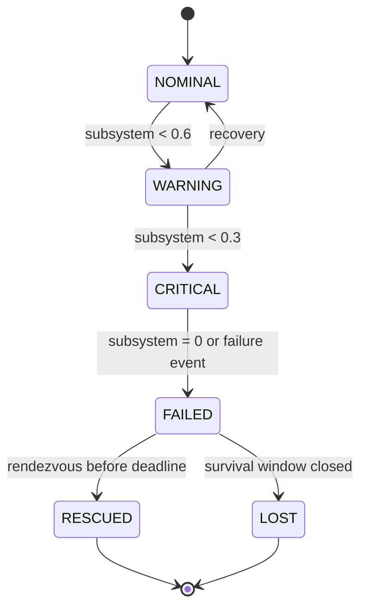
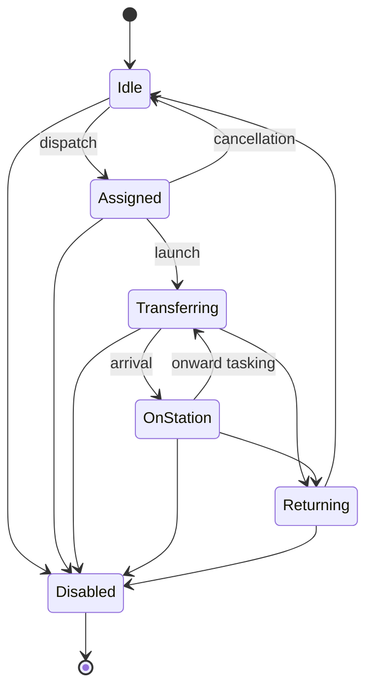
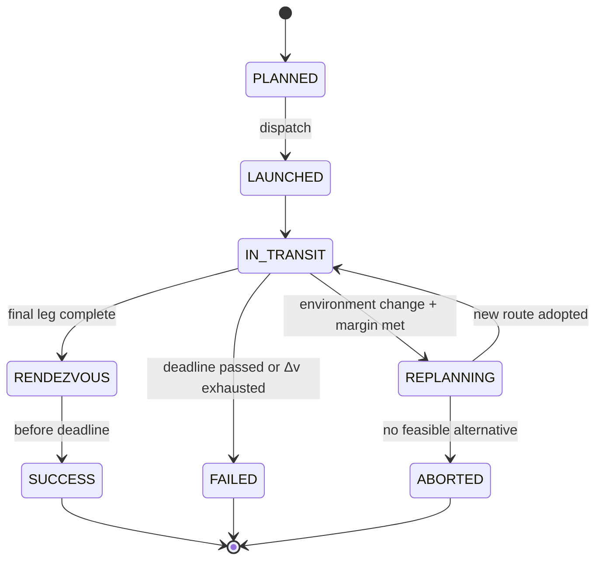
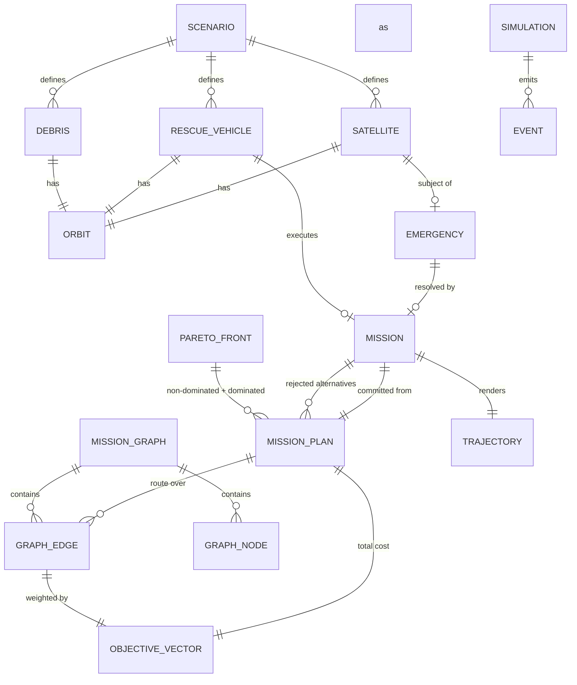

# ORCA — Data Model

Version 1.3 · updated after Phase 5 · 2026-09-03

Canonical definition of every entity in the C++ engine. `API_CONTRACT.md` defines how a
subset of these crosses the wire.

---

## 0. Conventions

### 0.1 Units — fixed project-wide

| Quantity | Unit | Notes |
|---|---|---|
| Distance, radius, altitude | **kilometres (km)** | Altitude is above mean equatorial radius `R⊕ = 6378.137 km` |
| Time | **seconds (s)** | Simulation time is seconds since scenario epoch, `t₀ = 0` |
| Angle | **radians internally**, degrees at the boundary | Conversion happens only in `io/`. Field names carry `Deg` when degrees |
| Velocity, Δv | **km/s** | |
| Fuel | **dimensionless fraction ∈ [0,1]** of the vehicle's Δv budget | **Not kilograms.** See §3.2 |
| Risk | **dimensionless ∈ [0,1]** | Simulation risk, not calibrated probability |
| Mass | *not modelled* | Deliberate omission — see `SIMULATION_MODEL.md` §8 |

**Rule:** a field name that does not state a unit uses the table above. `Deg`, `Km`, `Sec`
suffixes are used only where ambiguity is plausible.

### 0.2 Identifiers

Stable, human-readable, deterministic from seed.

| Type | Format | Example |
|---|---|---|
| Satellite | `SAT-###` | `SAT-017` |
| Rescue vehicle | `RV-##` | `RV-02` |
| Debris | `D-##` | `D-04` |
| Emergency | `E-###` | `E-003` |
| Mission | `M-###` | `M-001` |
| Graph node | `N-####` | `N-0042` |
| Event | `EV-#####` | `EV-00318` |

IDs are assigned in deterministic creation order. In C++ they are strong types
(`struct SatelliteId { std::uint32_t v; }`), not bare integers or strings, so a
`SatelliteId` can never be passed where a `MissionId` is expected. String form exists only
at the `io/` boundary.

### 0.3 Invariant notation

Invariants marked **[I]** are checked by `assert` in debug builds and by unit tests in all
builds. They are not documentation — they are testable claims.

---

## 1. Core Types

### `Vec3`
```cpp
struct Vec3 { double x, y, z; };   // km, Earth-Centred Inertial (ECI)
```
Frame: ECI, +Z along Earth's rotation axis, +X toward the scenario's reference direction at
`t₀`. Non-rotating. **[I]** components finite.

### `ObjectiveVector`
```cpp
struct ObjectiveVector {
    double time;       // s      ≥ 0
    double fuel;       // frac   ≥ 0
    double risk;       // [0,1]
    double distance;   // km     ≥ 0
};
```
The unit of currency for all optimization. **All four are minimised.** Any objective where
"more is better" must be negated or inverted at its source, never handled by a special case
in the comparison logic — this keeps `Dominance` free of per-objective knowledge.

**[I]** all components ≥ 0 · all finite · `risk ∈ [0,1]`.
Composition along a path (`⊕`): `time`, `fuel`, `distance` add; `risk` combines as
independent survival — see `SIMULATION_MODEL.md` §5.3.

### `Seed`
```cpp
using Seed = std::uint64_t;
```
Every stochastic draw derives from the scenario seed via a documented splitting scheme
(`SIMULATION_MODEL.md` §7). **No use of `std::random_device`, ever.**

---

## 2. Orbit

```cpp
struct Orbit {
    double semiMajorAxisKm;   // = radius (circular)
    double inclinationRad;    // [0, π]
    double raanRad;           // [0, 2π)  right ascension of ascending node
    double phaseRad;          // [0, 2π)  true anomaly at epoch t₀
    OrbitBand band;           // LEO | MEO | GEO  (derived, cached)
};
```

| Field | Range | Notes |
|---|---|---|
| `semiMajorAxisKm` | `> R⊕` | **[I]** must exceed 6378.137; circular ⇒ a = r |
| `inclinationRad` | `[0, π]` | 0 = equatorial prograde |
| `raanRad` | `[0, 2π)` | orbital plane orientation |
| `phaseRad` | `[0, 2π)` | angular position at epoch |

Derived (never stored as independent state — **[I]** always recomputed from `a`):

```
periodSec   T = 2π √(a³/μ)          μ = 398600.4418 km³/s²
meanMotion  ω = 2π / T              rad/s
speedKms    v = √(μ/a)
```

Bands (classification only, no behaviour): LEO `a − R⊕ < 2000`, MEO `< 35 000`, GEO otherwise.

**Simplification:** circular only. Eccentricity is not modelled. See `SIMULATION_MODEL.md` §8.

---

## 3. Domain Entities

### 3.1 `Satellite`

```cpp
struct Satellite {
    SatelliteId  id;
    std::string  name;
    Orbit        orbit;
    SatelliteStatus status;      // NOMINAL | WARNING | CRITICAL | FAILED | RESCUED | LOST
    Subsystems   health;
    double       fuelFraction;   // [0,1]
    std::optional<EmergencyId> activeEmergency;
};

struct Subsystems {              // each [0,1], 1.0 = fully healthy
    double power, propulsion, comms, thermal;
};
```

| Invariant | |
|---|---|
| **[I]** | `fuelFraction ∈ [0,1]` |
| **[I]** | every `Subsystems` component `∈ [0,1]` |
| **[I]** | `status == FAILED` ⇒ `activeEmergency.has_value()` |
| **[I]** | `status ∈ {RESCUED, LOST}` ⇒ terminal; no further transitions |



### 3.2 `RescueVehicle`

```cpp
struct RescueVehicle {
    VehicleId   id;
    std::string name;
    Orbit       orbit;
    VehicleStatus status;        // IDLE | ASSIGNED | TRANSFERRING | ON_STATION | RETURNING | DISABLED
    double      deltaVBudgetKms;      // total capability, e.g. 2.5 km/s
    double      deltaVRemainingKms;
    int         rescueCapacity;       // simultaneous casualties, typically 1
    std::optional<MissionId> activeMission;
};
```

| Invariant | |
|---|---|
| **[I]** | `0 ≤ deltaVRemainingKms ≤ deltaVBudgetKms` |
| **[I]** | `deltaVRemainingKms` is **monotonically non-increasing** (no refuelling in v1) |
| **[I]** | `status ∈ {ASSIGNED, TRANSFERRING}` ⇔ `activeMission.has_value()` |

**On the fuel unit.** The engine stores Δv in km/s — a physical quantity. Two *different*
fractions are derived from it, and Phase 1 found this section originally conflated them:

| Quantity | Definition | Meaning | Example |
|---|---|---|---|
| `RescueVehicle.fuelFraction` | `deltaVRemaining / deltaVBudget` | how full the tank is | RV-02: `2.16 / 2.5 = 0.864` |
| `ObjectiveVector.fuel` | `deltaVRequired / deltaVBudget` | what a plan **costs** | plan P-0007: `0.136` |

Both use the same denominator, so for a given vehicle they are directly comparable — that
comparison is exactly the feasibility test `canAfford()`. They match the values in
`API_CONTRACT.md` §4.2 and §4.4.

> **Correction of record.** This section previously defined `fuelFraction` as
> `1 − deltaVRemaining/deltaVBudget`, which is the *consumed* fraction and contradicts the
> `0.864` in the API contract fixture. The table above is authoritative. Pinned by the test
> `RescueVehicle.FuelFractionMatchesApiContractExample`.

Neither number is **comparable across vehicles with different budgets**: RV-02 spending
13.6% and RV-03 spending 13.6% are different quantities of Δv. This is the single easiest
number in the whole product to misread.

**Vehicle status transitions.** Phase 0 listed the vehicle states but gave no transition
diagram. Phase 1 defines one, implemented in `RescueVehicle.cpp` and tested:



Any state may fail to `Disabled`, which is terminal.

### 3.3 `Emergency`

```cpp
struct Emergency {
    EmergencyId  id;
    SatelliteId  subject;
    EmergencyKind kind;          // PROPULSION_FAILURE | POWER_FAILURE | COMMS_LOSS
                                 // | FUEL_CRITICAL | COLLISION_DAMAGE | THERMAL
    Severity     severity;       // LOW | MODERATE | HIGH | CRITICAL
    double       detectedAtSec;
    double       survivalWindowSec;
    double       deadlineSec;    // = detectedAtSec + survivalWindowSec
    double       priority;       // computed, [0,1]
    EmergencyState state;        // PENDING | ASSIGNED | IN_PROGRESS | RESOLVED | EXPIRED | UNREACHABLE
};
```

| Invariant | |
|---|---|
| **[I]** | `deadlineSec == detectedAtSec + survivalWindowSec` (never stored independently) |
| **[I]** | `survivalWindowSec > 0` |
| **[I]** | `priority ∈ [0,1]` |
| **[I]** | `state == RESOLVED` ⇒ some mission with this emergency completed with `SUCCESS` |
| **[I]** | `state == EXPIRED` ⇒ `simTime > deadlineSec` |

`priority` is **recomputed each tick** (urgency depends on remaining window), so it is
derived state, not stored input. See `OPTIMIZATION_MODEL.md` §7.

### 3.4 `DebrisObject`

```cpp
struct DebrisObject {
    DebrisId id;
    Orbit    orbit;
    double   radiusKm;        // hazard sphere, not physical size
    double   densityFactor;   // [0,1] relative hazard weight
    bool     detected;        // false → exists but unknown to the planner
};
```

`detected` is the mechanism behind dynamic replanning: undetected debris is present in the
world and affects nothing until a `DebrisAlert` event flips the flag, at which point affected
edges are re-costed. **[I]** `radiusKm > 0`, `densityFactor ∈ [0,1]`.

---

## 4. Graph

> **Implemented in Phase 3, revised from this section's original sketch.** Full design
> rationale: `GRAPH_MODEL.md`. Two corrections from the Phase 0 draft, both consequences
> of properties only established in Phase 2:

### `GraphNode`
```cpp
class GraphNode {
    NodeId id;
    std::variant<SatelliteId, VehicleId> entity;   // NOT a 3-way variant; no WaypointId
    Orbit orbit;                                   // exact for all time, not "at epoch"
};

enum class NodeKind { Satellite, RescueVehicle };  // NOT a 4-way enum
```

**Correction 1 — two node kinds, not four.** `VEHICLE_SOURCE`/`CASUALTY_SINK` collapsed
into predicates on the live entity (`RescueVehicle::isAvailable()`,
`Satellite::requiresRescue()`) rather than a stored tag — a stored tag would be a second,
staler place those facts live. `WAYPOINT` was never needed: an ordinary `Satellite` node
having outgoing edges already realises staging (`SYSTEM_DESIGN.md` §3), so no synthetic
node type was created for it (`GRAPH_MODEL.md` §2).

**Correction 2 — `orbit`, not `orbitAtEpoch`.** The field name implied a snapshot needing
refresh. It never does: `Orbit` is immutable and ORCA models no perturbations
(`SIMULATION_MODEL.md` §8), so the stored orbit is the exact generator of position at
*every* time, not a value sampled at one (`GRAPH_MODEL.md` §2.3).

### `GraphEdge`
```cpp
class GraphEdge {
    EdgeId id;
    NodeId from, to;                    // DIRECTED
    TransferResult referenceResult;     // cached sample — see below
    Seconds referenceDepartureTimeSec;  // when that sample was evaluated
};
```

**Correction 3 — no `TransferKind` tag, no separate `TransferParams`.** The Phase 0 sketch
anticipated needing a discriminator (`HOHMANN | PHASING | ...`) and a parameter bundle for
re-evaluation. Neither is needed: `TransferGeometry::isPurePlaneChange` already
distinguishes the one case that matters structurally, and re-evaluation needs nothing
beyond the two endpoint `Orbit`s already on the graph's nodes plus a departure time —
`GraphEdge` does not need to smuggle re-evaluation parameters of its own.

**The critical property, unchanged from the original design:** `referenceResult` is a
*cached sample*, not the truth. True cost is `TransferModel::evaluate(orbit(from),
orbit(to), t_depart, constraints)`, called fresh by the search
(`GRAPH_MODEL.md` §3.5). Edges are directed because `u→v` and `v→u` differ in both Δv and
feasibility.

**[I]** `from != to` · `referenceResult.objectives()` satisfies `ObjectiveVector`'s
invariants when feasible.

### `MissionGraph`
```cpp
class MissionGraph {
    std::vector<GraphNode> nodes_;
    std::vector<std::vector<EdgeId>> adjacency_;   // adjacency LIST, indexed by NodeId
    std::vector<GraphEdge> edges_;
};
```

`stats_` is **not** a `MissionGraph` member — kept in a separate `GraphBuildStats`
returned alongside the graph from `GraphBuilder::build()`, so the graph itself stays a pure
structural type with no build-process concerns baked in (single-responsibility;
`ARCHITECTURE.md` §5's "no God classes" applied one layer down).

```cpp
struct GraphBuildStats {
    int candidatePairs, feasibleEdges;
    int rejectedInvalidOrbit, rejectedDeltaVExceeded, rejectedFuelInsufficient,
        rejectedPhasingUnavailable, rejectedDistanceExceeded, rejectedRiskExceeded,
        rejectedDeadlineExceeded;   // one field per TransferFailureReason — never collapsed
    double buildTimeMs;
};
```

**Correction 4 — one field per `TransferFailureReason` (seven), not three
(`rejectedFuel`/`rejectedDeadline`/`rejectedRisk`).** `PhasingUnavailable` is its own
category, required to be so by Phase 3 §15 of the brief: it is frequently the *most
informative* rejection reason ORCA has (a near-co-altitude pair is a permanent geometric
fact, not a tunable limit — `TRANSFER_MODEL.md` §8.5), and folding it into a generic bucket
would hide exactly that finding.

**[I]** `adjacency_.size() == nodes_.size()` · every `EdgeId` in `adjacency_[u]` has
`edges_[e].from == u` · no self-loops.

Adjacency list rather than matrix: after feasibility pruning the graph is sparse
(`GraphStats` records 583 rejections vs 173 accepted edges in the reference demo), so
`O(V+E)` beats `O(V²)` in both space and iteration cost.

---

## 5. Mission and Trajectory

### `MissionPlan` — a candidate, before commitment
```cpp
struct MissionPlan {
    PlanId      id;
    VehicleId   vehicle;
    EmergencyId emergency;
    std::vector<EdgeId> route;
    ObjectiveVector totalCost;
    double      departureTimeSec, arrivalTimeSec;
    bool        feasible;
    std::optional<ConstraintViolation> bindingConstraint;
};
```
**[I]** `route` is a connected path from a vehicle source to the casualty sink ·
`totalCost == ⊕ over route` (asserted, not assumed) · `feasible == false` ⇒
`bindingConstraint.has_value()`.

### `Mission` — a committed plan
```cpp
struct Mission {
    MissionId    id;
    PlanId       sourcePlan;
    VehicleId    vehicle;
    EmergencyId  emergency;
    MissionState state;      // PLANNED | LAUNCHED | IN_TRANSIT | REPLANNING
                             // | RENDEZVOUS | SUCCESS | FAILED | ABORTED
    std::vector<EdgeId> currentRoute;
    int          currentLeg;
    double       progressOnLeg;      // [0,1]
    double       startedAtSec;
    std::optional<double> completedAtSec;
    double       deltaVSpentKms;
    int          replanCount;
    std::vector<PlanId> rejectedAlternatives;
};
```



**[I]** `progressOnLeg ∈ [0,1]` · `currentLeg < currentRoute.size()` ·
`state == SUCCESS` ⇒ `completedAtSec ≤ emergency.deadlineSec` ·
`deltaVSpentKms ≤ vehicle.deltaVBudgetKms`.

`rejectedAlternatives` exists so the UI can show *what ORCA chose against* — it is the
evidence behind the explanation, retained deliberately rather than discarded.

**Phase 7 note: `DynamicReplanner` never mutates a `Mission` itself.**
`DynamicReplanner::evaluate()` (`DYNAMIC_REPLANNING.md`) is a pure function returning a
`ReplanDecision` — it never calls `Mission::setState()` or `Mission::adoptRoute()`. Driving
the `IN_TRANSIT -> REPLANNING -> IN_TRANSIT | ABORTED` transition shown above (deciding
*when* to call the replanner, and applying its decision once returned) is the caller's
responsibility — `MissionExecutor` in a later phase. Phase 7's own tests apply decisions
manually (`mission.adoptRoute(*decision.newPlan)`) to verify the full cycle without
depending on that not-yet-built executor.

### `Trajectory` — render data, engine-produced
```cpp
struct Trajectory {
    MissionId id;
    TrajectoryState visualState;   // CANDIDATE | RECOMMENDED | ACTIVE | COMPLETED | REJECTED
    std::vector<TrajectoryPoint> polyline;   // sampled by the engine
};
struct TrajectoryPoint { double t; Vec3 position; };
```
**The engine samples the polyline.** The frontend draws the points it is given and never
integrates a transfer arc itself (`ARCHITECTURE.md` §6.1). Sample density is configurable.

---

## 6. Events

```cpp
struct Event {
    EventId   id;
    double    timeSec;
    EventKind kind;
    Severity  severity;
    EntityRef subject;
    std::string message;
    std::optional<EventPayload> payload;
};
```

| `EventKind` | Emitted when |
|---|---|
| `SimulationStart` / `SimulationEnd` | run boundaries |
| `SatelliteFailure` | subsystem reaches failure |
| `PropulsionFailure`, `CommunicationLoss`, `FuelCritical`, `ThermalAnomaly` | specific faults |
| `DebrisAlert` | debris becomes `detected` |
| `EmergencyDeclared` / `EmergencyExpired` | emergency lifecycle |
| `MissionPlanned` / `MissionStart` / `MissionReplan` | planning and dispatch |
| `Rendezvous` / `RescueComplete` / `MissionFailure` / `MissionAborted` | mission outcomes |
| `AssignmentComputed` | greedy vs optimal assignment produced |

**[I]** events are processed in non-decreasing `timeSec`. Ties break on `EventId` (creation
order), which makes ordering **total and deterministic** — essential for reproducibility.

---

## 7. Optimization Types

**Implemented in Phase 5, matching this section exactly for `OptimizationProfile` and
`ParetoFront` — `AlgorithmMetrics` below is corrected**, per-algorithm rather than unified;
see that struct's note.

```cpp
struct OptimizationProfile {
    ProfileKind kind;         // FASTEST | FUEL_SAVING | SAFETY_FIRST | BALANCED | CUSTOM
    double wTime, wFuel, wRisk, wDistance;
};
```
**[I]** all weights ≥ 0 · sum > 0 (normalised to 1 internally; an all-zero profile is rejected
at the boundary, `ARCHITECTURE.md` §11). `optimization/OptimizationProfile.hpp`.

```cpp
struct ParetoFront {
    std::vector<MissionPlan> solutions;      // mutually non-dominated
    std::vector<MissionPlan> dominated;      // retained for visualisation
    ObjectiveVector ideal, nadir;            // per-objective best/worst across the front
    bool truncated;
    int  labelsGenerated, labelsPruned;
};
```
**[I]** no member of `solutions` dominates another (property-tested) · every member of
`dominated` is dominated by at least one member of `solutions` · `ideal ≤ nadir` componentwise.
`optimization/ParetoFront.hpp`, built by `buildParetoFront()` from
`algorithms::ParetoSearchResult` — a raw, domain-agnostic result `algorithms/` produces
knowing nothing of `MissionPlan`, `VehicleId` or `EmergencyId` (`ARCHITECTURE.md`'s
dependency table; `PARETO_SEARCH.md` §5, §13 has the full reasoning for why that boundary
exists and how the conversion works).

`dominated` is kept deliberately: the Pareto chart is far more convincing when the rejected
points are visible alongside the frontier. Scoped to routes that reached the target
specifically, not every dominated label at every intermediate node
(`algorithms/ParetoSearch.hpp`'s `ParetoSearchResult::dominated`).

```cpp
struct AlgorithmMetrics {
    std::string algorithm;
    int nodesExpanded, edgesRelaxed, pqPushes, pqPops;
    int labelsGenerated, labelsPruned, labelsRetained;
    double wallTimeMs;
    bool  optimal;
};
```
**Corrected in Phase 5 (the underlying decision was already made in Phase 4, but never
recorded here): this unified struct was never built.** `Dijkstra`/`A*` populate
`SearchMetrics` (`algorithms/SearchMetrics.hpp`) and Pareto search populates
`ParetoSearchMetrics` (`algorithms/ParetoSearchMetrics.hpp`) — two distinct,
algorithm-specific structs, not one generic shape. `ParetoSearchMetrics.hpp`'s file comment
states the reasoning directly: folding single-objective-only and multi-objective-only
fields into one struct would leave half of them meaningless depending on which algorithm
populated it (e.g. `labelsGenerated` has no Dijkstra/A* analogue; `heuristicEvaluations`
has no Pareto-search analogue). Both structs are still measured, never estimated, and both
are what the future Algorithm Lab and benchmark suite report — just as two shapes, not one.

### 7.1 Assignment Types (Phase 6)

Full design in `ASSIGNMENT_MODEL.md`; the shapes only, here, for the same reference-table
purpose §7's other structs serve.

```cpp
struct CandidateFront {              // search-stage output; the only stage calling
    VehicleId vehicle;                // findParetoRoutes()
    EmergencyId emergency;
    bool feasible;
    std::optional<ConstraintKind> infeasibilityReason;  // reused enum, not a new one
    ParetoFront front;
};

struct ScoredCandidate {             // scoring-stage output, built FROM a CandidateFront,
    VehicleId vehicle;                 // never calling findParetoRoutes() itself
    EmergencyId emergency;
    bool feasible;
    std::optional<ConstraintKind> infeasibilityReason;
    std::optional<std::size_t> selectedPlanIndex;   // index, not a MissionPlan copy
    std::optional<ScoreBreakdown> breakdown;
};

struct AssignmentCostEntry {
    VehicleId vehicle;
    EmergencyId emergency;
    bool feasible;
    double cost;      // globalScore(V,E) * (2 - priority(E)); kInfeasibleAssignmentCost if !feasible
    double priority;  // the emergency's priority, carried for diagnostics
};

struct AssignmentMatrix {
    std::size_t vehicleCount, emergencyCount, dimension;  // dimension = vehicleCount + emergencyCount
    std::vector<std::vector<double>> costMatrix;          // dimension x dimension, padded
    std::vector<VehicleId> vehicleIds;
    std::vector<EmergencyId> emergencyIds;
    std::vector<std::vector<bool>> feasibleReal;           // vehicleCount x emergencyCount only
};

struct Assignment {
    VehicleId vehicle;
    EmergencyId emergency;
    PlanId plan;
    double cost;
    MissionPlan missionPlan;   // copied -- final assignments number at most min(V,E), not the
};                              // full candidate matrix (ASSIGNMENT_MODEL.md §6)

struct AssignmentResult {
    AssignmentStatus status;   // Success | PartiallyAssignable | Infeasible
    std::vector<Assignment> assignments;
    double totalCost;
    int assignedVehicleCount, assignedEmergencyCount, unassignedEmergencyCount, unusedVehicleCount;
    AssignmentMetrics metrics;
};
```

**[I]** `AssignmentMatrix.dimension == vehicleCount + emergencyCount`, never
`max(vehicleCount, emergencyCount)` — `ASSIGNMENT_MODEL.md` §7 has the correctness argument
for why the smaller padding is unsound. `feasibleReal[i][j] == false` for a pair must never
appear as a `(vehicle, emergency)` in any `AssignmentResult.assignments` — checked at
solve-time, not merely assumed (`optimization/AssignmentResult.cpp`).

`optimization/{MissionCandidate,AssignmentCost,AssignmentMatrix,AssignmentResult}.hpp`,
`optimization/EmergencyPriority.hpp` (`PriorityWeights`, `computePriority()` — a distinct,
deliberately un-mergeable weight system from `OptimizationProfile`, §7's own file comment),
`algorithms/{Hungarian,GreedyAssignment}.hpp` (`HungarianResult`, `GreedyResult` — both
domain-agnostic, knowing nothing of `VehicleId`/`EmergencyId`).

### 7.2 Dynamic Replanning Types (Phase 7)

Full design in `DYNAMIC_REPLANNING.md`; the shapes only, here.

```cpp
enum class ValidityState { Valid, Warning, Invalid, Impossible, Completed };

struct RemainingRouteEvaluation {   // one known path's real evaluation, never a search
    bool feasible;
    ObjectiveVector cost;
    Seconds arrivalTimeSec;
    std::optional<ConstraintKind> infeasibilityReason;   // set iff !feasible
};

struct MissionValidity {
    ValidityState state;
    ReplanReason reason;
    std::optional<ConstraintKind> violatedConstraint;
    std::string detail;
    RemainingRouteEvaluation remaining;
};

enum class ReplanDecisionType { Continue, Replan, Abort, Complete };
enum class AbortReason {
    None, NoFeasibleContinuation, VehicleUnavailable, TargetUnavailable,
    InsufficientFuel, DeadlineImpossible, RiskUnacceptable,
    Preempted,   // not a failure -- deliberately abandoned for a higher-priority emergency
};

struct ReplanDecision {
    ReplanDecisionType decision;
    ReplanReason reason;
    AbortReason abortReason;             // set iff decision == Abort
    MissionValidity validity;
    PlanId previousPlan;
    ObjectiveVector previousRemainingCost;
    Seconds previousArrivalSec;
    std::optional<MissionPlan> newPlan;  // set iff decision == Replan
    std::string detail;
    Seconds decidedAtSec;
};

struct ReplanPolicy {   // every field a policy decision, not a physical fact
    double switchMargin, materialFuelChangeFraction, materialRiskChangeFraction;
    double maxAcceptableRisk, warningDeltaVMarginFraction, warningDeadlineMarginFraction;
    double preemptionPriorityMargin, preemptionMaxProgressFraction;
    Seconds minimumReplanIntervalSec;
};

struct MissionChange {   // Phase 7's trigger; NOT the Phase 8 event system
    ChangeKind kind;
    Seconds atSec;
    std::optional<EdgeId> invalidatedEdge;
    std::optional<EmergencyId> newEmergency;
    std::optional<double> magnitudeFraction;   // how significant, [0,1]-ish; nullopt = always material
    std::string detail;
};

struct ReplanHistoryEntry {   // the lightweight log; DynamicReplanner accumulates these
    Seconds timestampSec;
    MissionId mission;
    ReplanReason reason;
    PlanId previousPlan;
    std::optional<PlanId> newPlan;
    ReplanDecisionType decision;
};

struct ReplanMetrics {
    int replanRequests, mandatoryReplans, optionalReplans, planSwitches, planRetentions,
        aborts, completions, candidatePlansGenerated;
    double totalReplanComputationMs;
};
```

**[I]** `evaluateMissionValidity()` never produces `ValidityState::Impossible` directly —
only `DynamicReplanner`, after an `Invalid` mission's own replan attempt finds no
alternative, elevates the decision to `Abort` (`MissionValidity.hpp`'s own scope boundary:
checking whether *any* alternative exists is a search, not a validity check). `ReplanDecision.newPlan.has_value() == (decision == ReplanDecisionType::Replan)`, checked
at every call site, never assumed.

`planning/{MissionChange,ReplanReason,ReplanPolicy,MissionValidity,ReplanDecision,
DynamicReplanner,GlobalReplanner}.hpp`.

### 7.3 Phase 8: Simulation Types

```cpp
enum class EventKind {   // Event.hpp — 14 values, the brief's own list verbatim
    SatelliteFailure, PropulsionFailure, CommunicationLoss, FuelCritical, DebrisAlert,
    EmergencyEscalation, EmergencyResolved, MissionStart, MissionReplan, Rendezvous,
    RescueStart, RescueComplete, MissionFailure, VehicleStateChange,
};

struct Event {
    EventId id;                          // sequential, never a memory address or random
    Seconds timestampSec;
    EventKind kind;
    std::optional<SatelliteId> satellite;
    std::optional<VehicleId> vehicle;
    std::optional<EmergencyId> emergency;
    std::optional<MissionId> mission;
    std::optional<DebrisId> debris;
    std::optional<EdgeId> invalidatedEdge;      // debris-invalidation mechanism
    std::optional<EmergencyKind> emergencyKind; // carried from scheduling to fire time
    std::optional<Severity> severity;
    std::optional<Seconds> survivalWindowSec;
    std::string detail;
};

struct SimulationMetrics {   // a plain tally, not analytics -- SimulationState.hpp
    long ticks, eventsProcessed, missionsUpdated, replansTriggered, replansCompleted,
        missionSuccesses, missionFailures, missionAborts;
};

struct SimulationState {   // simulation/SimulationState.hpp -- the single source of truth
    Seconds simulationTimeSec;
    std::unordered_map<std::uint32_t, Satellite>     satellites;
    std::unordered_map<std::uint32_t, RescueVehicle>  vehicles;
    std::unordered_map<std::uint32_t, DebrisObject>   debris;
    std::unordered_map<std::uint32_t, Emergency>      emergencies;
    std::unordered_map<std::uint32_t, Mission>        missions;
    std::unordered_map<std::uint32_t, MissionPlan>    missionPlans;   // one per mission
    SimulationMetrics metrics;
    std::uint32_t nextEmergencyId, nextMissionId;
    PlanId nextPlanId;
};
```

Same-timestamp events resolve by a fixed five-tier priority (`eventPriorityTier()`), never by
registration order — `SIMULATION_ENGINE.md` §6 has the full table. Full struct definitions:
`simulation/{Event,EventQueue,SimulationClock,SimulationState,EmergencyGenerator,
MissionExecutor,SimulationEngine,EventDispatcher}.hpp`.

---

## 8. Scenario and Snapshot

```cpp
struct Scenario {
    std::string name, description;
    Seed   seed;
    double durationSec, timeStepSec;
    std::vector<SatelliteSpec> satellites;
    std::vector<VehicleSpec>   vehicles;
    std::vector<DebrisSpec>    debris;
    std::vector<ScheduledFailure> scheduledFailures;   // deterministic demo events
    EnvironmentConfig environment;
};
```

Scenarios support **both** deterministic scripted failures (for the demo and for tests) and
seeded stochastic generation (for benchmarks). Both are reproducible; only the mechanism
differs.

```cpp
struct SimulationSnapshot {
    double simulationTimeSec;
    SimState runState;                  // STOPPED | RUNNING | PAUSED | COMPLETED
    double speedMultiplier;
    std::vector<SatelliteView>  satellites;
    std::vector<VehicleView>    rescueVehicles;
    std::vector<DebrisView>     debris;
    std::vector<EmergencyView>  emergencies;
    std::vector<MissionView>    missions;
    std::vector<Event>          newEvents;      // since previous snapshot
    AnalyticsSummary            analytics;
};
```

`*View` types are **flattened projections** for transport — no `std::variant`, no optionals
requiring special encoding, no pointers. The engine's internal types are richer; the view
types are what `API_CONTRACT.md` mirrors in TypeScript.

> **Status as of Phase 9: `Scenario`, `Event`, and a real snapshot/view projection all
> exist and run.** The actual `Scenario` (`domain/Scenario.hpp`) is narrower than sketched
> above: `{name, seed, config (timeStepSec/durationSec/snapshotRateHz), satellites,
> vehicles, debris}` — no `scheduledFailures` or `environment` field; scripted/random
> failures are supplied separately at run time via `EmergencyGenerator`
> (`SIMULATION_ENGINE.md` §10), not stored on the scenario itself. The actual `Event`
> (`simulation/Event.hpp`) is a flat struct keyed by a 14-value `EventKind`, carrying
> optional `satellite`/`vehicle`/`emergency`/`mission`/`debris`/`invalidatedEdge` IDs plus
> `emergencyKind`/`severity`/`survivalWindowSec` — richer than a bare notification, since it
> must carry enough for `EventDispatcher.cpp` to act on it, not merely enough to log it
> (`SIMULATION_ENGINE.md` §6). **`SimulationSnapshot` and the `*View` types were built in
> Phase 9 as `cpp/io/SimulationView.hpp` and `cpp/io/ViewProjection.cpp`, shaped differently
> from this section's Phase 0 sketch** — `INTEGRATION_ARCHITECTURE.md` §4 is the accurate
> description: no `AnalyticsSummary` (no `analytics/` module exists yet), no `runState`
> beyond `RUNNING`/`PAUSED` (matching `SimulationClock::isRunning()`'s actual two states),
> `recentEvents` (not `newEvents`) drawn from `SimulationState`'s own bounded event log
> rather than a since-last-snapshot diff, and every `MissionView` carries its route as
> `MissionLegView`s with real per-leg endpoint positions/timings, not a bare `EdgeId` list.

---

## 9. Relationship Diagram



---

## 10. Ownership and Lifetime

| Data | Owner | Lifetime |
|---|---|---|
| `Scenario` | `SimulationEngine` (owned by value, `scenario_`) | whole run, immutable after load |
| Satellites/vehicles/debris/emergencies/missions/mission plans | `SimulationState` (owned by `SimulationEngine`) | whole run |
| `MissionGraph` | `SimulationEngine` (`graph_`), built once at construction | whole run — never rebuilt; debris invalidation filters candidate routes instead (`SIMULATION_ENGINE.md` §11) |
| `ParetoFront` | transient, produced and consumed within one `CandidateGeneration`/`DynamicReplanner` call | one search call |
| `Mission` | `SimulationState` (`missions` map) | until terminal state; not archived elsewhere — a completed run's missions remain readable in `state()` until the engine itself is destroyed or `reset()` |
| `SimulationMetrics` | `SimulationState` (`metrics`) | whole run, reset on `reset()` |

> **Status as of Phase 8: this table's Owner column is now the actual, built ownership —
> corrected from the original `MissionPlanner`/`MissionExecutor`-as-owners sketch, which
> predated `SimulationState` existing at all.** `MissionExecutor.hpp`'s
> `advanceMissionProgress()` is a free function, not a class, and owns nothing; it receives
> `Mission&`/`RescueVehicle&` references into `SimulationState`'s storage and mutates through
> them. There is no `MetricsCollector` — `SimulationMetrics` is a plain struct field on
> `SimulationState` (`SIMULATION_ENGINE.md` §5).

**Memory discipline:** `Scenario`'s own static entities (satellites/vehicles/debris as
originally loaded) live in contiguous `std::vector`s (`domain/Scenario.hpp`), referred to by
strongly-typed IDs. `SimulationState`'s *dynamic* collections (everything that can be created
during a run — emergencies, missions, mission plans — plus the copies of satellites/vehicles/
debris a run actually mutates) use `std::unordered_map<uint32_t, T>` instead: those entity
types have deleted default constructors, so a growing `std::vector` risks a reallocation
invalidating a reference held mid-tick, a real hazard once entities are created dynamically
rather than only read from a fixed, load-time-only `Scenario` (`SIMULATION_ENGINE.md` §5).
`shared_ptr` is still not needed anywhere in the core. `unique_ptr` appears only for
polymorphic strategy objects (`PathSearch`, `AssignmentSolver`, `TransferModel`).
