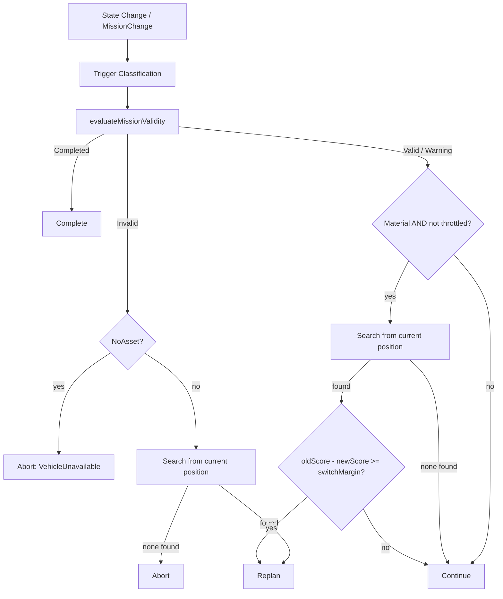

# ORCA — Dynamic Replanning

Version 1.0 · Phase 7 · 2026-09-03

How ORCA answers *"a mission was valid when it was planned; the environment changed; what
should ORCA do now?"* — by orchestrating the already-tested Phase 5/6 search and assignment
stack, never by reimplementing it.

---

## 1. Motivation

Phases 4–6 answer *"what is the best plan right now?"* — a snapshot question. A real rescue
mission is not a snapshot: fuel is spent, deadlines approach, vehicles fail, new casualties
appear. Phase 6's own final report named this directly as the major remaining limitation:
*"the assignment is produced for one planning snapshot and is not yet continuously
reconsidered as mission conditions change."* Phase 7 is that reconsideration, expressed as
one deterministic, directly-callable function rather than a running loop —
`DynamicReplanner::evaluate()` answers *"is my current plan still valid, and if not, what
should replace it?"* for one mission at a time, and `evaluateGlobalReplan()` answers the
same question for the fleet as a whole.

**Deliberately not built here**: the continuous simulation clock, the event queue, debris
detection, or anything that decides *when* to call the replanner — that is Phase 8. Phase 7
builds the decision the replanner makes once called; Phase 8 decides when to call it.

> **Status as of Phase 8: built, and calling this file's decision logic exactly as
> described.** `cpp/simulation/EventDispatcher.cpp` is the caller — `SIMULATION_ENGINE.md`
> §11 has the full trigger table. This file's core functions were extended, not replaced,
> to support it: `evaluateMissionValidity()` and its helpers
> (`MissionValidity.hpp`/`.cpp`) gained an optional `invalidatedEdge` parameter (forces a
> specific leg infeasible regardless of its physics — how a detected debris hazard reaches
> this file without `GraphBuilder`/`TransferModel` ever being touched), and
> `DynamicReplanner::evaluate()`'s search paths gained `excludeSolutionsUsingEdge()`, which
> filters a candidate front through that same edge before `selectRecommendedPlan()` runs.
> §13.7 below documents a real bug found in that filter during Phase 8 and fixed here.

## 2. Mission Validity

`MissionValidity.hpp`'s `evaluateMissionValidity()` is the question this whole file exists
to answer well: does the mission's CURRENT route, re-evaluated from where the vehicle
actually is right now, still work.

Five states, exact semantics (the brief's own prose is easy to misread at the
Warning/Invalid boundary, so each is stated precisely in `MissionValidity.hpp` itself):

| State | Meaning |
|---|---|
| `Valid` | Feasible with a comfortable margin on every constraint. |
| `Warning` | Feasible, but a margin (delta-v or time-to-deadline) has become thin. |
| `Invalid` | No longer satisfies a required constraint — replanning is mandatory. |
| `Impossible` | `Invalid`, AND no alternative was found either. Never produced by `evaluateMissionValidity()` directly — only `DynamicReplanner` can know this, since checking "does any alternative exist" is a search, not a validity check. |
| `Completed` | The emergency is already `Resolved`, or every leg has already been flown. |

**No duplicated physics.** `evaluateRemainingRouteCost()` walks the mission's *own, already
known* sequence of edges from the correct starting leg and sums each leg's real
`TransferModel::evaluate()` result — the same operation
`pareto_search_oracle_test.cpp`'s independent oracle performs to verify search results, not
a new algorithm. It never searches for alternatives.

**Which leg to start from.** A leg already in progress (`progressOnLeg() > 0`) is treated
as committed — its delta-v is already being spent and cannot be un-spent — so evaluation
starts at the *next* leg. A leg not yet begun is still fully re-plannable and is included.
`remainingLegStartIndex(currentLeg, progressOnLeg)` is the one-line rule.

## 3. Triggers

`MissionChange.hpp`'s `ChangeKind` — what was reported, not why it matters (`ReplanReason`
is the diagnosis, kept as a distinct type for the same reason `ConstraintKind` and
`EmergencyKind` are distinct: one is an event, the other a conclusion):

```
FuelChanged  VehicleUnavailable  TargetConditionChanged  RiskChanged  DebrisDetected
EmergencyAdded  EmergencyEscalated  EmergencyResolved  CommunicationLost
RouteInvalidated  DeadlineChanged  ManualReplan
```

A `MissionChange` carries an optional `magnitudeFraction` — how significant the change is,
as a caller-supplied fraction. This is what makes §12's "did this change materially affect
the mission?" answerable without a change-kind-specific field for every possible magnitude:
`FuelChanged`/`RiskChanged` compare against dedicated `ReplanPolicy` thresholds
(`materialFuelChangeFraction` / `materialRiskChangeFraction`); a change with no magnitude
attached (or `ManualReplan`) is always treated as material — a caller explicitly asking for
a replan, or reporting a kind of change too binary to have a "how much," should never be
silently ignored.

## 4. Mandatory vs. Optional Replanning

The single most load-bearing distinction in this file.

- **Mandatory** (`MissionValidity::state == Invalid`): the current route no longer works.
  `ReplanPolicy::switchMargin` is never consulted — brief §33's "hard constraints override
  switching reluctance," verified directly by
  `MandatoryReplanIgnoresSwitchMarginEvenWhenAlternativeIsOnlySlightlyBetter`. A search
  runs; if it finds nothing, the decision is `Abort`, not a fabricated `Replan`.
- **Optional** (`Valid`/`Warning`): the current route still works. A search runs only if
  the trigger is material (§3) and not throttled (§9); if it does run, the alternative must
  beat the current plan's score by at least `switchMargin` to be adopted — otherwise the
  current plan is retained.

One exception inside the mandatory path, found during Phase 7's own testing (§13): if the
violated constraint is `ConstraintKind::NoAsset` (the vehicle itself is disabled), no search
runs at all — searching for a new *route* for a vehicle that cannot fly *any* route is
meaningless. The decision is `Abort` immediately.

## 5. Local vs. Global Replanning

- **Local** (`DynamicReplanner.hpp`): is *this* mission's route still good. Operates on one
  vehicle, one emergency, from the vehicle's current position.
- **Global** (`GlobalReplanner.hpp`): should the fleet's entire idle-vehicle-to-pending-
  emergency assignment be reconsidered. Calls Phase 6's real pipeline —
  `generateAllCandidateFronts()` → `scoreCandidates()` → `buildAssignmentCosts()` →
  `buildAssignmentMatrix()` → `solveAssignmentHungarian()` — unmodified, over
  **available (idle) vehicles and pending emergencies only**.

**Why global replanning never touches an active mission directly.** `Mission::emergency()`
has no setter (`Mission.hpp`'s own API) — Phase 6's assignment machinery has no way to
"retarget" an in-flight mission to a different emergency even if asked to. A vehicle
already flying a mission is simply not in the `availableVehicles` list a global replan is
given; whether that mission should be interrupted at all is §7's separate question.

## 6. Mission Progress

Phase 1 made orbital position time-derived and deliberately kept it that way
(`RescueVehicle::positionAtKm()`'s own doc comment: "while transferring, its true position
lies along the mission trajectory rather than on this orbit"). Phase 7 preserves this: no
new stored positional state was introduced. Instead, §2's leg-index rule determines *which
graph node* replanning starts from, and every remaining-route evaluation begins there, not
at the mission's original launch node — verified directly by
`MissionProgressChangesTheReplanningStartPoint`, which shows a mission 50% through its
first leg evaluates a strictly cheaper remaining cost than the same mission freshly
launched, because one leg's cost has already dropped out of what remains.

**Exact position along an in-progress leg is not modelled.** The leg-progress rule is a
binary "not started / already committed" distinction, not a continuous interpolation along
the transfer trajectory — see §13.

## 7. Preemption

`DynamicReplanner::evaluatePreemption()` — Phase 7 brief §23 — is a pure policy decision,
independent of the graph or transfer model entirely: given a mission's progress and the
priority gap to a candidate emergency, should this mission be abandoned.

```
tooFarAlong        = missionProgressFraction >= preemptionMaxProgressFraction (default 0.85)
priorityGapEnough   = (candidatePriority - currentPriority) >= preemptionPriorityMargin (default 0.15)

preempt  iff  !tooFarAlong  AND  priorityGapEnough
```

Progress is a hard cutoff, not a margin — an almost-finished rescue is never
second-guessed by a policy tuning mistake, matching the brief's own "low-priority emergency
should not interrupt an almost-complete critical rescue."

**Preemption never retargets — it aborts.** Since `Mission::emergency()` is immutable
post-construction (§5), "preempt" here means "abort this mission, freeing its vehicle."
Dispatching that freed vehicle to the new emergency is a *subsequent*
`evaluateGlobalReplan()` call, not part of `evaluatePreemption()` itself
(`PreemptionDoesNotRetargetTheMission` tests this structurally: the resulting
`ReplanDecision` never carries a `newPlan`). `AbortReason::Preempted` is kept distinct from
the failure-driven abort reasons (`InsufficientFuel`, `DeadlineImpossible`, ...) so a
caller/UI can tell "this rescue could not continue" apart from "this rescue was
intentionally superseded" — both end the mission the same way
(`MissionState::Aborted`) but mean very different things.

## 8. Switching Cost

Phase 7 brief §24 asks for a conceptual switching cost — already-spent transfer effort,
progress loss, operational disruption — distinct from physical transfer cost. **This is
represented implicitly, not as a separate numeric penalty added to the score comparison.**
Two mechanisms already produce the intended effect without inventing a second cost
currency: (1) `switchMargin` (§4) requires a *material* improvement before switching at
all, which is precisely what a switching-cost term would otherwise be needed to outweigh;
(2) mission progress is preserved exactly (§6) — a switch never discards already-completed
legs, so "already-spent transfer effort" is never lost to begin with, it simply isn't
re-litigated. A caller wanting an explicit numeric switching-cost term (e.g., to feed a
future UI's "this switch cost X to make") can compute one from `ReplanDecision`'s
`previousRemainingCost` vs `newPlan->totalCost()` directly — the data is there — but no such
term is subtracted from the score internally. Stated here as a scope decision, not
an oversight.

## 9. Hysteresis

Two independent mechanisms prevent oscillation (brief §41):

1. **`switchMargin`** (§4, §8): an optional switch must be a *material* improvement, not
   merely a better score by any nonzero amount.
2. **`minimumReplanIntervalSec`** (`ReplanPolicy`, default `0.0` — disabled): throttles how
   often the SAME mission's OPTIONAL path may switch, regardless of trigger frequency.
   Mandatory replanning is never throttled — an infeasible mission is never left to run
   into a wall because the clock said "not yet."

`DoesNotOscillateBetweenTwoNearEqualPlans` verifies the practical case directly: a mission
that switches to a better plan, then immediately faces the identical trigger again, does
not switch back — because having just adopted the better plan, comparing it against itself
finds no material improvement in either direction.

## 10. Decision Flow



## 11. Termination

`evaluate()` is a plain function call with no loop and no recursion by construction — it
terminates trivially. The one termination hazard actually found during implementation was
inside `evaluateRemainingRouteCost()`'s infeasibility diagnosis, which originally called
itself indirectly through the public entry point and recursed until the stack overflowed
(§13.1 has the full account). The fix separates the pure route-walk from the diagnosis
layer so the diagnosis's own relaxed-constraint probes can never re-trigger diagnosis.

## 12. Metrics

`ReplanMetrics` (Phase 7 brief §28, verbatim): `replanRequests`, `mandatoryReplans`,
`optionalReplans`, `planSwitches`, `planRetentions`, `aborts`, `completions`,
`totalReplanComputationMs` / `averageReplanComputationMs()`, `candidatePlansGenerated`.
Accumulated on the `DynamicReplanner` instance across calls; `MetricsAndHistoryAccumulateAcrossCalls`
verifies both the metrics and the parallel `ReplanHistoryEntry` log grow correctly.
`ReplanHistoryEntry` is deliberately small (timestamp, mission, reason, previous/new plan
id, decision) — an in-memory index, not a database (brief §27 explicitly: "an in-memory
vector is enough for now").

## 13. Limitations

**13.1 The delta-v-budget-vs-risk-model interaction — a real cross-phase bug found and
fixed while building this phase.** `TransferRiskModel.cpp`'s risk formula deliberately
keeps a vehicle's TOTAL delta-v budget and its currently-REMAINING delta-v as two separate
inputs (`TransferRiskInputs::deltaVBudgetKms` vs `.deltaVRemainingKms`) — burning 95% of a
tank that started at 5.0 km/s is treated very differently from burning 95% of a tank that
started at 0.16 km/s, correctly. Phase 6's `CandidateGeneration.cpp` collapses this
distinction (`SearchConstraints` has only one delta-v field), which was invisible in Phase
6 because it only ever plans FRESH vehicles, where remaining equals total. Phase 7 is the
first code to evaluate a genuinely partially-spent vehicle, and an early version of
`MissionValidity.cpp` copied Phase 6's collapsed convention directly — making a routine,
low-risk transfer for a partially-spent vehicle score as artificially dangerous, because
the risk model was fed a shrunken "remaining-as-budget" denominator. Fixed in
`MissionValidity.cpp`'s own `TransferConstraints` construction (which builds constraints
directly, not through `SearchConstraints`) by keeping `deltaVBudgetKms` as the vehicle's
TRUE total and only `maxDeltaVKms` as what remains. **`DynamicReplanner.cpp`'s search path
(`generateReplanFront()`, which goes through `SearchConstraints` to reach
`findParetoRoutes()`) still inherits Phase 6's original collapsed convention** — fixing
that would mean adding a second delta-v field to `SearchConstraints` and updating every
consumer (Dijkstra, A*, Pareto search), which is Phase 4-6 territory Phase 7's brief
explicitly scopes out ("must not duplicate ... transfer calculations"). Stated here as a
known, real limitation rather than silently carried over: a NEW candidate route generated
during replanning for a heavily-spent vehicle may show a slightly inflated risk score
relative to what `MissionValidity.cpp`'s own (corrected) validity check would report for
the SAME route. The gap is bounded and one-directional (risk only ever reads as WORSE than
reality under this limitation, never better), so no infeasible plan is ever accepted as a
result of it — but the exact risk number in that specific case should not be over-trusted.

**13.2 Exact mid-leg position is not modelled** (§6) — only "not started" vs "already
committed" per leg, not a continuous point along the transfer trajectory. **Still true after
Phase 8**: `MissionExecutor.hpp` (`SIMULATION_ENGINE.md` §8) tracks `progressOnLeg()` as a
time fraction within the current leg, which answers "how far along," but nothing derives an
actual ECI position from it — `positionAtKm()` remains defined only for an entity's
*orbital* position, not a vehicle's position while mid-transfer. Genuinely deferred further,
not resolved by Phase 8.

**13.3 The `Unreachable` diagnosis is an honest simplification**, inherited directly from
`CandidateGeneration.cpp`'s own documented limitation: relaxing deadline alone and delta-v
alone are checked, but relaxing *both together* is not — a route reported `Unreachable`
might still be reachable under some combination neither single relaxation captures.

**13.4 No switching-cost number is computed** (§8) — represented implicitly via
`switchMargin` and progress preservation, not as an explicit penalty term.

**13.5 Global replanning is scoped to idle vehicles only** (§5) — an active mission's
vehicle only becomes available for a global replan after a SEPARATE preemption decision
frees it; nothing jointly optimises "should I preempt AND what should the freed vehicle do"
in one pass.

**13.6 Two more findings from adversarial self-review, both fixed.**
`evaluateGlobalReplan()` originally trusted its `availableVehicles` argument outright — a
caller accidentally passing an already-committed vehicle (one still flying an active
mission) would have it silently double-booked onto a second, unrelated emergency, since
Phase 6's assignment machinery has no concept of "already committed" at all. Fixed with an
explicit `requireThat(vehicle.isAvailable(), ...)` check over every vehicle offered
(`GlobalReplanner.cpp`), with a regression test
(`RejectsAVehicleThatIsAlreadyCommittedToAnActiveMission`). Separately, `evaluate()`'s
trigger-to-reason mapping (`reasonForChangeKind()`) originally mapped `EmergencyAdded`/
`EmergencyEscalated` to `ReplanReason::NewHigherPriorityEmergency` — misleading, since
`evaluate()`'s local optional path only ever searches for a better route to THIS mission's
OWN emergency and structurally cannot reconsider a different one; that question belongs
entirely to `evaluatePreemption()` (§7). A caller relying on the old mapping could have
concluded `evaluate()` handles cross-emergency preemption when it does not. Remapped to
`ReplanReason::EnvironmentChanged`, with the reasoning recorded directly in
`DynamicReplanner.cpp` next to the mapping.

**13.7 Dominated-solution-pool fallback gap — found and fixed during Phase 8.** When
`excludeSolutionsUsingEdge()` (added to support debris invalidation, see the status note in
§1) filters a candidate front's `solutions` down to nothing — every non-dominated route used
the excluded edge — the original implementation simply returned that empty set, which meant
`selectRecommendedPlan()` had nothing to choose and the mission aborted, even when a
perfectly feasible, merely *dominated* alternative route existed in the same front's
`dominated` set (retained only for visualization by Phase 5/6's original design, never
previously read as a fallback pool). Found via `SIMULATION_ENGINE.md`'s end-to-end demo
scenario (§16 there): a topology with two genuine alternative routes still produced an abort
because the second route was Pareto-dominated by the first. Fixed by extending
`excludeSolutionsUsingEdge()`: if filtering `solutions` leaves it empty, the same edge filter
is applied to `dominated`, and any survivors are promoted into the result with `ideal`/
`nadir` recomputed over them. This is not fabricating a solution — every dominated route was
already independently confirmed feasible by the same Pareto search that produced the
original front; it was excluded from `solutions` for being non-optimal, not for being
infeasible.

## 14. Future Improvements

- A real switching-cost term, if a future phase's UI wants to show it explicitly rather
  than have it implicit in `switchMargin`.
- Extending `SearchConstraints` with a genuine remaining-vs-total delta-v distinction,
  closing §13.1's gap at the search layer too (a Phase 4-6-touching change, deliberately
  deferred).
- Continuous mid-leg position interpolation. Phase 8's simulation clock exists now, but this
  remains unbuilt (§13.2) — a future phase deriving an actual ECI position from
  `progressOnLeg()` and the leg's endpoints.
- Joint preemption + global reassignment in one optimisation pass, if empirical use shows
  the two-step (preempt, then separately reassign) sequence produces materially worse
  outcomes than a joint one would.
