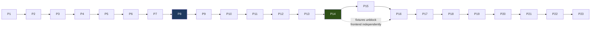

# ORCA — Implementation Roadmap

Version 1.3 · updated after Phase 3 · 2026-09-02

---

## 0. Status

> **Two numbering schemes are in play, and they are not 1:1.** "Phase 0/1/2/3…" in
> conversation and in most other docs refers to *implementation sessions*. "P1…P23" below
> is this roadmap's finer-grained sequencing *within* that work. The mapping so far:
> session Phase 1 → P2–P4, session Phase 2 → P5, session Phase 3 → **P6 and half of P7**
> (Dijkstra only — A* remains). They are written side by side in the table below so this
> does not have to be re-derived next session.

| Phase | State | Notes |
|---|---|---|
| **P1** Toolchain and build | ⚠️ **Partial** | CMake still absent, so `CMakeLists.txt` is **written but never configured**. Working around it: `scripts/build_engine.sh` and `scripts/run_tests.sh` compile the same sources with the same flags directly. `git init` not performed. |
| **P2** Core types and RNG | ✅ **Done** | Strong IDs, constants, units, vectors, angular maths, deterministic RNG with portable transforms and stream splitting. |
| **P3** Domain entities | ✅ **Done** | Satellite, RescueVehicle, Emergency, DebrisObject, Mission, MissionPlan, Scenario — with state machines and invariants enforced at construction. |
| **P4** Orbital propagation | ✅ **Done** | `SimplifiedOrbitalModel` + `Orbit`. Validated against textbook values and the sidereal day. |
| **P5** Transfer model | ✅ **Done** | Hohmann + combined plane change, wait-based phasing, risk, feasibility. **FIFO established by proof and 143 991 verified comparisons.** The Phase 0 phase-penalty model was found to violate FIFO and was replaced — see `TRANSFER_MODEL.md` §8.3. |
| **P6** Mission graph | ✅ **Done** | `MissionGraph` (adjacency list, dense IDs), `GraphBuilder` (scenario-wide, vehicle-agnostic, the three-way Group 1/2/3 feasibility split — `GRAPH_MODEL.md` §3), `GraphBuildStats` (one field per `TransferFailureReason`, `PhasingUnavailable` never collapsed). |
| **P7a** Dijkstra | ✅ **Done** | Earliest-arrival, evaluated at each node's actual arrival time (not global start — `GRAPH_MODEL.md` §6.1). Verified against an independent brute-force oracle on graphs containing real cycles. Cumulative-budget non-enforcement is a **found, tested, documented** limitation, not a gap (§6.3). |
| **P7b** A* (session Phase 4) | ✅ **Done** | Admissible heuristic from Hohmann/plane-change lower bounds, independently derived and verified. `HEURISTIC_DESIGN.md`. |
| **P8** Pareto search (session Phase 5) | ✅ **Done** | Martins' multi-objective label-setting, fixes the cumulative-Δv limitation P7a documented. `PARETO_SEARCH.md`. |
| **P9** Optimization and profiles (session Phase 5) | ✅ **Done** | `ObjectiveNormalizer`, `OptimizationProfile`, `MissionScorer`, `ParetoFront`. `OPTIMIZATION_MODEL.md`. |
| **P10** Assignment (session Phase 6) | ✅ **Done** | Hungarian (from scratch, `O(n^3)`) + greedy baseline, global cost normalisation (corrected a real Phase-0 doc error — `OPTIMIZATION_MODEL.md` §8.1), `(N+M)x(N+M)` padded matrix. `ASSIGNMENT_MODEL.md`. |
| **P12** Planning and dynamic replanning (session Phase 7) | ✅ **Done, ahead of P11** | `DynamicReplanner`/`GlobalReplanner`/`MissionValidity` — see this table's own §3 entry for the scope corrections against the original P12 plan. `DYNAMIC_REPLANNING.md`. |
| **P11** Simulation engine | ⬜ Next | Now the first CALLER of the already-built `DynamicReplanner`, per the corrected §3 entry. |
| P13 onward | ⬜ Not started | |

**Verification:** 531 tests, all passing, built and run with `-Werror` under
`-Wall -Wextra -Wpedantic -Wshadow -Wconversion -Wsign-conversion -Wold-style-cast`.

**P1 exit criterion is not met** (CMake cannot configure). It has not blocked P2–P12,
because the direct-compile scripts cover build and test; it *will* block CI, coverage
tooling and GoogleTest adoption. Install CMake before those matter.

---

## 1. Sequencing Principle

**The entire computational engine is built and verified before any frontend work begins.**

Three reasons:

1. **The engine is the project.** If time runs out, an engine with no UI is a complete DSA
   project. A UI with a half-built engine is nothing.
2. **The UI cannot be designed against imagined data.** Building the frontend against real
   engine output avoids a redesign when the data turns out different from the guess.
3. **The visualisation is the most visible and least essential part.** Time spent on Earth
   shading is time not spent on label-setting correctness. Sequencing protects against that
   temptation structurally rather than through willpower.

Each phase has an **exit criterion**. A phase is not done when the code is written; it is done
when the criterion is demonstrably met.

---

## 2. Phase Overview

```mermaid
gantt
    title ORCA Implementation Sequence
    dateFormat X
    axisFormat %s

    section Setup
    P1  Toolchain + build      :p1, 0, 1
    section Engine core
    P2  Core types + RNG       :p2, after p1, 1
    P3  Domain entities        :p3, after p2, 1
    P4  Orbital propagation    :p4, after p3, 1
    P5  Transfer model         :p5, after p4, 1
    P6  Graph                  :p6, after p5, 1
    section Algorithms
    P7  Dijkstra + A*          :p7, after p6, 1
    P8  Pareto label-setting   :p8, after p7, 1
    P9  Optimization + profiles:p9, after p8, 1
    P10 Assignment             :p10, after p9, 1
    section Simulation
    P11 Simulation engine      :p11, after p10, 1
    P12 Planning + replanning  :p12, after p11, 1
    P13 Analytics + benchmarks :p13, after p12, 1
    P14 IO + serve mode        :p14, after p13, 1
    section Application
    P15 Node bridge            :p15, after p14, 1
    P16 Frontend shell         :p16, after p15, 1
    P17 Orbital visualisation  :p17, after p16, 1
    P18 Mission Control        :p18, after p17, 1
    P19 Optimization Lab       :p19, after p18, 1
    P20 Network + Algorithm Lab:p20, after p19, 1
    P21 Analytics + remaining  :p21, after p20, 1
    section Research
    P22 Benchmark campaign     :p22, after p21, 1
    P23 Polish + presentation  :p23, after p22, 1
```



**MVP boundary: end of Phase 14.** At that point ORCA is a complete, tested, benchmarkable
command-line mission planner. Everything after is interface.

---

## 3. Phases

### P1 — Toolchain and Build

**The only hard blocker on the critical path.**

- Install CMake (audit §3.2). Optionally Ninja.
- `CMakeLists.txt`: C++20, `-Wall -Wextra -Werror`, Debug/Release.
- `orca_core` static library + `orca_engine` executable + `orca_tests`.
- GoogleTest via `FetchContent`, pinned tag.
- `git init`, `.gitignore`.
- `scripts/build.sh`, `scripts/test.sh`.

**Exit:** `cmake --build build && ctest` runs green with one trivial test.

---

### P2 — Core Types and RNG

- `core/Types.hpp` — strong ID types, `Vec3`, `ObjectiveVector`, enums as `enum class`.
- `core/Constants.hpp` — `μ`, `R⊕`, `π` only. Nothing else is a compiled constant.
- `core/Math.hpp` — angle wrapping, clamping, safe comparison, epsilon.
- `core/RandomGenerator` — `mt19937_64` + stream splitting + **own** uniform/normal transforms.

**Exit:** RNG determinism test passes; `NoStdDistributionUsed` and `NoRandomDevice` pass.

> Writing our own distribution transforms in P2 rather than discovering the
> implementation-defined problem in P13 is the single highest-leverage ordering decision in
> the roadmap (`SIMULATION_MODEL.md` §7.3).

---

### P3 — Domain Entities

`Satellite`, `RescueVehicle`, `Emergency`, `DebrisObject`, `Orbit`, `Mission`, `MissionPlan`,
`Scenario` — with every **[I]** invariant from `DATA_MODEL.md` as a debug assert plus a test.
Entities in contiguous `std::vector`s addressed by index IDs.

**Exit:** invariant tests pass; state machines reject invalid transitions.

---

### P4 — Orbital Propagation

`OrbitalPropagator` behind an interface (the seam for SGP4 later).

**Exit:** all of `TEST_PLAN.md` §3.1 — period at 500 km = 94.62 min, `v` = 7.6126 km/s,
`NoDriftOverLongRun` over 100 000 steps.

---

### P5 — Transfer Model

`TransferModel` interface (the seam for Lambert later). Hohmann, plane change, combined
manoeuvre, phasing penalty, wait model.

**Exit:** `TEST_PLAN.md` §3.2 — Δv LEO→GEO = 3.8926 km/s, plane change 1° = 0.1329 km/s,
`InclinationDominatesAltitude`, `CombinedCheaperThanSeparate`, and **`FifoPropertyHoldsForAllEdges`**.

> FIFO must be established **here**, before any search exists. Discovering a FIFO violation in
> P7 would invalidate work already built on top of it.

---

### P6 — Graph ✅ Done

`GraphNode`, `GraphEdge`, `MissionGraph`, `GraphBuilder`, `GraphBuildStats` — one field per
`TransferFailureReason`, `PhasingUnavailable` never collapsed into a generic bucket.

**Exit, as revised (`GRAPH_MODEL.md` full rationale):** the originally-planned
`BuildIsDeterministic` test was dropped — graph construction is a pure function of
`(Scenario, TransferModel, Options)` with no randomness of its own, so re-testing
determinism here would test Phase 1/2's RNG determinism a second time under a different
name. What replaced it, and was verified against the real implementation before being
trusted: `PhasingUnavailableIsItsOwnCategoryNeverGenericInfeasible`,
`RejectionAccountingIsExhaustive`, `CapabilityAndDeadlineAreNeverRejectedAtBuildTime`,
`EdgeSetIsInvariantToReferenceTime`. 34 tests total across structure and builder.

---

### P7a — Dijkstra ✅ Done

**Exit — met, with one deliberate scope decision recorded rather than silently taken:**
no shared `PathSearch` interface with A* yet. Introducing an abstract interface for one
concrete algorithm, before a second exists to reveal what they actually need to share,
would be exactly the premature abstraction the project's own coding standard warns against.
The interface question is deferred to P7b, when A*'s real shape is known.

Verified: `MatchesBruteForceOnRandomGraphs` (renamed
`DijkstraOracle.AgreesWithBruteForceOnDirectedGraphWithACycle` — extended to include a real
cycle, since ORCA's directed graph permits one and the original plan's phrasing left that
untested); the mandated "critical rule" test
(`TimeDependence.IndirectLegUsesArrivalTimeAtIntermediateNodeNotGlobalStart`); the
documented cumulative-budget limitation, pinned as a passing (not merely absent) test.
49 tests total across three files.

**Found during implementation, not anticipated by the original plan:** single-label
Dijkstra cannot soundly enforce a cumulative path-wide delta-v budget — only a per-edge
one. `GRAPH_MODEL.md` §6.3 has the full argument; it is why P8's label-setting, not a
patch here, is the correct place for that constraint.

---

### P7b — A* ⬜ Next

`AlgorithmMetrics` shared with P7a (already `SearchMetrics`, in place). Heuristics per
`ALGORITHMS.md` §4.3.

**Exit:** **`OptimalCostEqualsDijkstra`**; `HeuristicIsAdmissible` on every fixture node;
**`ExpandsNoMoreThanDijkstra`**.

> If the last one fails, A* is dead weight — record that finding rather than keeping it for
> appearances. (This caveat proved itself worth keeping: P5's phasing-model replacement and
> P7a's cumulative-budget finding both came from taking exactly this kind of "if it fails,
> say so" instruction literally.)
>
> Now that P7a exists as a concrete sibling, decide here — not before — whether a shared
> `PathSearch` interface earns its place, based on how much A* and Dijkstra's
> implementations actually turn out to share.

---

### P8 — Pareto Label-Setting

`Dominance` **first**, fully property-tested, then `ParetoSearch`. Label pool, lazy deletion,
ε-dominance, label cap, `truncated` flag.

**Exit:** dominance properties over 10 000 triples; **`MatchesBruteForceOnSmallGraphs`**
(`V ≤ 7`, exact set equality); `FrontIsMutuallyNonDominated`;
`PrunedPlusRetainedEqualsGenerated`.

> `MatchesBruteForceOnSmallGraphs` is the single most valuable test in ORCA. Do not proceed
> past P8 until it is green.

---

### P9 — Optimization and Profiles

`ParetoFront` (retaining dominated members), `ObjectiveNormalizer`, `OptimizationProfile` from
`configs/profiles.json`, `MissionScorer`, total tie-breaking.

**Exit:** the `OPTIMIZATION_MODEL.md` §12 worked example reproduces exactly — three profiles,
one front, three different winners; `TieBreakingIsStable`.

---

### P10 — Assignment

`AssignmentSolver` interface; greedy and Hungarian behind it; cost matrix; regret.

**Exit:** `HungarianMatchesBruteForce` (`n ≤ 8`, all `n!`);
`GreedyIsSuboptimalOnCounterexample` (109 vs 23); `GreedyNeverBetterThanHungarian` over 1000
random matrices.

---

### P11 — Simulation Engine — **completed as Phase 8**

Clock, event queue, emergency generator, mission executor, `SimulationEngine` orchestration in
the fixed order of `SYSTEM_DESIGN.md` §8.

**Corrected after Phase 7: this phase ran AFTER dynamic replanning, not before it, exactly as
predicted below.** Dynamic replanning was built as a directly-callable, deterministic
function with no dependency on a running simulation clock or event queue at all
(`DYNAMIC_REPLANNING.md` §1), so nothing blocked building it first. Phase 8's job was to
become the FIRST caller of the already-built, already-tested `DynamicReplanner` — deciding
*when* to invoke it (a clock tick, a detected environment change), never rebuilding its
decision logic. Full report: `SIMULATION_ENGINE.md`.

**Exit, corrected against what was actually built** (`TEST_PLAN.md`'s post-Phase-8 note to
§5-6 has the full accounting): `SameSeedIdenticalRun` → built as
`SimulationEngine.SameSeedAndScriptProduceIdenticalOutcomes`;
`SpeedMultiplierDoesNotAffectResult` → holds structurally (`SimulationClock` never reads its
own `speedMultiplier()`), not as a standalone named test; `StepwiseEqualsContinuous` → built
as `SimulationEngine.LargeAdvanceProcessesEveryEventNoneSkipped`; `SeedSplittingIsIndependent`
→ not built as a standalone test, though `RandomStream`'s per-subsystem derivation
(`RandomGenerator::forStream()`, Phase 1) is the mechanism that would make it true. 56 new
tests total: `simulation_clock_test.cpp` (16), `event_queue_test.cpp` (10),
`simulation_state_test.cpp` (7), `emergency_generator_test.cpp` (6),
`mission_executor_test.cpp` (5), `simulation_engine_test.cpp` (7),
`end_to_end_demo_test.cpp` (1), plus 4 `MissionValidity` extension tests for the
`invalidatedEdge`/`legArrivalTimesOut` parameters added to support this phase. Full
regression: 532 (Phase 7 baseline) + 56 = **588 passed, 0 failed.**

**Three real bugs found and fixed during this phase** (`SIMULATION_ENGINE.md` §14-15 has the
full account): a dominated-solution-pool fallback gap in
`DynamicReplanner::excludeSolutionsUsingEdge()` (excluding a debris-threatened edge could
leave zero non-dominated alternatives even when a physically feasible, merely-dominated
alternative existed); a `MissionExecutor` idempotence gap allowing a mission's final leg to
have its delta-v double-consumed if `advanceMissionProgress()` was called again before the
caller transitioned the mission out of `InTransit` (exactly the sequence
`SimulationEngine::tick()` itself produces via its one-tick `Rendezvous` lag); and — found by
this phase's own adversarial self-review, not by a test failure — `Mission.hpp`'s documented
`InTransit → Replanning → InTransit` state transition was declared in the state table but
never actually entered by any caller until this phase's `EventDispatcher.cpp` was corrected
to walk through it.

---

### P12 — Planning and Dynamic Replanning — **completed as Phase 7, ahead of P11**

**Corrected: built as `planning/{MissionValidity,DynamicReplanner,GlobalReplanner,
ReplanDecision}.{hpp,cpp}` — not the four classes this entry originally named.**
`FeasibilityEvaluator`'s role is `optimization/CandidateGeneration.hpp` (Phase 6);
`MissionPlanner`'s role is the same file plus `MissionScorer.hpp` (Phase 5); there is no
separate `RescueCoordinator` (its role split between `DynamicReplanner`'s local question
and `GlobalReplanner`'s fleet-wide one, `DYNAMIC_REPLANNING.md` §5); `MissionExplanation`
is `ReplanDecision.hpp`'s `explain()`. **No incremental edge patching was built** —
`ALGORITHMS.md` §11.2 has the full correction: that describes Phase 8's not-yet-built event
engine, not this phase, and `MissionGraph` has no `patchEdges()` method. Full report:
`DYNAMIC_REPLANNING.md`.

**Exit:** `EndToEndSingleRescue` (covered by `dynamic_replanner_test.cpp`'s scenarios A-J);
`DynamicReplanScenario` (covered); ~~`IncrementalPatchEqualsFullRebuild`~~ (not applicable
— no incremental patch exists to verify against a full rebuild; full re-search runs every
time, `ALGORITHMS.md` §11.3); `ReplanHysteresisPreventsOscillation`
(`DoesNotOscillateBetweenTwoNearEqualPlans`); `NoFeasiblePlanScenario` returning a named
binding constraint (`ScenarioC_NoFeasibleAlternative_Abort`).

---

### P13 — Analytics and Benchmarks

`MetricsCollector`, `BenchmarkRunner`, `ExperimentRunner`, CSV/JSON export with full
environment and protocol metadata.

**Exit:** `orca_engine bench --tier smoke` produces a real CSV; performance thresholds
(`TEST_PLAN.md` §10) pass.

---

### P14 — IO and Serve Mode — **completed as part of Phase 9, narrower than sketched**

NDJSON codec, `ScenarioLoader` with schema validation and field-path errors, `ResultExporter`,
CLI dispatch, `--serve` loop, structured `stderr` logging.

**Corrected: no `ScenarioLoader` or `ResultExporter` was built.** `--serve` (`cpp/app/
main.cpp`) always runs one fixed canonical demo scenario (`cpp/simulation/DemoScenario.hpp`)
rather than loading `scenarios/demo.json` by path — no scenario-file format or loader exists
anywhere in the repository, so `{"cmd":"init","scenarioPath":...}` is not a recognized
command (`INTEGRATION_ARCHITECTURE.md` §9.5). What WAS built, real and tested: the NDJSON
codec (`cpp/io/JsonValue.{hpp,cpp}` writer, `cpp/io/JsonParser.{hpp,cpp}` reader,
`cpp/io/CommandProtocol.{hpp,cpp}` for the nine lifecycle commands `SimulationEngine`
actually supports), the `--serve` loop itself, and stdout-is-protocol/stderr-is-logs
discipline. No `stderr` logging exists yet because nothing in this phase's code path
produces any diagnostic output to route there.

**Exit, corrected:**
```bash
printf '{"cmd":"start"}\n{"cmd":"advance","seconds":30}\n' | ./orca_engine --serve
```
emits valid NDJSON — verified directly (`INTEGRATION_ARCHITECTURE.md`'s development
process), not via a golden-file test (none was built; `tests/io/view_projection_test.cpp`
serves the equivalent verification role by asserting known/cross-checked snapshot values).
No `cpp-no-node` CI job exists (no CI is configured for this project at all, per
`REPOSITORY_AUDIT.md`) — the property it protects (the engine builds and passes tests with
no Node installed) is true by construction, since `cpp/CMakeLists.txt`/`scripts/
build_engine.sh` never reference anything in `backend/`.

---

### P15 — Node Bridge — **completed as Phase 9, narrower than sketched**

`EngineSupervisor` (spawn, health, capped restart with backoff), NDJSON codec, snapshot
coalescer, event buffer, `reqId` correlation, Express REST, `ws` server, `ENGINE_MODE=replay`
for fixture playback.

**Corrected: built as `backend/src/engine/EngineProcess.ts`** (spawn, health via
`getStatus()`, `reqId` correlation, `stderrTail` — not a class named `EngineSupervisor`,
and no capped-restart-with-backoff policy: a crashed engine surfaces as `status: 'CRASHED'`
and every pending request rejects immediately, but nothing automatically respawns it yet).
**No `ws` server, no snapshot coalescer, no event buffer, no replay mode** — Phase 9's own
brief was explicit that REST-polling is the right starting point, not a WebSocket push
channel (`ARCHITECTURE.md` §4.1's correction). `api/server.ts` is plain Express, seven
routes (`INTEGRATION_ARCHITECTURE.md` §5's table).

**Exit, matches as corrected:** REST endpoints work against the real engine
(`backend/test/server.test.ts`, spawning the actual compiled binary); an engine that fails
to launch or crashes surfaces `503 {error:{code:'ENGINE_DOWN', detail:{stderrTail}}}`
(`backend/test/server.test.ts`'s "when the engine is down" suite). No replay mode was built
— not needed, since the real engine binary is fast enough to spawn per test run directly.

---

### P16 — Frontend Shell — **completed as Phase 9, narrower than sketched**

Vite + React + TypeScript. `types/engine.ts` mirroring `API_CONTRACT.md` §4. Zustand store,
WebSocket hook, app shell, nav rail, top bar, timeline, design tokens.

**Corrected: no Zustand.** React Context + hooks (`frontend/src/state/EngineContext.tsx`)
was sufficient for this phase's state shape (connection status, one snapshot, one selection)
without adding a state-management dependency — "avoid unnecessary frameworks," Phase 9's own
explicit guidance. No WebSocket hook (REST polling instead, `useEffect`-driven in
`EngineProvider`). No design-token system or timeline component — out of scope (brief §65).
`types/engine.ts` mirrors the REAL, narrower Phase 9 contract
(`INTEGRATION_ARCHITECTURE.md` §4), not `API_CONTRACT.md` §4's full aspirational shape.

**Exit, matches as corrected:** connects, receives snapshots, renders time and run state
(`StatusBar`); `frontend/test/EngineContext.test.tsx` covers connection-state transitions
directly; `npm run typecheck` (`tsc --noEmit`) clean.

---

### P17 — Orbital Visualisation — **completed as Phase 10, narrower than sketched**

react-three-fiber scene: Earth, atmosphere, terminator, orbit rings, instanced markers,
selection halo, camera rig, starfield.

**Corrected: Phase 9 built the foundation (brief §38); Phase 10 built the rest of what this
row lists except three specific items.** Built in Phase 10: atmosphere/rim-glow (a
back-facing low-opacity shell, not a shader-based atmosphere), band-colored orbit rings, a
real selection halo (a static ring around the selected marker) and a real emergency pulse
(an animated expanding ring for critical/failed status — `VISUAL_DESIGN.md` §7), the
`OrbitControls` camera rig, and the `<Stars>` starfield (both landed in Phase 9 already).
**As of Phase 10, still not built**: a terminator (day/night shading), instanced rendering
(still one component per entity — fine at this phase's object counts, a real gap before the
500-object target), and the 500-object/30fps performance target itself (never measured —
still no C++ scenario that large exists to test against). These three gaps are stated
honestly, not retroactively claimed here.

**Phase 11 (brief §32-35) closed the instancing and measurement gaps; the terminator remains
undone.** `ScenarioGenerator`'s `dense` family plus `orca_engine --serve <family>:<size>`
(Phase 11's own new CLI mode) makes a real 500-object scenario servable for the first time,
closing the "no C++ scenario that large exists" gap. Satellite and vehicle markers are now
one `THREE.InstancedMesh` each (`EntityMarkerField.tsx`) instead of one mesh per entity — a
real, measured (Playwright + instrumented WebGL draw calls, not estimated) drop from 562 to 2
marker draw calls per frame at 500 satellites/62 vehicles (`VISUAL_DESIGN.md` §7,
`docs/FINAL_BENCHMARK_REPORT.md`). Orbit rings remain un-instanced (`VISUAL_DESIGN.md` §6's
own documented reasoning: each ring's shape/orientation genuinely differs, not just its
scale) and now dominate the scene's total draw calls (~566 of ~568/frame) — a real, honestly
reported remaining bottleneck, not a false "instancing is done" claim. The terminator
(day/night shading) is still not built — deferred as a pure visual-polish item outside this
phase's own priority list (brief's explicit "correctness, scalability, measurement,
reproducibility, research evidence, or final usability" scope test).

---

### P18 — Mission Control — **completed as Phase 10, narrower than sketched**

Mission Intelligence panel (all three states), trajectory rendering with all five visual
states, event timeline, transport controls, error and empty states.

**Corrected: built with three real states, not five, and no `DisplayedValuesMatchFixtureExactly`
test by that name.** Mission links use three visual states (`completed`/`current`/`upcoming`,
directly from `MissionLegView.status`) — the brief's original five-state sketch
(`Candidate`/`Recommended`/`Active`/`Completed`/`Rejected`) does not map cleanly onto what
the engine actually reports: a mission's `legs` array only ever contains its ONE current
real route, never candidate or rejected alternatives (those exist only in
`MissionView.paretoFront`, Optimization Lab's concern, not a route line on the map).
Mission Intelligence, the event timeline, transport controls, and empty/error states are
all real (`VISUAL_DESIGN.md` §9-10). Test coverage for "displayed values match the engine
exactly" is real but named per-component (`MissionIntelligence.test.tsx`'s fuel/risk/ETA
assertions against known fixture values), not one test with that exact name.

**Exit, as actually verified:** the full demo scenario is watchable end to end via the real
REST API (Phase 10 final report §7's manual smoke demonstration); `frontend/test/`'s 51
tests assert real values render, never fabricated ones.

---

### P19 — Optimization Lab — **completed as Phase 10 with profile re-scoring deferred; profile re-scoring and Pareto history landed in Phase 11**

Pareto scatter (front, dominated, recommended, risk-as-size), weight sliders, profile presets,
search-metrics panel.

**As of Phase 10**: the scatter/dominance/recommended visualization is real and built exactly as
described; profile presets are rendered but disabled, not wired to a live `reselect`
command. `evaluateGlobalReplan()`'s cached-front re-scoring capability
(`API_CONTRACT.md` §3.2) was never built as a runtime NDJSON command in Phase 9 or 10 — per
brief §43's own explicit fallback ("keep the control UI clearly disabled until supported"),
the five profile buttons are rendered, honestly disabled, with an explanatory tooltip,
rather than simulating a fake local reselection. No "search-metrics panel"
was built here (that content moved to Algorithm Lab's scope, P20).

**Phase 11 (brief §50-54) landed both deferred pieces.** The `rescoreParetoFront` command now
exists end-to-end (`cpp/io/CommandProtocol`, `main.cpp`'s `applyRescoreCommand()`, the Node
bridge's `/sim/rescoreParetoFront` route, `frontend/src/services/engineService.ts`'s
`sendRescoreParetoFront()`); the four real profile buttons (`FASTEST`/`FUEL_SAVING`/
`SAFETY_FIRST`/`BALANCED` — the `CUSTOM` button was dropped, since the engine has no such
profile) are live, and `MissionScorer::selectRecommendedPlan()` re-selects the recommended
point on the mission's already-captured front with no new search. Pareto history
(`missionParetoHistory`) also now retains every planning pass rather than freezing at the
original dispatch-time front, and the page's new "Planning History" section lists each pass.
The one remaining honest limitation: a pass captured from a local replan is a single-point
front (the plan actually adopted), not a full re-derived multi-point front — documented on
`SimulationState::ParetoFrontSnapshot` itself.

---

### P20 — Network and Algorithm Lab — **Network completed as Phase 10; Algorithm Lab remains a placeholder**

Split physical/graph view with linked hover; stepped Dijkstra/A*/label-setting replay from
engine traces; label table with pruning animation.

**Corrected: Orbital Network is real** (`pages/OrbitalNetwork/`) — every node/edge from
`snapshot.graph`, a presentation-only deterministic ring layout (explicitly not claiming
algorithmic structure, brief §37), active-route highlighting matched against real mission
legs, and real edge-cost detail on hover. **Algorithm Lab is an honest placeholder**
(`pages/AlgorithmLab/`) — no per-search trace/metrics (nodes expanded, edges relaxed, wall
time) are currently retained anywhere in `SimulationState` for a snapshot to report, so the
page states that explicitly rather than fabricating a stepped replay from data that does
not exist yet.

---

### P21 — Analytics and Remaining Screens — **completed as Phase 10, using only real in-session data**

Analytics dashboard, Mission History, Scenario Builder, Settings; export.

**As of Phase 10, corrected: no export, no Scenario Builder (a single fixed scenario, no
scenario-file loading exists — `INTEGRATION_ARCHITECTURE.md` §9.5).** Analytics shows real
metric cards from `snapshot.metrics` only (no time-series charts — no history is retained for
one, brief §46's own "do not fabricate historical data"). Mission History lists real,
current-session `snapshot.missions` (terminal missions are never pruned from the map, so this
is a complete, honest history for the run, brief §47). Scenario shows the one real, active
scenario by name. Settings has exactly one real, functioning preference (reduce motion) plus
Presentation Mode's own dedicated toggle — no settings with no effect (brief §49).

**Phase 11 (brief §60) added export.** `MissionHistoryPage` gained "Export CSV"/"Export JSON"
buttons (`utils/exportMissionHistory.ts`) — a real, client-side download of exactly the
`snapshot.missions` data the table already renders, no server round-trip and nothing added
beyond what was already displayed (`frontend/test/exportMissionHistory.test.ts`,
`MissionHistory.test.tsx`'s download test). Scenario Builder and scenario-file loading remain
undone — out of this phase's own priority list.

**Exit, as actually verified:** every screen has a designed empty/placeholder state
(verified by inspection and by `frontend/test/`'s per-page tests); no axe-core pass was run
(no accessibility-testing tooling was added this phase — a real, stated gap).

---

### P22 — Benchmark Campaign

Run `standard`, then `full`. Analyse per `BENCHMARK_PLAN.md` §7. Generate figures from
`results.csv`. Write up findings — **including negative ones**.

**Exit:** real numbers in `benchmarks/`; figures regenerable from raw CSV; Q1–Q7 answered
with data.

---

### P23 — Polish and Presentation Mode — **Presentation Mode completed as Phase 10; broader polish remains open**

Presentation script over a live run, `prefers-reduced-motion`, keyboard shortcuts, tooltips,
final documentation pass reconciling docs with what was actually built.

**Corrected: a real Presentation Mode exists** (`pages/PresentationMode/`) — full-screen
scene, no chrome, real emergency-satellite → rescue-vehicle pairing, a status line derived
from the same mission-resolution logic Mission Control uses (never a scripted narration
independent of actual state). A manual "reduce motion" toggle exists (Settings) and
disables the emergency pulse animation; it does not read the OS-level
`prefers-reduced-motion` media query. Hover tooltips exist on scene markers and chart
points. **Not built**: keyboard shortcuts, a scripted presentation sequence beyond the one
live demo scenario. This documentation pass itself (`VISUAL_DESIGN.md` plus the corrections
throughout this file) is the "final documentation pass reconciling docs with what was
actually built" this row asks for, current as of Phase 10 — a genuinely final pass (covering
P22's benchmark campaign, still unbuilt) remains open.

---

## 4. Dependency Graph



The dashed edge matters: once P14 records fixtures, frontend work can proceed in
`ENGINE_MODE=replay` **without a working engine build** — which is what keeps the CMake gap
from blocking everything if it persists.

---

## 5. Critical Path and Risk

| Phase | Risk | Mitigation |
|---|---|---|
| **P1** | **CMake absent — hard blocker** | Install first; nothing else proceeds |
| P5 | FIFO property fails | Establish before P7. If it fails, fix the transfer model — never relax the test |
| P8 | Label explosion; brute-force comparison fails | ε/caps; do not proceed until exact-match is green |
| P11 | Determinism leak | Four-level design from P2; test at every phase, not just P11 |
| P17 | Three.js scope creep | Tier 3 cut first; time-box |
| P22 | Negative result on Q4 | Pre-registered: report it, narrow the claim |

---

## 6. Cut Order

If time runs short, cut in this order — **strictly**:

```
1  Electron packaging
2  Scenario Builder (P21)
3  Mission History (P21)
4  Union-Find             (already conditional on measurement)
5  Spatial index          (already conditional; brute force fine < 200 objects)
6  Presentation mode (P23)
7  Network screen (P20)
8  Algorithm Lab (P20)     ← reluctantly; it is the best viva asset
9  Optimization Lab (P19)
```

**Never cut:** P1–P14 (the engine), the test suite, determinism, or Mission Control.

The engine plus its tests *is* the project. Everything above line 14 makes it legible;
nothing above line 14 makes it work.

---

## 7. Definition of Done

A phase is done when **all** hold:

- [ ] Code compiles with `-Wall -Wextra -Werror`
- [ ] The phase's exit criterion is demonstrably met
- [ ] Coverage target met (`TEST_PLAN.md` §2)
- [ ] No `.cpp` over 300 lines without an `// LARGE-FILE:` justification
- [ ] No magic numbers outside `core/Constants.hpp` and `configs/`
- [ ] Layering test passes — no upward includes
- [ ] Determinism test still passes
- [ ] Documentation updated where the implementation diverged from the design

**The last item is the one that gets skipped**, and skipping it is how sixteen good documents
become sixteen stale ones. Where the implementation diverges from Phase 0, the document is
wrong until updated — and the divergence is worth recording, because *why* the design changed
under contact with reality is exactly the kind of thing a viva rewards.
