# ORCA — System Design

Version 1.2 · updated after Phase 4 · 2026-09-03

> **Phase 4.** `algorithms/Dijkstra · AStar` in the diagrams below is now both algorithms,
> as this document already anticipated — A* was added alongside Dijkstra with no change to
> where it sits or what it depends on. See `ALGORITHMS.md` §4 and `HEURISTIC_DESIGN.md` for
> the search and its heuristic; `GRAPH_MODEL.md` §6.1 for the time-dependence rule both
> algorithms share unchanged.

Ten diagrams covering the system end to end. `ARCHITECTURE.md` says *what the layers are*;
this document says *how the work actually flows through them*.

---

## 1. Complete System

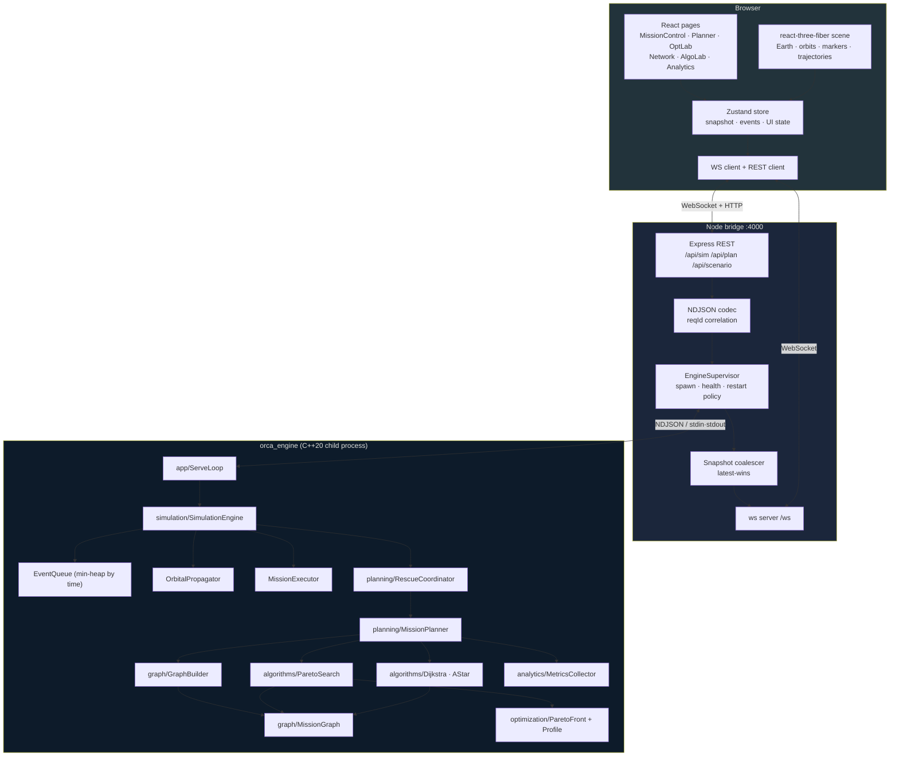

---

## 2. Emergency Detection

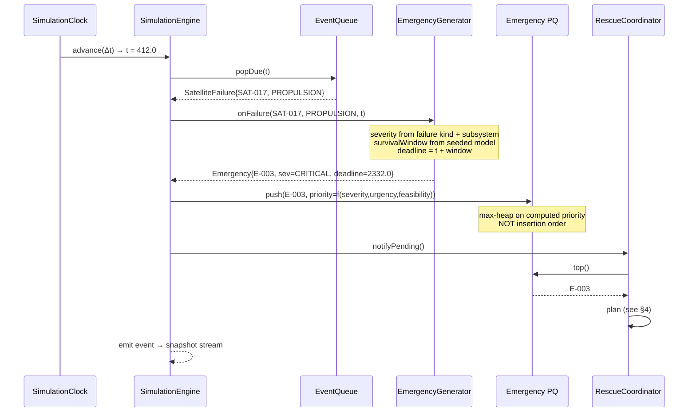

**Design note.** Priority is *recomputed*, not static: urgency rises as the deadline
approaches, so a moderate emergency near its window close can overtake a fresh critical one.
The priority queue is rebuilt when the ordering key changes — see `ALGORITHMS.md` §6 for why
this is preferred over a decrease-key heap here.

---

## 3. Graph Construction

> **Revised in Phase 3.** The diagram and ordering below reflect what `GraphBuilder`
> actually implements, which differs from this section's original Phase 0 sketch in two
> load-bearing ways, both explained in full in `GRAPH_MODEL.md` §3:
>
> 1. **The graph is built once per scenario, not once per `(casualty, t₀)`.** It is
>    vehicle-agnostic and reusable across every search. "Vehicle source" and "casualty
>    sink" are not stored node properties — they are which two node IDs a *caller* of
>    Dijkstra happens to pass in. A node's kind is just `Satellite` or `RescueVehicle`
>    (`GRAPH_MODEL.md` §2.1); which one currently needs rescuing is a query against the
>    live entity (`Satellite::requiresRescue()`), never a cached graph fact.
> 2. **Δv, fuel and deadline cannot be decided at build time**, because build time knows
>    neither the vehicle nor the departure time a search will actually use. Only
>    `InvalidOrbit`, the *permanent* case of `PhasingUnavailable` (no relative drift and
>    never aligned), and the two per-leg policy ceilings (`RiskExceeded`,
>    `DistanceExceeded`) are decidable once, permanently. Everything else moves to
>    Dijkstra, evaluated at the real departure time with the real vehicle's budget.

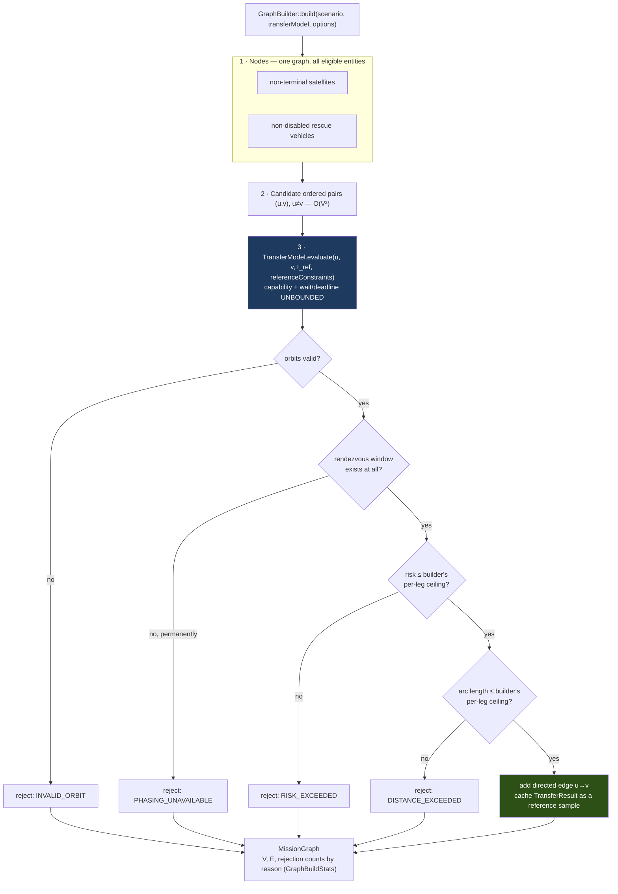

Deferred to Dijkstra, at search time, per relaxation (`GRAPH_MODEL.md` §3.3–§3.4):
`DeltaVExceeded`, `FuelInsufficient` (checked against the specific vehicle's total budget),
`PhasingUnavailable`'s *wait-exceeds-this-search's-horizon* case, and `DeadlineExceeded`.

Three things make this more than a nested loop:

1. **Edges are directed and asymmetric.** `u→v` and `v→u` differ in Δv (raising vs lowering
   orbit) and, once a vehicle is known, in feasibility (the vehicle at `u` has a different
   fuel budget than whatever occupies `v`).
2. **Rejection counts are kept by reason** (`GraphBuildStats`, one field per
   `TransferFailureReason`, `PhasingUnavailable` never folded into a generic bucket). This
   turns "no feasible path" into an actionable message (`ARCHITECTURE.md` §11) and gives
   the Network screen something honest to show.
3. **The check order matches `TransferFeasibility::checkFeasibility` exactly**
   (`TRANSFER_MODEL.md` §12.1): orbit validity, then reachability, then policy limits —
   never fuel or deadline first, because those are not this layer's decision to make.

No spatial index is used for the risk term yet (`GRAPH_MODEL.md` §9) — that arrives with
Phase 9's debris model. At Phase 3's scenario sizes, `O(V²)` candidate evaluation is
unmeasured against a real workload, so pruning it now would be optimising a cost that has
not been shown to matter.

---

## 4. Route Planning (single mission)

> **Corrected in Phase 3.** `GraphBuilder::build()` takes a `Scenario`, not a
> `(casualty, t₀)` pair — the graph is scenario-wide and reusable (§3 above). A real
> `MissionPlanner` (Phase 6+) either reuses an already-built graph or rebuilds it once
> after a state change, independently of which casualty it is about to plan for; `casualty`
> and `t₀` are supplied to the *search* (`PS`, below), not to `GB`.

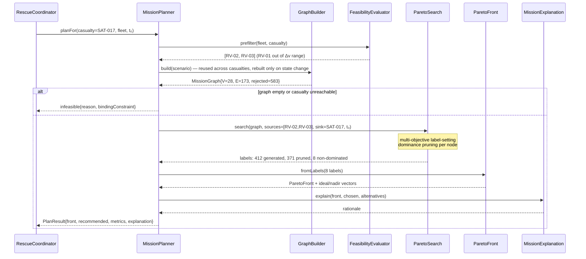

Note `MP` returns the **whole front**, not just a winner. Selection happens next, separately.

---

## 5. Pareto Search (label-setting internals)

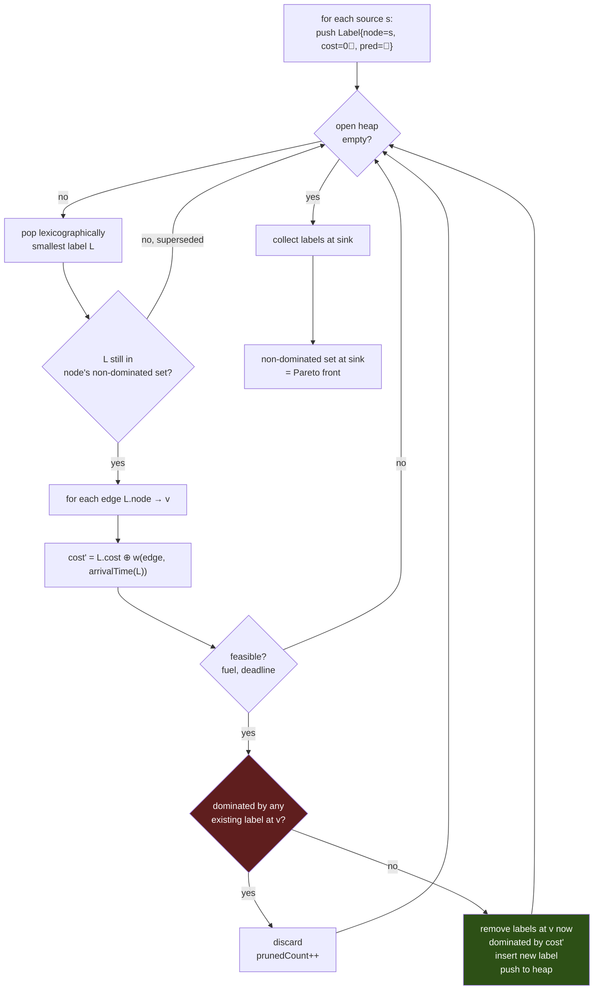

The `CHK` step (lazy deletion) matters: rather than removing superseded labels from the heap,
they are skipped on pop. This is the standard trick that keeps the heap a plain
`std::priority_queue` with no decrease-key support. See `ALGORITHMS.md` §5.

---

## 6. Final Plan Selection

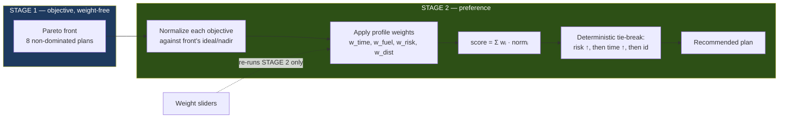

**This separation is the intellectual centre of ORCA.** Moving a slider is `O(|front|)` —
a rescore of at most a few dozen points, with no graph search. That is why the Optimization
Lab feels instant, and it is the concrete payoff of not scalarising early.

---

## 7. Assignment Optimization (multi-emergency)

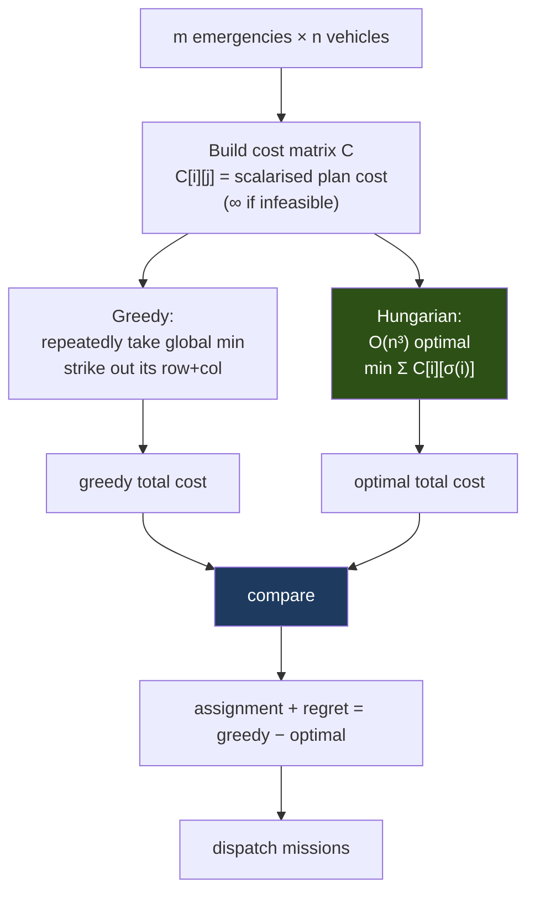

**Both are always computed** (they are cheap relative to planning), so the UI and the
benchmarks can always report the *regret* of greedy. That number is the evidence for why the
Hungarian algorithm is in the project at all — if regret is consistently zero on realistic
scenarios, that is an honest finding to report, not a failure to hide.

Rectangular cases (`m ≠ n`) are padded with dummy rows/columns at cost 0.

---

## 8. Simulation Loop

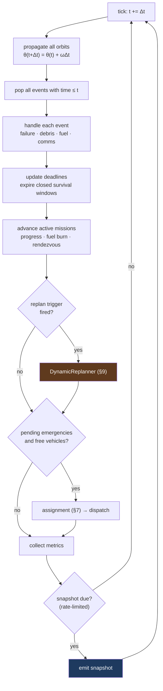

Ordering is fixed and significant: propagate before events (events reference current
positions), expire deadlines before planning (never plan for an already-dead casualty), and
snapshot last (so a snapshot is always a consistent post-tick state, never mid-update).

---

## 9. Dynamic Replanning

**Status as of Phase 8: every box below now exists.** `DynamicReplanner::evaluate()`
(Phase 7, `DYNAMIC_REPLANNING.md`) remains the plain, directly-callable decision function;
`SimulationEngine` (Phase 8, `SIMULATION_ENGINE.md`) is its first real caller, invoking it
from `EventDispatcher.cpp`'s `handleDebrisAlert`/`handleVehicleDegradation` on the triggers
`SIMULATION_ENGINE.md` §11 lists. **Two corrections to the sequence diagram below, which
predates Phase 8's actual implementation:** there is no `GraphBuilder.patchEdges()` and no
incremental edge patching anywhere in the codebase — `MissionGraph` has no `patchEdges()`
method, and none was built (`ALGORITHMS.md` §11.2/§11.3 has the full correction). Debris
invalidation is instead represented as excluding one specific `EdgeId` from the *same*
stable graph's already-computed candidate front (`SIMULATION_ENGINE.md` §11's
"route-filtering, not graph-rebuilding"), not as a spatial region query against a rebuilt or
patched graph. The sequence below is retained as the general *shape* of the integration
(an event triggers a targeted re-evaluation, which flows into a replan decision, which flows
back into execution) but its "spatial query" and "GraphBuilder" steps should be read as
"proximity heuristic over the mission's remaining route" and "the existing, unmodified
graph," respectively — `SIMULATION_ENGINE.md` is the authoritative description of what
actually runs.

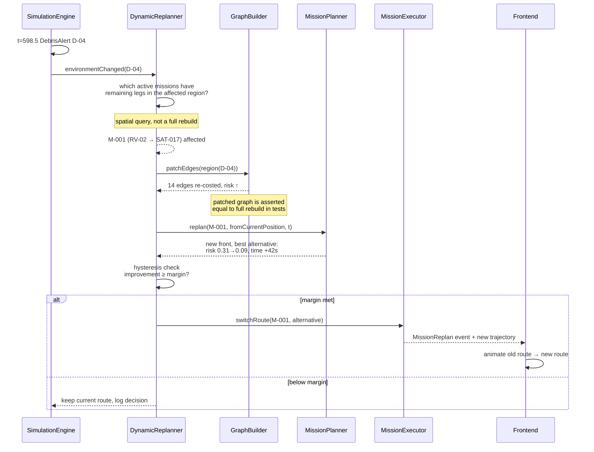

**Hysteresis is essential.** Without a switching margin the planner oscillates between two
near-equal routes every tick, which looks broken and wastes fuel in the model. The margin is
configurable and its value is a documented tuning decision, not a magic number.

---

## 10. Frontend ⇄ Backend ⇄ Engine Communication

> **Status as of Phase 9: the `orca_engine` subgraph below is accurate as built. The
> Frontend/Node bridge subgraphs describe a WebSocket-based design Phase 9 deliberately did
> not build — REST polling instead** (`ARCHITECTURE.md` §4.1's correction,
> `INTEGRATION_ARCHITECTURE.md` §5-6 for the real design). Concretely: no `useEngineSocket()`
> (`EngineProvider`'s `useEffect` poll loop instead), no Zustand store (React Context), no
> `ws server`/snapshot coalescer/event buffer (a plain Express REST surface — `GET /health`,
> `GET /snapshot`, `POST /sim/*` — where every response already IS the latest snapshot, so
> there is nothing to coalesce), no class named `EngineSupervisor` (`EngineProcess`). The
> backpressure/correlation table below describes problems a push-based WebSocket channel
> has that a pull-based REST poll does not: there is no "engine outruns the browser" to
> solve (the browser asks whenever it asks, always for the newest state); no
> reconnect handshake beyond the same polling loop's next successful call succeeding again.
> `reqId` correlation is real and built exactly as described, just over HTTP request/response
> pairs rather than WebSocket frames.

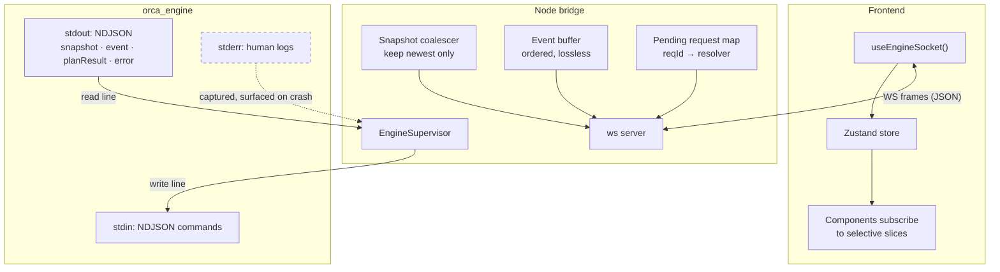

### Backpressure and correlation

| Concern | Handling |
|---|---|
| Engine outruns the browser | Coalescer holds one snapshot; older ones are dropped **by design** |
| Events must not be dropped | Separate lossless ordered buffer; if it exceeds a bound the engine is throttled instead |
| Slider dragged rapidly | Each request carries `reqId`; responses with a stale `reqId` are discarded client-side |
| Client reconnects | Server sends the latest snapshot immediately, then resumes streaming |
| Engine dies | Supervisor emits `engineStatus:down` with the captured `stderr` tail; UI dims to last-known state |

### Why `stderr` is separate

Protocol on `stdout`, logs on `stderr`. A stray `std::cout` in debugging code would otherwise
inject a non-JSON line into the protocol stream and desynchronise the codec. Keeping them on
different file descriptors makes that class of bug impossible rather than merely unlikely.

---

## 11. Visualisation Data Pipeline

The orbital-link visual language (`UI_UX_SPEC.md` §1.3) makes a specific demand on the
architecture: **every drawn relationship must correspond to engine data.** A line between two
orbital objects is only meaningful if the engine computed that the relationship exists.

This is what closes the loop between the visual design and the single-source-of-truth rule.

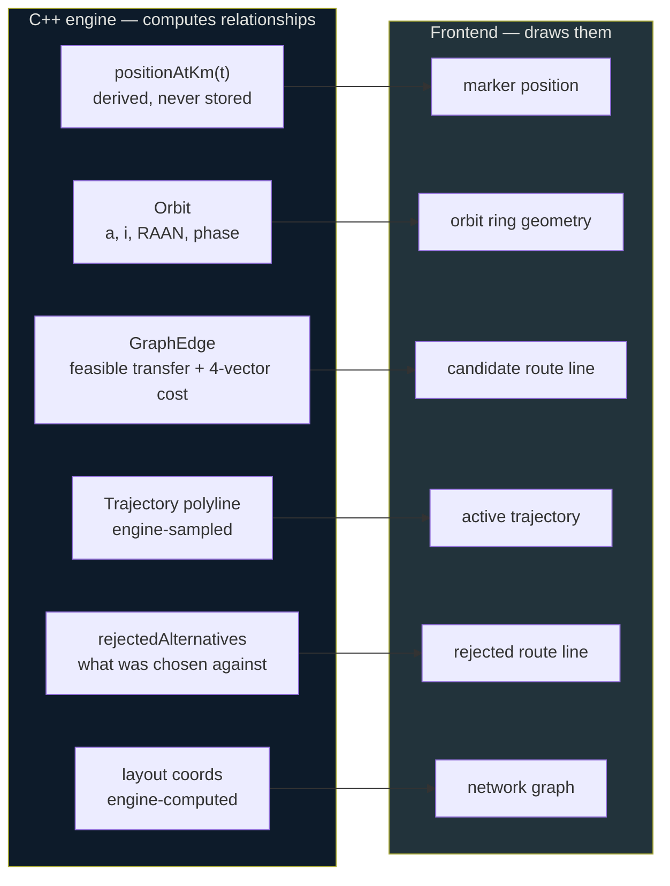

| Visual element | Engine source | Why it cannot be frontend-derived |
|---|---|---|
| Marker position | `Orbit::positionAtKm(t)` | Requires `mu` and the orbital model; duplicating it creates a second physics implementation |
| Orbit ring | `Orbit` elements | Ring radius must match marker orbit exactly, or the marker visibly floats off its own ring |
| Candidate route | `GraphEdge` set | The frontend has no feasibility model and cannot know which transfers are possible |
| Active trajectory | engine-sampled polyline | Interpolating a transfer arc is propagation, which is engine work |
| Rejected alternatives | `Mission::rejectedAlternatives` | These are search results; they exist nowhere else |
| Network layout | engine `layout` coords | A force-directed layout in React would be a real algorithm in the UI (`ARCHITECTURE_REVIEW.md` §2) |

**The consequence for Phase 1**, and the reason this section exists now rather than at Phase
17: the domain model had to expose position as a *function of time* rather than as stored
state, so the renderer can ask for any instant — including instants between snapshots, and
instants in the past when scrubbing. `Orbit::positionAtKm(t)` is that seam, and it was built
in Phase 1 precisely so the visualisation layer has nothing left to compute.

> **Status as of Phase 10: marker position, orbit ring, and candidate-route rows above are
> built exactly as this table describes.** Two rows are corrected against what was actually
> built (`VISUAL_DESIGN.md` §8/§13 have the full reasoning):
>
> - **Active trajectory** is NOT an engine-sampled polyline — `MissionLegView` carries only
>   each leg's two real endpoint positions (no intermediate points), and the frontend draws
>   a straight connector between them. This is deliberate, not a shortcut: exact mid-leg
>   position is not modelled anywhere in the engine either
>   (`DYNAMIC_REPLANNING.md` §13.2), so an engine-sampled arc would have nothing real to
>   sample from. A straight line between two real points is the honest choice, stated as
>   such in `VISUAL_DESIGN.md`, not presented as a computed trajectory.
> - **Network layout** is NOT engine-computed — `GraphNodeView`/`GraphEdgeView`
>   (`cpp/io/SimulationView.hpp`) carry no layout coordinates at all; the Orbital Network
>   page positions nodes with a simple, deterministic, presentation-only ring layout
>   (`frontend/src/pages/OrbitalNetwork/networkLayout.ts` — vehicles inner ring, satellites
>   outer ring, evenly spaced by index). This is explicitly NOT a force-directed layout (the
>   concern this table's own row raises) and is documented as carrying no algorithmic
>   meaning, per brief §37's own instruction.
>
> `Mission::rejectedAlternatives` is not currently surfaced to the frontend at all (a
> possible small future addition, not fabricated here).
